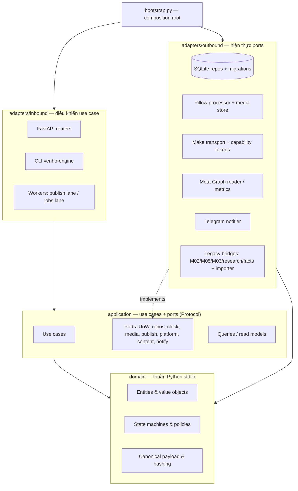
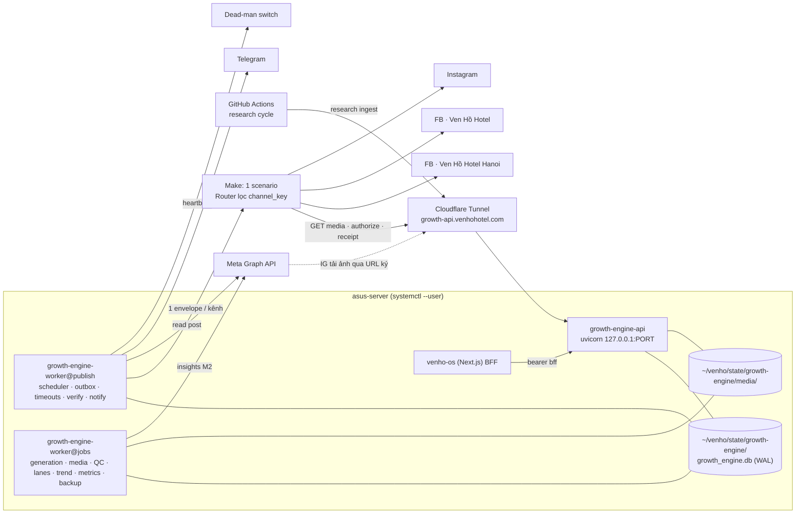
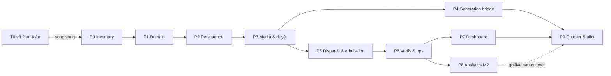

# VENHO Growth Content v2 — Master Plan (Clean Architecture · AI-executable)

| Mục | Giá trị |
|---|---|
| **Mã kế hoạch** | `GC2` (Growth Content v2) |
| **Phiên bản** | v1.2-CA — bản hợp nhất, tối ưu kiến trúc từ *Technical Spec & Plan v1.0* (04/11/2026) |
| **Ngày** | 04/11/2026 (Asia/Ho_Chi_Minh) |
| **Đầu vào** | `GROWTH_CONTENT_V2_TECHNICAL_SPEC_AND_PLAN.md` v1.0 · `VENHO_GROWTH_AGENT_STATUS_REPORT_2026-11-04.md` · cấu trúc repo `west-lake-living/venho-ai-studio` @ `9ab0a22` (04/11/2026) |
| **Trạng thái** | PROPOSED — chưa triển khai, chưa đổi production. Đã chốt 04/11: phương án C, 3 kênh, Make router (xem §2) |
| **Người đọc chính** | AI Agent (Claude Code trong VS Code) + Harry (duyệt gate) |
| **Vị trí lưu đề xuất trong repo** | `docs/growth_engine/GC2_MASTER_PLAN.md` |

> **Thay đổi v1.2 (04/11/2026, Harry chốt):** (1) **phương án C** — v3.2 tiếp tục chạy và được thêm module *chỉ đọc* (Meta client dùng chung, đối soát 3 kênh, Insights cho bài đã đăng) trong lúc xây lõi v2; (2) **3 kênh**: Facebook *Ven Hồ Hotel Hanoi*, Facebook *Ven Hồ Hotel*, Instagram; (3) **dùng lại scenario Make có Router** hiện tại, đổi sang lọc theo `channel_key`. Chi tiết: §1.3 (O14–O16), §2, Track 0.

> **Tên gọi.** "v2" là tên **đợt nâng cấp** này, không phải hạ phiên bản agent v3.1/v3.2. Code mới nằm trong package `growth_engine/` (xem ADR-03). Mọi ID trong tài liệu dùng tiền tố `GC2-`.

---

## Mục lục

0. [Hướng dẫn cho AI Agent (đọc trước mọi task)](#0-hướng-dẫn-cho-ai-agent-đọc-trước-mọi-task)
1. [Tóm tắt điều hành & thay đổi so với spec v1.0](#1-tóm-tắt-điều-hành--thay-đổi-so-với-spec-v10)
2. [Quyết định cần Harry chốt](#2-quyết-định-cần-harry-chốt)
3. [Phạm vi, bất biến và giới hạn cam kết](#3-phạm-vi-bất-biến-và-giới-hạn-cam-kết)
4. [Kiến trúc Clean Architecture](#4-kiến-trúc-clean-architecture)
5. [Mô hình miền & máy trạng thái](#5-mô-hình-miền--máy-trạng-thái)
6. [Persistence: quy ước, bảng, DDL](#6-persistence-quy-ước-bảng-ddl)
7. [Đặc tả use case (application layer)](#7-đặc-tả-use-case-application-layer)
8. [Hợp đồng tích hợp: Make, Media, Meta, Telegram](#8-hợp-đồng-tích-hợp-make-media-meta-telegram)
9. [HTTP API & bảo mật](#9-http-api--bảo-mật)
10. [UX Dashboard (venho-os) & Telegram](#10-ux-dashboard-venho-os--telegram)
11. [Vận hành: worker, chế độ đăng, sự cố, quan sát](#11-vận-hành-worker-chế-độ-đăng-sự-cố-quan-sát)
12. [Chuyển đổi dữ liệu, cutover, rollback](#12-chuyển-đổi-dữ-liệu-cutover-rollback)
13. [Triển khai server, backup, phục hồi](#13-triển-khai-server-backup-phục-hồi)
14. [File tree chuẩn hoá](#14-file-tree-chuẩn-hoá)
15. [Roadmap & task cards](#15-roadmap--task-cards)
16. [Chiến lược kiểm thử & nghiệm thu](#16-chiến-lược-kiểm-thử--nghiệm-thu)
17. [Truy vết: báo cáo 04/11 → task](#17-truy-vết-báo-cáo-0411--task)
18. [Quy tắc vận hành bắt buộc](#18-quy-tắc-vận-hành-bắt-buộc)
19. [Phụ lục: prompt mẫu, bảng mã lỗi, thuật ngữ](#19-phụ-lục)

---

## 0. Hướng dẫn cho AI Agent (đọc trước mọi task)

### 0.1. Nguyên tắc vàng

1. **Làm đúng một task card mỗi lần** (ví dụ `GC2-P1-T04`). Không gộp task, không làm trước task sau.
2. **Chỉ tạo/sửa file trong mục `Files` của task.** Cần đụng file khác → dừng, ghi *Change Request* vào `task_status.md`, chờ Harry.
3. **Bất biến (§3.3) thắng mọi thứ.** Nếu cách làm nhanh hơn vi phạm một `INV-xx`, không làm.
4. **Test trước, code sau.** Mỗi task liệt kê test bắt buộc; viết test đỏ → code → xanh.
5. **0 network trong pytest.** Mọi provider (Make, Meta, Telegram, AI, Drive) dùng fake/mock. `tests/growth_engine/conftest.py` chặn socket ra ngoài.
6. **Không tự điền giá trị thật** (Page ID, token, URL Make, field Graph API). Thiếu → để placeholder `REQUIRED_FROM_P0` và loader phải fail ở production.
7. **Gặp gate 🔒 thì dừng.** Viết checklist cho Harry, không tự thao tác Make/Meta/server/production.
8. **Không đụng legacy** ngoài phạm vi task. Legacy (`growth_orchestrator/`, `publishing_gateway/`, `ops/asus-server/growth-dispatch.sh`…) đang chạy production.

### 0.2. Quy trình chuẩn cho mỗi task

```text
1. Đọc §0, task card, và các mục "Đọc trước" của task.
2. Kiểm tra phụ thuộc: các task trong "Phụ thuộc" đã DONE trong task_status.md.
3. git switch main && git pull --ff-only && git switch -c gc2/<task-id>-<slug>
4. Viết/mở rộng test theo mục "Tests bắt buộc".
5. Code trong phạm vi "Files". Mỗi module Python mới mở đầu bằng:
       from __future__ import annotations
6. Chạy lệnh Verify của task (mặc định: VERIFY_DEV ở §0.3). Tất cả phải xanh.
7. Chạy kiểm tra kiến trúc: pytest -q tests/growth_engine/architecture
8. Append task_status.md (mẫu §0.4) + ghi bài học/quyết định vào task_memory.md.
9. Commit: "GC2-P1-T04: <tóm tắt>" ; mở PR với checklist DoD của task.
10. Báo cáo cho Harry: files đã đổi, lệnh verify + kết quả, rủi ro còn lại.
```

### 0.3. Lệnh chuẩn

| Tên | Lệnh | Ghi chú |
|---|---|---|
| `VERIFY_DEV` | `uv run --extra api --with pytest --with httpx pytest -q tests/growth_engine` | Trên máy dev / clone làm việc |
| `VERIFY_ARCH` | `uv run --with pytest pytest -q tests/growth_engine/architecture` | Kiểm tra luật phụ thuộc giữa các lớp |
| `VERIFY_LEGACY` | `uv run --with pytest pytest -q tests` | Chạy toàn bộ suite cũ khi task đụng `pyproject.toml` hoặc code dùng chung |
| `LOCK` | `uv lock` rồi commit `uv.lock` **cùng commit** với `pyproject.toml` | Quy tắc hiện hành của repo |
| Trên server runtime | **Không** `uv run` trong `~/venho/growth-runtime/venho-ai-studio`. Release v2 build venv riêng bằng `deploy-release.sh` (§13) | Tránh gỡ extras `drive/gemini` |

> Python: `pyproject.toml` khai báo `>=3.9`. Code mới **không** dùng cú pháp chỉ có từ 3.10+ khi chạy runtime (`match`, `dataclass(slots=True)`, `X | Y` ngoài annotation). Phiên bản Python thật của server được xác minh ở `GC2-P0-T01`.

### 0.4. Mẫu ghi `task_status.md`

```markdown
### GC2-P1-T04 — Delivery state machine (YYYY-MM-DD)
**Status:** DONE | BLOCKED | CHANGE_REQUEST
**Files:** growth_engine/domain/delivery/transitions.py, tests/growth_engine/unit/domain/test_delivery_transitions.py
**Verify:** `<lệnh>` → N passed, 0 network
**DoD:** [x] ... [x] ...  (trích từ task card)
**INV/AC liên quan:** INV-03, INV-06
**Rủi ro / việc để lại:** ...
```

### 0.5. Điều kiện dừng (bắt buộc hỏi Harry)

- Task cần secret, Page ID, quyền Meta, thao tác Make, SSH server, đổi DNS/Cloudflare.
- Test chỉ qua được nếu gọi network thật.
- Spec mâu thuẫn với bất biến, với quy tắc §18, hoặc với code legacy đang chạy.
- Cần đổi schema đã có migration được áp dụng ở bất kỳ môi trường nào (chỉ được thêm migration mới).
- Ước lượng task vượt 2× so với card.

---

## 1. Tóm tắt điều hành & thay đổi so với spec v1.0

### 1.1. Vấn đề cần giải (từ báo cáo 04/11)

Growth Agent v3.2 đăng đúng giờ từ khi lên asus-server (21/10), nhưng còn 3 điểm yếu gốc:
1. **Không đo hiệu quả thật** — M08 vẫn dùng `MockMetricsAdapter`.
2. **Lỗi hỏng âm thầm** — hệ thống kiểm tra "bước đã chạy" chứ không kiểm tra "đầu ra trông thế nào" (ảnh xoay 04/11, ảnh dự phòng 2 tháng, ảnh phòng ngủ gắn bài cà phê).
3. **Trạng thái trong JSON commit vào git** — nhiều tiến trình cùng ghi, phải có script gộp, skip-worktree, checkout Dashboard có thể kẹt.

**Hiện trạng kênh (Harry xác nhận 04/11/2026): 3 kênh.**

| `channel_key` | Kênh | ID | Ghi chú |
|---|---|---|---|
| `fb_hanoi` | Facebook Page *Ven Hồ Hotel Hanoi* | `1124616474074140` | Đăng từ 08/2026; registry có 35 bài PUBLISHED: 32 post ID chuẩn, 1 ID dạng `pfbid…`, 2 ID giả |
| `fb_venho` | Facebook Page *Ven Hồ Hotel* | xác minh ở P0-T02 | Thêm ngày 03/11/2026; bài đầu tiên 04/11 (bị xoá vì ảnh sai, Harry đăng lại tay) |
| `ig_venho` | Instagram business | xác minh ở P0-T02 | Đăng đều từ 08/2026 (46 bài) |

Make hiện dùng **Router rẽ cả hai nhánh Facebook** cho mỗi lệnh FB, nên registry chỉ ghi post ID của Page Hanoi — kết quả Page *Ven Hồ Hotel* không được hệ thống theo dõi. Ngoài ra 2 bài (10/08, 12/08) mang post ID giả `"3. Post ID"` (nhãn field Make) nhưng vẫn ở trạng thái PUBLISHED.

### 1.2. Giải pháp một câu

Một **Growth Engine** duy nhất trên server (Python, Clean Architecture) giữ **một SQLite DB làm nguồn sự thật**, quản lý vòng đời `slot → delivery (mỗi Page) → revision bất biến → duyệt → lệnh outbox → cổng cấp quyền đăng → receipt → xác minh → số đo thật`; Make chỉ còn là lớp thực thi, Dashboard chỉ gọi API.

### 1.3. Các tối ưu so với spec v1.0

> Tất cả bất biến `INV-01…12` và tiêu chí `AC-01…18` của spec v1.0 được **giữ nguyên**. Bảng dưới chỉ liệt kê thay đổi về cấu trúc/thiết kế.

| # | Spec v1.0 | Bản này (v1.1-CA) | Lý do |
|---|---|---|---|
| O1 | Thư mục gợi ý `growth_orchestrator/v2/` | Package top-level **`growth_engine/`** với 3 lớp `domain / application / adapters` + composition root | Ranh giới rõ, kiểm tra kiến trúc bằng test, không lẫn `growth_orchestrator.domain` cũ; dễ retire legacy (ADR-03) |
| O2 | Admission 2 bước: `claim` → `authorize` | **Single-gate**: Make tải ảnh → `authorize` duy nhất → tạo bài | Bỏ trạng thái `PREPARING`, bỏ lease/fencing của execution, blueprint Make ít hơn 1 lệnh HTTP; lỗi tải ảnh trước authorize vẫn tự retry an toàn (ADR-04, quyết định `GC2-D03`) |
| O3 | Unique "1 execution chưa rõ/command" | Unique **"1 execution live/delivery"** xuyên mọi command (index DB) | Bảo vệ `INV-01` ngay cả khi safe-retry tạo command mới |
| O4 | Outbox: PENDING/DELIVERING/ACKED/CANCELLED/EXPIRED | Thêm `AUTHORIZED` + index "1 command mở/delivery" + luật giao lại sau ACK | Làm rõ "đã cấp quyền thì không bao giờ giao lại" |
| O5 | 1 worker | **2 lane worker**: `publish` (nhanh, giữ scheduler) và `jobs` (AI, ảnh, metrics) | Job sinh ảnh dài không thể chặn tick 09:00; vẫn chỉ 1 scheduler (ADR-08) |
| O6 | Layout `/opt`, `/var/lib` | Layout **user-level** dưới `~/venho/…` + `systemctl --user` | Khớp hạ tầng hiện có trên asus-server, không cần sudo (ADR-07) |
| O7 | Chuyển cả `facts` (M01) vào DB v2 | **Facts chỉ snapshot** (`package_facts`); store M01 giữ nguyên chủ sở hữu. Research/Trend candidates **chuyển** vào DB v2 | Tôn trọng ranh giới module M01; Trend candidate là quyết định biên tập của Growth (`GC2-D05`) |
| O8 | Không nói rõ bản nháp vào DB mới bằng cách nào | Thêm **Phase P4 — Generation bridge** (strangler quanh M02/M05/image options) | Đây là khoảng trống lớn nhất khi triển khai thật |
| O9 | `can_retry` cho riêng nút retry | **`allowed_actions` do backend trả** cho mọi nút | UI không tự suy luận trạng thái (UX nhất quán, ít bug) |
| O10 | Watchdog GitHub Actions hoặc Mac | **Dead-man switch** (healthchecks.io hoặc Mac Mini) | GitHub `schedule` đã trễ 4–7 giờ trong thực tế (báo cáo 04/11) |
| O11 | 8 phase (P0–P7) | **10 phase (P0–P9) + Track 0**, 64 task card có `Files/Tests/DoD/Verify` | Task nhỏ, AI tự chạy được, Harry duyệt theo gate |
| O12 | `receipt_inbox.execution_id` có FK | **Không FK**, receipt lạ lưu `QUARANTINED` | Không bao giờ mất bằng chứng |
| O13 | — | Mã lỗi chuẩn `ERR_GC2_*`, mã preflight `PF_*`, test chặn network, lệnh `venho-engine doctor` | DX: chẩn đoán bằng một lệnh tự chứa |
| O14 | Mỗi Page một scenario Make | **Một scenario hiện có + Router**, mỗi nhánh = một kênh, lọc `channel_key` (ADR-09) | Dùng lại connection/cấu hình Harry đã làm; mỗi lệnh chỉ chạy đúng một nhánh |
| O15 | Instagram không là đích v2 | **Giữ Instagram — 3 kênh** (Harry chốt 04/11) | IG đang đăng đều; thêm profile ảnh 4:5, nhánh router IG |
| O16 | Đóng băng toàn bộ v3.2 tới cutover | **Phương án C**: đóng băng *lõi* v3.2, thêm module chỉ đọc (T0-04…T0-06) dùng chung code với v2 | Có số đo thật và đối soát 3 kênh sau ~1–2 tuần thay vì ~8 tuần |

### 1.4. Mốc phát hành

| Mốc | Nội dung | Phase |
|---|---|---|
| **M0 — Sẵn sàng** | Inventory thật, quyết định §2 chốt, hợp đồng Make/Meta có fixture | P0 |
| **M0+ — Số đo sớm (v3.2)** | Đối soát 3 kênh hằng ngày, Insights thật cho bài đã đăng, báo cáo tuần | Track 0 |
| **M1 — Đăng an toàn** | 3 kênh, duyệt đúng bytes, admission, receipt, xác minh, sự cố, Dashboard qua API, cutover | P1–P7, P9 |
| **M2 — Đo lường thật** | Meta Insights theo Page, checkpoint 24h/72h/7d, báo cáo tuần | P8 |

Ước lượng: **34–46 ngày kỹ thuật** (tổng các task card; chưa tính chờ quyền Meta, thời gian Harry duyệt và ≥ 14 ngày pilot). Cao hơn spec v1.0 (22–34) do Phase P4 generation bridge, test fault-injection, Instagram (+2–3 ngày) và Track 0 mở rộng (+3 ngày, nhưng P6/P8 giảm ~2 ngày nhờ dùng lại Meta client). Số này là ước lượng thiết kế, chốt lại sau P0.

---

## 2. Quyết định cần Harry chốt

> Mỗi quyết định có **mặc định đề xuất**. Nếu Harry không đổi, AI Agent làm theo mặc định. Cột "Chặn" cho biết phase nào không được bắt đầu khi chưa chốt.

| ID | Câu hỏi | Mặc định đề xuất | Phương án khác | Chặn |
|---|---|---|---|---|
| **GC2-D00** | v2 đưa DB + API trên server làm authority duy nhất — gần với hướng Control Plane v4.x đã **tạm hoãn** (09/2026). Có mở lại qua L2 Governance? | ✅ **Chốt hướng 04/11** (phương án C có xây lõi v2); ghi DR chính thức "GC2 thay thế quyết định hoãn v4.x cho phần publishing" ở P0-T06 | Giữ v3.2, chỉ làm Track 0 + U1 analytics | P1 |
| **GC2-D01** | Kênh đích v2 | ✅ **Chốt 04/11: 3 kênh** — `fb_hanoi` (*Ven Hồ Hotel Hanoi*, `1124616474074140`), `fb_venho` (*Ven Hồ Hotel*), `ig_venho` (Instagram). Threads chỉ giữ lịch sử | Bỏ IG (spec v1.0) | P0 |
| **GC2-D02** | Các kênh dùng chung nội dung? | Chung package + chung ảnh gốc (khớp cách router đang đăng); FB giữ tỉ lệ, IG có variant 4:5 riêng; caption theo `caption_profile` từng kênh (mặc định giống nhau); **duyệt nhóm 1 chạm** cho cả 3 kênh | Caption riêng hoàn toàn (tăng chi phí AI + thời gian duyệt) | P4 |
| **GC2-D03** | Giao thức admission với Make | **Single-gate** (ADR-04) | 2 bước claim + authorize như spec v1.0 | P5 |
| **GC2-D04** | Vị trí code | Package `growth_engine/` top-level trong `venho-ai-studio` | `growth_orchestrator/v2/` | P1 |
| **GC2-D05** | Facts (M01) và Trend candidates | Facts: chỉ snapshot vào package. Trend/research candidates: chuyển vào DB v2 | Chuyển cả facts (spec v1.0) — cần CR riêng cho M01 | P4 |
| **GC2-D06** | Backup ngoài máy & watchdog | Archive mã hoá bằng `age` (khoá riêng giữ ngoài server) → thư mục Google Drive riêng; heartbeat → healthchecks.io | Backup sang Mac Mini qua Tailscale; watchdog bằng launchd trên Mac | P6 |
| **GC2-D07** | v3.2 trong lúc xây v2 | ✅ **Chốt 04/11: phương án C** — đóng băng *lõi* (dispatch, registry, rollout stage, `--allow-shadow`, `schedule`); **cho phép** module bổ sung chỉ đọc: T0-01, T0-04, T0-05, T0-06 | A: chỉ nâng cấp tại chỗ · B: đóng băng toàn bộ | Track 0 |
| **GC2-D08** | Hostname cho Make/media | `growth-api.venhohotel.com` qua Cloudflare Tunnel; `/internal/*` dùng Access Service Token + bearer; `/media/publish/*` bypass Access + token ký | Dùng path dưới `os.venhohotel.com` | P5 |
| **GC2-D09** | Cấu trúc scenario Make | ✅ **Chốt 04/11**: dùng scenario Router hiện có; mỗi nhánh lọc `channel_key`, không nhánh fallback, bearer riêng mỗi nhánh (ADR-09) | Mỗi kênh một scenario riêng | P5 |

### 2.1. ADR tóm tắt

| ADR | Quyết định | Hệ quả | Phương án loại |
|---|---|---|---|
| **ADR-01 Storage** | SQLite WAL, một host, file trên disk local (không Drive/NFS/git). Kiểm tra SQLite mà **Python runtime** liên kết ≥ 3.51.3 hoặc bản backport được xác nhận (theo spec v1.0; xác minh ở P0-T01) | Không cần Postgres/Redis; repository interface giữ khả năng đổi storage | Postgres: chỉ khi cần nhiều host ghi hoặc đo được lock contention |
| **ADR-02 Authority** | Một service FastAPI (`growth-engine-api`) + 2 worker cùng release là nơi duy nhất ghi DB. Dashboard, Make, GitHub Actions đều đi qua HTTP | Hết checkout phụ, hết sync JSON | Dashboard gọi CLI ghi thẳng DB: hai checkout khác commit cùng ghi một DB → phá bất biến |
| **ADR-03 Package** | `growth_engine/` top-level; chỉ `adapters/outbound/legacy/` được import code legacy | Có test kiến trúc tự động | `growth_orchestrator/v2/` dễ import nhầm module cũ |
| **ADR-04 Admission** | Single-gate: `envelope → Make tải ảnh → POST authorize → (execute=true) → tạo bài → receipt`. Chỉ CAS đầu tiên trả `execute=true` | Execution chỉ có `AUTHORIZED/REPORTED/NO_SIDE_EFFECT/UNKNOWN` | 2 bước: thêm endpoint, trạng thái PREPARING, lease recovery |
| **ADR-05 Media** | Media store local theo SHA-256, phục vụ qua `GET /media/publish/{sha}.jpg?t=…` (token HMAC, hết hạn). **Facebook:** Make tải rồi upload binary. **Instagram:** Meta tự tải ảnh từ URL này, nên token phải còn hạn tới `execute_before + 30′` và route không qua trang login. Drive chỉ là nguồn nạp | Ảnh gửi đi luôn đúng bytes đã duyệt | Drive public URL: bytes có thể đổi dưới cùng ID |
| **ADR-06 Machine auth** | Bearer riêng cho từng principal (`bff`, `make-fb-hanoi`, `make-fb-venho`, `make-ig`, `research-ingest`), lưu dạng hash; scope hẹp. Capability token HMAC (stdlib) cho từng command | Rotate/revoke riêng từng principal | HMAC raw-body từ Make: chưa chứng minh Make làm được |
| **ADR-07 Deploy** | `~/venho/growth-engine/releases/<sha>` + symlink `current`, state ở `~/venho/state/growth-engine/`, `systemctl --user` | Deploy không đè DB/media/secrets | `/opt` + root |
| **ADR-08 Worker lanes** | `growth-engine-worker@publish` (scheduler, outbox, timeout, verify, notify) và `@jobs` (generation, media, QC, lanes, metrics, backup) | Tick 09:00 không bị job AI chặn; chỉ lane `publish` có scheduler | 1 worker: job AI 3–5 phút làm lỡ cửa sổ |
| **ADR-09 Make topology** | Một scenario (bản hiện có) + Router; mỗi nhánh = một kênh, filter `channel_key` + `environment`, **không** bật fallback route; mỗi nhánh có bearer riêng | Dùng lại connection; scenario bị tắt thì dừng cả 3 kênh (chấp nhận ở quy mô này) | Mỗi kênh một scenario: cách ly tốt hơn nhưng phải dựng lại |

---

## 3. Phạm vi, bất biến và giới hạn cam kết

### 3.1. Trong phạm vi v2

- **Ba kênh** (`fb_hanoi`, `fb_venho`, `ig_venho` — bảng ở §1.1) có lịch, duyệt, kết quả, retry, analytics **riêng**. Trong ví dụ/test, "Page A / Page B" nghĩa là hai kênh bất kỳ.
- Một DB là nguồn trạng thái vận hành duy nhất (`growth_engine.db`).
- Duyệt đúng **caption + bytes ảnh cuối + Page + thời điểm**.
- Make chỉ tạo bài khi backend cấp quyền; webhook nhận ≠ được đăng.
- Đối soát sau đăng, xử lý kết quả không rõ, báo sự cố nghiệp vụ.
- Analytics thật theo khả năng từng Page/API; không trộn mock.
- Chuyển đổi dữ liệu và phục hồi không phát lại bài cũ.

### 3.2. Ngoài phạm vi bản đầu (non-goals)

Tự duyệt nội dung · tự tối ưu chiến lược · thay Make bằng direct publishing · multi-region · video/carousel/Reels · viết lại Research/M02/M05/M03 · chuyển store Facts M01 · thư viện ảnh qua Drive (U5) · bỏ lựa chọn ảnh B (U8, quyết định sau khi có số đo M2). Threads giữ dữ liệu lịch sử, không là đích v2.

### 3.3. Bất biến (giữ nguyên từ spec v1.0)

| ID | Bất biến | Thực thi ở đâu |
|---|---|---|
| INV-01 | Một `(slot, channel)` có tối đa một delivery đang sở hữu quyền xuất bản | Index `one_active_delivery_per_target`, `one_live_execution_per_delivery` |
| INV-02 | Approval gắn với revision bất biến (caption, bytes ảnh cuối, Page, lịch, policy snapshot) | FK `(revision_id, payload_hash)`; trigger bất biến |
| INV-03 | Sửa trường ảnh hưởng đầu ra → revision mới, approval hiện tại mất hiệu lực | Use case `create_revision` |
| INV-04 | Duyệt không gọi Make; chỉ scheduler enqueue lệnh đến hạn | `approve_group` không có port publishing |
| INV-05 | Webhook 2xx / "Accepted" không phải bằng chứng đã đăng | Command `ACKED` ≠ delivery `PUBLISHED` |
| INV-06 | Kết quả không rõ không được tự chuyển thành "chưa đăng" để gửi lại | `UNKNOWN` chỉ thoát qua `resolve_unknown` có actor |
| INV-07 | Retry Page B không gửi lại Page A đã thành công | Delivery tách theo target |
| INV-08 | Dispatch không chọn lại ảnh, không đổi caption, không fallback, không gọi AI | Lane `publish` không có port AI/generation |
| INV-09 | Thay đổi nghiệp vụ + audit + outbox commit cùng transaction | `UnitOfWork.begin_immediate()` |
| INV-10 | Không có hai hệ thống cùng sở hữu quyền đăng một slot/Page | `dispatch_epoch` + cutover §12 |
| INV-11 | Thiếu dữ liệu ≠ lỗi API ≠ số 0; mock không được ghi thành real | `value_state`, `source` CHECK |
| INV-12 | Bài đã đăng hoặc chưa rõ kết quả không bị fast lane/replacement thay | Guard trong `reserve_target`, `supersede` |

### 3.4. Giới hạn cam kết

**Không cam kết exactly-once** xuyên DB → Make → Facebook (không có transaction chung). Cam kết là: mỗi command chỉ được **cấp quyền một lần**, chống xử lý lặp nội bộ, và **dừng để đối soát** khi side effect bên ngoài không rõ. Nếu Make hoặc Facebook tự lặp thao tác tạo bài bên trong, DB không thể tự ngăn — vì vậy cấu hình retry của Make là một phần hợp đồng nghiệm thu (§8.1.4).

---

## 4. Kiến trúc Clean Architecture

### 4.1. Các lớp và luật phụ thuộc



**Luật phụ thuộc (được test `tests/growth_engine/architecture/test_layer_boundaries.py` kiểm tra bằng AST):**

| Module | Được import | Bị cấm import |
|---|---|---|
| `growth_engine.domain.*` | stdlib (gồm `zoneinfo`, `hashlib`, `json`, `unicodedata`, `dataclasses`, `enum`, `typing`), `growth_engine.domain.*` | mọi thứ khác (kể cả `pydantic`, `sqlite3`, `PIL`, `requests`, `os.environ`, `datetime.now`) |
| `growth_engine.application.*` | stdlib, `growth_engine.domain.*`, `growth_engine.application.*` | `growth_engine.adapters.*`, `growth_engine.bootstrap`, framework, legacy packages |
| `growth_engine.adapters.inbound.*` | mọi lớp bên trong + `fastapi`, `pydantic`, `typer` | `growth_engine.adapters.outbound.*` (phải nhận qua container) |
| `growth_engine.adapters.outbound.*` | mọi lớp bên trong + thư viện ngoài | `growth_engine.adapters.inbound.*` |
| `growth_engine.adapters.outbound.meta.*` | thêm `shared.meta` (Meta client dùng chung với v3.2, T0-04) | phần `shared` khác |
| `growth_engine.adapters.outbound.legacy.*` | **chỗ duy nhất** (ngoại lệ: dòng trên) được import `growth_orchestrator`, `publishing_gateway`, `validator_studio`, `content_studio`, `prompt_studio`, `research_engine`, `knowledge_studio`, `shared` | — |
| `growth_engine.bootstrap` | tất cả | — |
| Legacy packages | — | **không** được import `growth_engine` |

Quy ước mã hoá trong domain:
- Entity/VO là `@dataclass(frozen=True)`. Thao tác trả **bản mới + danh sách domain event**, không mutate.
- Thời gian là `int` epoch milliseconds UTC (`EpochMs`). Domain **không gọi đồng hồ**; use case nhận `Clock` qua port.
- ID là `str` UUID4 do port `IdGenerator` sinh (test dùng ID xác định).
- Lỗi là cây `DomainError` có `code: str` (`ERR_GC2_*`), map sang HTTP ở inbound adapter.

### 4.2. Bounded context (module nghiệp vụ)

| Context | Trách nhiệm | Aggregate chính | Use case tiêu biểu |
|---|---|---|---|
| **channels** | Page đích, cấu hình route Make đã khoá, caption profile | `Channel`, `ChannelConfig` | `register_channel_config` |
| **scheduling** | Lịch T2/T4/T6/T7, slot, target mỗi Page, projection trạng thái slot | `Slot`, `SlotTarget` | `ensure_slots`, `reserve_target`, `reschedule_slot` |
| **content** | Package chủ đề/brief/facts snapshot; research/trend candidates | `ContentPackage`, `ResearchCandidate` | `generate_package`, `ingest_candidate`, `expire_candidates` |
| **media** | Nạp ảnh, chuẩn hoá, lưu bất biến theo hash, QC | `MediaAsset`, `MediaVariant`, `QcReport` | `ingest_asset`, `prepare_variant`, `evaluate_qc` |
| **review** | Revision bất biến, ảnh/caption, duyệt/loại/thu hồi | `Delivery`, `DeliveryRevision`, `ApprovalDecision` | `create_revision`, `approve_group`, `reject_revision` |
| **publishing** | Scheduler, outbox, cổng admission, receipt | `OutboxCommand`, `Execution`, `Receipt` | `enqueue_due`, `authorize_publish`, `apply_receipt` |
| **verification** | Xác minh bài, UNKNOWN, safe retry | `PublicationVerification` | `verify_publication`, `resolve_unknown`, `request_safe_retry` |
| **analytics** (M2) | Số đo thật, checkpoint, báo cáo | `MetricObservation` | `collect_metrics`, `build_weekly_report` |
| **ops** | Chế độ đăng, epoch, pause, sự cố, thông báo, heartbeat, ngân sách | `RuntimeControls`, `Incident`, `PaidCall` | `set_mode`, `pause`, `open_incident` |

### 4.3. Danh mục port (hợp đồng giữa application và adapters)

> File: `growth_engine/application/ports/*.py`. Viết bằng `typing.Protocol`. Adapter thật và fake test đều phải thoả cùng Protocol.

```python
# ports/clock.py
class Clock(Protocol):
    def now_ms(self) -> int: ...                       # epoch ms UTC

class IdGenerator(Protocol):
    def new_id(self) -> str: ...                       # UUID4 text

# ports/uow.py
class UnitOfWork(Protocol):
    channels: ChannelRepo; slots: SlotRepo; packages: PackageRepo
    media: MediaRepo; qc: QcRepo; deliveries: DeliveryRepo
    commands: CommandRepo; executions: ExecutionRepo; receipts: ReceiptRepo
    verifications: VerificationRepo; jobs: JobRepo; audit: AuditRepo
    incidents: IncidentRepo; controls: ControlsRepo; idempotency: IdempotencyRepo
    budget: BudgetRepo; candidates: CandidateRepo; metrics: MetricRepo; legacy: LegacyImportRepo
    def begin_immediate(self) -> ContextManager["UnitOfWork"]: ...   # BEGIN IMMEDIATE … COMMIT/ROLLBACK
    def read_only(self) -> ContextManager["UnitOfWork"]: ...

# ports/media.py
class ImageProcessor(Protocol):
    def normalize(self, original: Path, spec: TransformSpec) -> NormalizedImage: ...   # bytes + w/h/sha
class MediaStore(Protocol):
    def put_original(self, stream: BinaryIO, max_bytes: int) -> StoredObject: ...
    def put_variant(self, data: bytes, sha256: str) -> str: ...                        # object_key
    def open(self, object_key: str) -> BinaryIO: ...
    def verify(self, object_key: str, sha256: str) -> bool: ...
class SignedUrlIssuer(Protocol):
    def media_url(self, sha256: str, command_id: str, expires_at_ms: int) -> str: ...

# ports/publishing.py
class PublishTransport(Protocol):
    def deliver(self, route_ref: str, envelope: dict) -> TransportResult: ...          # ACK hoặc lỗi có phân loại
class CapabilityTokens(Protocol):
    def issue(self, claims: CommandClaims) -> str: ...
    def verify(self, token: str, audience: str, now_ms: int) -> CommandClaims: ...     # raise ERR_GC2_CAPABILITY_INVALID

# ports/platform.py
class PlatformReader(Protocol):
    def read_post(self, channel: ChannelConfigView, post_id: str) -> PostEvidence: ...
    def search_recent(self, channel: ChannelConfigView, since_ms: int, until_ms: int) -> list[PostEvidence]: ...
class MetricsSource(Protocol):                                                          # M2
    def fetch(self, channel: ChannelConfigView, post_id: str, metrics: list[MetricSpec]) -> list[RawMetric]: ...

# ports/content.py
class ContentGenerator(Protocol):
    def draft(self, request: DraftRequest) -> DraftPackage: ...                         # KHÔNG ghi legacy registry/Drive
class QcEvaluator(Protocol):
    def evaluate(self, variant: VariantView, caption: str, facts: FactSnapshot, policy: EffectiveQcPolicy) -> QcResult: ...
    def compile_policy(self, project: str, subject: str, scenario: str | None) -> EffectiveQcPolicy: ...
class FactSource(Protocol):
    def approved_facts(self, keys: list[str], at_ms: int) -> FactSnapshot: ...
class CandidateSource(Protocol):
    def scan(self, now_ms: int) -> list[CandidateInput]: ...

# ports/notify.py
class Notifier(Protocol):
    def send(self, message: NotificationMessage) -> NotifyResult: ...
```

### 4.4. Tái sử dụng legacy (strangler) — không viết lại

| Năng lực có sẵn | Vị trí legacy | Dùng lại thế nào trong v2 |
|---|---|---|
| Chọn chủ đề theo mùa, loại trùng 120 ngày | `growth_orchestrator/application/topic_ideation.py`, `topic_selector.py` | Gọi qua `LegacyGeneratorAdapter` (P4) |
| Brief → prompt (M02) → caption (M05), naturalness v3.2 | `growth_orchestrator/bridges/m05_content_bridge.py`, `validator_studio/naturalness/` | Gọi qua `LegacyGeneratorAdapter`; output thành `DraftPackage` |
| Ảnh A/B/C theo scenario | `growth_orchestrator/application/image_options.py` | Lấy **file local**, không lấy Drive URL |
| QC ảnh theo DNA (M03) | `validator_studio/`, `growth_orchestrator/bridges/m03_validator_bridge.py` | `LegacyQcAdapter` + `compile_effective_qc_policy` |
| Trend Radar | `research_engine/trend_radar/` | `LegacyTrendSource` → `ingest_candidate` |
| Facts đã duyệt | `knowledge_studio/facts/` | `LegacyFactSource` (chỉ đọc) → snapshot |
| Telegram bot | `shared/notify/telegram.py` | `TelegramNotifier` |
| Chính sách ngân sách | `shared/budget/ledger.py::BudgetPolicy`, `config/.../budget_policy.yaml` | Đọc cap; reserve/settle mới ở bảng `paid_calls` |
| Lịch 4 bài/tuần | `config/projects/venho_hotel/growth/cadence_policy.yaml` (version 2) | Đọc chỉ-đọc; `policy_version = version + sha256(file)` |
| Atomic claim ý tưởng | `shared/jobs/job_store.py` | Tham khảo; viết lại với epoch ms + fencing token |
| `to_upload_jpeg`, `normalize_for_instagram` | `image_options.py`, `publishing_gateway/image_constraints.py` | **Không gọi trực tiếp**; hành vi pad 4:5 nền `#F7F4EF` là tham chiếu cho profile `instagram_photo_v1` (P3-T01) |
| Scenario Make có Router (2 nhánh FB + IG) | Make (cấu hình hiện tại) | Giữ scenario + connection; đổi router sang lọc `channel_key` (ADR-09, P5-T05, P9-T03) |
| Meta Graph read client | `shared/meta/` (mới ở T0-04) | P6-T01, P8-T02 bọc lại, không viết lại |
| Insights + đối soát 3 kênh | `~/venho/state/growth-reports/` (T0-05, T0-06) | Import vào `metric_observations`/`legacy_imports` ở P9-T03 |
| Fallback ảnh lúc dispatch | `publishing_gateway/adapters/make_gateway.py` | **Loại bỏ** trong v2 (vi phạm INV-08) |
| Registry JSON / `growth_state_merge.py` | `publishing_gateway/publication_registry.py`, `ops/asus-server/` | Chỉ là **nguồn import** (P2-T07, P9-T03), sau đó archive |

### 4.5. Topology runtime



Luật topology:
- Chỉ **lane `publish`** chạy scheduler và outbox. Chạy 2 instance lane `publish` → `doctor` báo lỗi (khoá file `~/venho/state/growth-engine/publish.lock`).
- API chạy **1 worker uvicorn** (SQLite một writer; tải nhỏ).
- Không process nào giữ transaction trong lúc gọi network, AI hay xử lý ảnh.

---

## 5. Mô hình miền & máy trạng thái

### 5.1. Thuật ngữ miền

| Khái niệm | Định nghĩa | Bất biến chính |
|---|---|---|
| `Channel` | Một kênh đích: Facebook Page hoặc tài khoản Instagram business (`channel_key`, `platform`, `remote_account_id` đã xác minh) | Identity không đổi; đổi Page/tài khoản = channel mới |
| `ChannelConfig` | Snapshot bất biến: route Make, Graph API version, capability, caption profile, `config_hash` | Không chứa token |
| `Slot` | Một thời điểm nội dung theo lịch (vd T2 09:00 ICT) | Natural key `(project, local_date, local_time, lane)` |
| `SlotTarget` | Một Page được yêu cầu đăng trong slot | `UNIQUE(slot, channel)` |
| `ContentPackage` | Chủ đề + brief + facts snapshot chung cho các Page của slot | Bất biến; đổi brief = package mới |
| `Delivery` | Nghĩa vụ đăng một package tới **một** `SlotTarget` | Tối đa 1 delivery active/target |
| `DeliveryRevision` | Đầu ra bất biến cho đúng một Page: caption, variant ảnh, lịch, payload canonical, `payload_hash` | Không UPDATE/DELETE |
| `ApprovalDecision` | APPROVE / REJECT / REVOKE gắn đúng `(revision_id, payload_hash)` | Append-only |
| `OutboxCommand` | Lệnh bền vững gửi Make; có thể giao nhiều lần, identity giữ nguyên | `business_key = publish:<delivery>:<revision>:<seq>` |
| `Execution` | Một lần backend **cấp quyền** tạo bài (grant) | Tối đa 1 execution live/delivery |
| `Receipt` | Sự kiện Make báo về; chưa phải bằng chứng đã kiểm chứng | Dedupe `(issuer, event_id)` |
| `PublicationVerification` | Bằng chứng đọc từ nền tảng hoặc xác nhận thủ công có audit | Append-only |

### 5.2. Máy trạng thái `Delivery`

**Tập trạng thái:** `DRAFT, IN_REVIEW, APPROVED, QUEUED, EXECUTING, REPORTED_PUBLISHED, PUBLISHED, UNKNOWN, BLOCKED, FAILED_FINAL, EXPIRED, CANCELLED, SUPERSEDED, LEGACY_UNVERIFIED`.

- **LIVE** (đang/có thể có side effect): `EXECUTING, REPORTED_PUBLISHED, UNKNOWN`.
- **TERMINAL:** `PUBLISHED, FAILED_FINAL, EXPIRED, CANCELLED, SUPERSEDED`.
- `active = 0` **chỉ** với `SUPERSEDED` (CHECK trong DB). Trạng thái terminal khác giữ `active = 1` để target "đóng" — muốn đăng lại phải tạo slot mới qua biên tập.

**Bảng chuyển trạng thái** (mã `Dnn` = chuyển trạng thái delivery, khác quyết định `GC2-Dnn` ở §2) — mã hoá *nguyên văn* thành dữ liệu `TRANSITIONS` trong `growth_engine/domain/delivery/transitions.py`. Mọi chuyển không có trong bảng → `InvalidTransition (ERR_GC2_STATE_CONFLICT)`.

| # | Từ | Sự kiện (`DeliveryEvent`) | Sang | Use case | Guard bắt buộc | Ghi kèm trong cùng transaction |
|---|---|---|---|---|---|---|
| D01 | ∅ | `RESERVE` | DRAFT | `reserve_target` | Target chưa có delivery active; slot chưa huỷ | audit |
| D02 | DRAFT | `CREATE_REVISION` | IN_REVIEW | `create_revision` | Revision đầy đủ; variant `qc_status ∉ {FAIL, QUARANTINED}` | revision; audit; job notify "chờ duyệt" |
| D03 | IN_REVIEW | `CREATE_REVISION` | IN_REVIEW | `create_revision` | `If-Match` row_version | revision mới |
| D04 | IN_REVIEW | `REJECT` | IN_REVIEW | `reject_revision` | revision = current | REJECT decision; job thay thế theo `replace_mode` |
| D05 | IN_REVIEW | `APPROVE` | APPROVED | `approve_group` | hash khớp; QC ≠ FAIL; facts còn hạn tại `scheduled_at`; `now < deadline`; channel enabled; `config_hash` khớp | APPROVE decision; `active_approval_id` |
| D06 | APPROVED | `REVOKE` · `CREATE_REVISION` | IN_REVIEW | `revoke_approval` · `create_revision` | Không có execution live | REVOKE decision; (revision mới) |
| D07 | APPROVED | `ENQUEUE` | QUEUED | `enqueue_due` | `scheduled_at ≤ now ≤ deadline`; mode `LIVE_MANUAL`; không pause (global/channel); epoch hiện hành | command `seq=1` PENDING |
| D08 | QUEUED | `REVOKE` · `CREATE_REVISION` | IN_REVIEW | như D06 | Command chưa `AUTHORIZED` | command → CANCELLED; REVOKE |
| D09 | QUEUED | `AUTHORIZE` | EXECUTING | `authorize_publish` | Preflight đầy đủ PASS (§7.6) | execution AUTHORIZED; command AUTHORIZED |
| D10 | QUEUED | `PREFLIGHT_BLOCK` | BLOCKED | `authorize_publish` | Có lỗi preflight loại *chặn* | command CANCELLED; `blocked_reason`; incident |
| D11 | EXECUTING | `RECEIPT_CREATED` | REPORTED_PUBLISHED | `apply_receipt` | grant/hash/Page khớp; post ID không phải placeholder | execution REPORTED; post ID; job verify T+5′ |
| D12 | EXECUTING | `RECEIPT_NO_SIDE_EFFECT` (retryable) | BLOCKED | `apply_receipt` | `error_class` thuộc danh sách đã kiểm chứng ở P0-T03 | execution NO_SIDE_EFFECT |
| D13 | EXECUTING | `RECEIPT_NO_SIDE_EFFECT` (non-retryable) | FAILED_FINAL | `apply_receipt` | như D12 + `retryable=false` | execution NO_SIDE_EFFECT |
| D14 | EXECUTING | `RECEIPT_UNKNOWN` · `RECEIPT_TIMEOUT` | UNKNOWN | `apply_receipt` · `watch_receipt_timeouts` | — | execution UNKNOWN; incident HIGH |
| D15 | UNKNOWN | `RECEIPT_CREATED` (muộn) · `RESOLVE_PUBLISHED` | REPORTED_PUBLISHED | `apply_receipt` · `resolve_unknown` | Bằng chứng post ID đúng Page | execution REPORTED |
| D16 | UNKNOWN | `RESOLVE_NO_SIDE_EFFECT` | BLOCKED | `resolve_unknown` | actor + lý do + bằng chứng (log Make) | execution NO_SIDE_EFFECT |
| D17 | REPORTED_PUBLISHED | `VERIFY_OK` | PUBLISHED | `verify_publication` | `existence=EXISTS ∧ ownership=MATCH` | verification; `verification_quality` |
| D18 | REPORTED_PUBLISHED | `VERIFY_MISMATCH` | UNKNOWN | `verify_publication` | `NOT_FOUND` hoặc `MISMATCH` **xác định** (không phải UNAVAILABLE) | execution UNKNOWN; incident CRITICAL |
| D19 | BLOCKED | `SAFE_RETRY` | QUEUED | `request_safe_retry` | Không có execution live; mọi execution trước = NO_SIDE_EFFECT; còn cửa sổ; approval còn hiệu lực | command `seq = max+1` |
| D20 | BLOCKED | `MARK_FAILED_FINAL` | FAILED_FINAL | `close_delivery` | actor + lý do | audit |
| D21 | DRAFT · IN_REVIEW · APPROVED · QUEUED · BLOCKED | `EXPIRE` | EXPIRED | `expire_overdue` | `now > deadline`; không execution live | command mở → EXPIRED |
| D22 | DRAFT · IN_REVIEW · APPROVED · QUEUED · BLOCKED | `CANCEL` | CANCELLED | `cancel_delivery` | Không execution live; có lý do | command mở → CANCELLED |
| D23 | DRAFT · IN_REVIEW · APPROVED · QUEUED | `SUPERSEDE` | SUPERSEDED (`active=0`) | `reject_revision(NEW_TOPIC)` · lanes | Không execution live (INV-12) | delivery mới DRAFT cùng target **trong cùng transaction** |
| D24 | LEGACY_UNVERIFIED | `LEGACY_VERIFY` | PUBLISHED | `verify_publication` | Bằng chứng đúng Page | verification |
| D25 | PUBLISHED | `VISIBILITY_CHANGE` | PUBLISHED | `verify_publication` | — | cập nhật `platform_visibility` (không bao giờ tái đăng) |

Ghi chú bắt buộc:
- `PAUSED` / mode không cho phép tại lúc authorize → trả `execute=false` (`reason=PAUSED`), **giữ** QUEUED; outbox ngừng giao lại khi pause. Hết cửa sổ → D21.
- Receipt lỗi đến **sau** thành công không làm tụt trạng thái (ghi `IGNORED_STALE` + audit).
- Không có chuyển `EXECUTING → APPROVED` hay `UNKNOWN → EXPIRED`.

### 5.3. Máy trạng thái `Execution` (single-gate)

| # | Từ | Sự kiện | Sang | Ghi chú |
|---|---|---|---|---|
| E01 | ∅ | authorize CAS thắng | AUTHORIZED | `grant_expires_at = min(now + 60s, deadline)`; `receipt_due_at = grant_expires_at + 15′` |
| E02 | AUTHORIZED | receipt `POST_CREATED` | REPORTED | |
| E03 | AUTHORIZED | receipt `REJECTED_NO_SIDE_EFFECT` | NO_SIDE_EFFECT | Chỉ với error class đã kiểm chứng |
| E04 | AUTHORIZED | receipt `OUTCOME_UNKNOWN` · quá `receipt_due_at` | UNKNOWN | |
| E05 | UNKNOWN | receipt muộn `POST_CREATED` · resolve có post ID | REPORTED | |
| E06 | UNKNOWN | resolve `NO_SIDE_EFFECT` (operator) | NO_SIDE_EFFECT | actor + bằng chứng |
| E07 | REPORTED | verify MISMATCH xác định | UNKNOWN | Delivery D18 |

`NO_SIDE_EFFECT` là trạng thái duy nhất rời khỏi tập live → cho phép safe-retry (D19).

### 5.4. Máy trạng thái `OutboxCommand`

| # | Từ | Sự kiện | Sang | Quy tắc |
|---|---|---|---|---|
| C01 | ∅ | enqueue / safe-retry | PENDING | `expires_at = deadline`; `next_attempt_at = now` |
| C02 | PENDING | worker claim (lease + token ngẫu nhiên) | DELIVERING | `WHERE state='PENDING' AND next_attempt_at<=now` |
| C03 | DELIVERING | Make trả 2xx | ACKED | Hoàn tất phải `WHERE lease_token = :expected` |
| C04 | DELIVERING | lỗi transport | PENDING | `attempts+1`; backoff `uniform(0, min(300s, 5s·2^n))`; tôn trọng `Retry-After`; tối đa 8 |
| C05 | DELIVERING | lease hết hạn (worker chết) | PENDING | Fencing: token cũ không ack được |
| C06 | ACKED | chưa có authorize sau 5′ và `now < deadline − 2′` và `attempts < 8` | PENDING | Giao lại **cùng envelope/token**; authorize chặn lần 2 |
| C07 | PENDING · DELIVERING · ACKED | authorize CAS | AUTHORIZED | Không bao giờ giao lại sau trạng thái này |
| C08 | PENDING · DELIVERING · ACKED | revoke / edit / cancel / supersede / preflight block | CANCELLED | Cùng transaction với delivery |
| C09 | PENDING · DELIVERING · ACKED | `now > expires_at` | EXPIRED | Delivery D21 |

Hết 8 lượt mà chưa ACK → incident HIGH, command đứng PENDING tới khi EXPIRED; **không** tạo command mới.

### 5.5. Projection trạng thái slot (không lưu cột riêng)

`derive_slot_view(slot, targets, deliveries)` — hàm thuần, ưu tiên từ trên xuống:

| Thứ tự | Trạng thái slot | Điều kiện |
|---|---|---|
| 1 | `CANCELLED` | `slot.cancelled_at` có giá trị |
| 2 | `NEEDS_ATTENTION` | Có target UNKNOWN, BLOCKED, FAILED_FINAL, quality FAIL, hoặc REPORTED_PUBLISHED quá 60′ chưa xác minh |
| 3 | `COMPLETE` | Mọi target `required` = PUBLISHED |
| 4 | `PARTIAL` | ≥ 1 target PUBLISHED/REPORTED_PUBLISHED và còn target chưa xong |
| 5 | `MISSED` | `now > deadline`, không target nào đăng, không execution live |
| 6 | `READY` | Mọi target còn phải đăng ∈ {APPROVED, QUEUED, EXECUTING} |
| 7 | `AWAITING_REVIEW` | Có target IN_REVIEW |
| 8 | `PLANNED` | Còn lại (DRAFT/chưa có delivery) |

API trả thêm `progress = {published, total}` và `attention_flags[]` (vd `PAGE_B_UNKNOWN`). `PARTIAL` không được che lỗi.

### 5.6. Payload canonical & hash

Payload nghiệp vụ `growth.publish.v2` (khoá trong approval):

```json
{
  "schema_version": "growth.publish.v2",
  "delivery_id": "<uuid>",
  "revision_id": "<uuid>",
  "channel_id": "<uuid>",
  "remote_account_id": "<verified-account-id>",
  "channel_config_hash": "<sha256>",
  "caption": "<exact text incl. hashtags and final tracking URL>",
  "media": [{"sha256": "<sha256>", "mime": "image/jpeg", "width": 1536, "height": 1024}],
  "scheduled_at_ms": 1794189600000,
  "deadline_at_ms": 1794191400000,
  "qc_report_id": "<uuid>",
  "ruleset_hash": "<sha256>",
  "fact_snapshot_hash": "<sha256>"
}
```

Thuật toán (`growth_engine/domain/delivery/canonical_payload.py`):

```text
1. Khi TẠO revision (một lần duy nhất): caption = unicodedata.normalize("NFC", caption)
   rồi thay "\r\n" và "\r" bằng "\n". Từ đây không normalize lại.
2. Mọi số là int (epoch ms, width, height). Có float hoặc NaN → ValueError.
3. canonical_bytes = json.dumps(payload, ensure_ascii=False, sort_keys=True,
                                separators=(",", ":")).encode("utf-8")
4. payload_hash = sha256(canonical_bytes).hexdigest()
5. Cột caption/variant/scheduled_at/deadline_at của revision PHẢI khớp payload_json.
```

- URL media đã ký **không** nằm trong payload (là credential vận chuyển). Identity ảnh = `sha256`.
- Golden vector: test cố định 3 payload mẫu (có tiếng Việt, emoji, xuống dòng CRLF) → hash cố định. Đổi thuật toán = đổi `schema_version`.

### 5.7. `allowed_actions` (backend quyết định nút nào hiện)

`allowed_actions(delivery, ctx) -> list[ActionView]` trong `domain/delivery/allowed_actions.py`; mỗi phần tử `{action, enabled, reason_code}`:

| Trạng thái | Hành động khả dụng |
|---|---|
| DRAFT | `cancel` |
| IN_REVIEW | `approve`, `edit_caption`, `replace_image`, `rotate_image`, `reject`, `cancel` |
| APPROVED | `revoke`, `edit_caption`*, `replace_image`*, `cancel` (*tạo revision mới → phải duyệt lại) |
| QUEUED | `revoke`, `cancel` (nếu command chưa AUTHORIZED) |
| EXECUTING · REPORTED_PUBLISHED | `open_post` (nếu có permalink) |
| UNKNOWN | `reconcile` |
| BLOCKED | `view_reason`, `safe_retry` (chỉ khi guard D19 đúng), `mark_failed`, `cancel` |
| PUBLISHED | `open_post` |
| Còn lại | không có |

Frontend **chỉ** hiển thị hành động `enabled=true`; không tự suy luận từ màu/trạng thái.


> Ví dụ: `1794189600000` = 09:00 ICT ngày 09/11/2026 = 02:00 UTC; deadline = +30 phút.

---

## 6. Persistence: quy ước, bảng, DDL

### 6.1. Quy ước bắt buộc

| Chủ đề | Quy ước |
|---|---|
| File DB | `~/venho/state/growth-engine/growth_engine.db` (env `GE_DB_PATH`). Không nằm trong git, Drive mount, NFS |
| PRAGMA (mỗi connection) | `foreign_keys=ON`, `journal_mode=WAL`, `synchronous=FULL`, `busy_timeout=5000`. Connection factory kiểm tra lại `PRAGMA foreign_keys` = 1, sai → raise |
| Kiểm tra phiên bản | `sqlite3.sqlite_version` của **Python runtime** ≥ ngưỡng ở ADR-01; sai → `doctor` FAIL, API `/health/ready` 503 |
| ID | UUID4 TEXT. Remote ID Facebook luôn TEXT (không parse sang số ở JS) |
| Thời gian | INTEGER epoch ms UTC. Ngày/giờ local + IANA timezone chỉ để hiển thị/giải thích lịch |
| JSON | TEXT canonical; kiểm tra bằng JSON Schema ở adapter. Không thay foreign key bằng JSON |
| Transaction ghi | `BEGIN IMMEDIATE` → re-read điều kiện → ghi → `COMMIT`. Không network/AI/ảnh bên trong |
| Optimistic concurrency | Aggregate thay đổi được có `row_version`; mọi mutation từ UI dùng CAS `WHERE id=? AND row_version=?` |
| Unique conflict | Phân loại *replay cùng payload* (trả kết quả cũ) vs *cùng key khác payload* (409). Cấm `INSERT OR IGNORE` nuốt lỗi |
| SQLITE_BUSY | Retry tối đa 5 lần, backoff 20–200 ms; hết → `ERR_GC2_DB_BUSY` (503). Không fallback JSON |
| Xoá | Không hard-delete delivery, revision, approval, receipt, verification, audit. FK mặc định RESTRICT |
| Migration | File SQL đánh số trong `adapters/outbound/persistence/sqlite/migrations/`; bảng `schema_migrations(version, name, checksum, applied_at, application_version)`; checksum khác file đã áp dụng → dừng. **Chỉ thêm migration mới**, không sửa file cũ |

### 6.2. Danh mục bảng

| Migration | Bảng | Mục đích | Mốc |
|---|---|---|---|
| (runner) | `schema_migrations` | Phiên bản schema | M1 |
| 0001 | `runtime_controls` | Mode đăng, epoch, pause — điều kiện admission | M1 |
| 0001 | `channels`, `channel_configs` | Page đích + snapshot cấu hình bất biến | M1 |
| 0001 | `slots`, `slot_targets` | Lịch + target mỗi Page | M1 |
| 0001 | `content_packages`, `package_facts` | Package bất biến + snapshot facts dùng trong package | M1 |
| 0002 | `media_assets`, `media_variants`, `qc_reports` | Ảnh gốc, artifact đã chuẩn hoá, QC append-only | M1 |
| 0003 | `deliveries`, `delivery_revisions`, `approval_decisions` | Nghĩa vụ đăng, revision bất biến, quyết định append-only | M1 |
| 0004 | `outbox_commands`, `executions`, `receipt_inbox`, `publication_verifications` | Đường đăng và bằng chứng | M1 |
| 0005 | `jobs`, `audit_events`, `incidents`, `api_idempotency`, `paid_calls`, `legacy_imports` | Vận hành, kiểm toán, ngân sách, import | M1 |
| 0006 | `research_candidates`, `candidate_decisions` | Trend/research candidate + quyết định biên tập | M1 |
| 0009 | `metric_observations` | Số đo thật append-only | M2 |

> Số 0007–0008 để trống cho bổ sung trong M1 (vd index hiệu năng sau đo đạc).

### 6.3. DDL tham chiếu (đã kiểm chứng)

DDL dưới đây đã được nạp vào SQLite 3.53.1 và chạy bộ kiểm tra ràng buộc (§16.3): `foreign_key_check` rỗng, `integrity_check = ok`, 21 trường hợp vi phạm bị từ chối đúng, 2 trường hợp hợp lệ (safe-retry sau `NO_SIDE_EFFECT`, receipt lạ lưu `QUARANTINED`) được chấp nhận. **AI Agent copy nguyên văn từng khối vào file migration cùng tên.** Đây là ràng buộc tối thiểu; application vẫn phải thực thi §6.4.

#### `0001_core.sql` — runtime controls, channels, slots, packages

```sql
-- 0001_core.sql — runtime controls, channels, slots, packages
CREATE TABLE runtime_controls (
  environment     TEXT PRIMARY KEY CHECK(environment IN ('test','production')),
  publish_mode    TEXT NOT NULL CHECK(publish_mode IN ('DISABLED','DRY_RUN','LIVE_MANUAL')),
  dispatch_epoch  TEXT NOT NULL,
  global_pause    INTEGER NOT NULL DEFAULT 0 CHECK(global_pause IN (0,1)),
  policy_version  TEXT NOT NULL,
  row_version     INTEGER NOT NULL DEFAULT 1 CHECK(row_version > 0),
  updated_at      INTEGER NOT NULL
);

-- 3 kênh v2: fb_hanoi, fb_venho (Facebook Page), ig_venho (Instagram business account).
CREATE TABLE channels (
  id                TEXT PRIMARY KEY,
  project_id        TEXT NOT NULL,
  environment       TEXT NOT NULL CHECK(environment IN ('test','production')),
  channel_key       TEXT NOT NULL,          -- 'fb_hanoi' | 'fb_venho' | 'ig_venho' (dùng cho filter router Make, tên env)
  platform          TEXT NOT NULL CHECK(platform IN ('facebook','instagram')),
  remote_account_id TEXT NOT NULL,          -- Facebook Page ID hoặc Instagram user ID, luôn TEXT
  name              TEXT NOT NULL,
  enabled           INTEGER NOT NULL DEFAULT 0 CHECK(enabled IN (0,1)),
  paused            INTEGER NOT NULL DEFAULT 0 CHECK(paused IN (0,1)),
  created_at        INTEGER NOT NULL,
  UNIQUE(environment, platform, remote_account_id),
  UNIQUE(environment, channel_key)
);
CREATE TRIGGER channel_identity_immutable
BEFORE UPDATE OF project_id, environment, channel_key, platform, remote_account_id ON channels
BEGIN SELECT RAISE(ABORT, 'channel_identity_is_immutable'); END;

CREATE TABLE channel_configs (
  id                TEXT PRIMARY KEY,
  channel_id        TEXT NOT NULL REFERENCES channels(id),
  version           INTEGER NOT NULL CHECK(version > 0),
  make_route_ref    TEXT NOT NULL,
  graph_api_version TEXT NOT NULL,
  capability_json   TEXT NOT NULL,
  caption_profile   TEXT NOT NULL DEFAULT 'default',
  config_hash       TEXT NOT NULL CHECK(length(config_hash) = 64),
  created_at        INTEGER NOT NULL,
  UNIQUE(channel_id, version),
  UNIQUE(id, channel_id)
);
CREATE TRIGGER no_channel_config_update BEFORE UPDATE ON channel_configs
BEGIN SELECT RAISE(ABORT, 'channel_config_is_immutable'); END;

CREATE TABLE slots (
  id              TEXT PRIMARY KEY,
  project_id      TEXT NOT NULL,
  local_date      TEXT NOT NULL,
  local_time      TEXT NOT NULL,
  timezone        TEXT NOT NULL,
  lane            TEXT NOT NULL,
  cadence_version TEXT NOT NULL,
  scheduled_at    INTEGER NOT NULL,
  deadline_at     INTEGER NOT NULL CHECK(deadline_at >= scheduled_at),
  cancelled_at    INTEGER,
  cancel_reason   TEXT,
  row_version     INTEGER NOT NULL DEFAULT 1 CHECK(row_version > 0),
  created_at      INTEGER NOT NULL,
  UNIQUE(project_id, local_date, local_time, lane)
);
CREATE INDEX slot_due ON slots(scheduled_at, deadline_at);

CREATE TABLE slot_targets (
  id          TEXT PRIMARY KEY,
  slot_id     TEXT NOT NULL REFERENCES slots(id),
  channel_id  TEXT NOT NULL REFERENCES channels(id),
  required    INTEGER NOT NULL DEFAULT 1 CHECK(required IN (0,1)),
  UNIQUE(slot_id, channel_id),
  UNIQUE(id, channel_id)
);

CREATE TABLE content_packages (
  id                   TEXT PRIMARY KEY,
  slot_id              TEXT NOT NULL REFERENCES slots(id),
  topic_key            TEXT NOT NULL,
  pillar               TEXT NOT NULL,
  lane                 TEXT NOT NULL,
  candidate_id         TEXT,
  source_snapshot_json TEXT NOT NULL,
  fact_snapshot_json   TEXT NOT NULL,
  fact_snapshot_hash   TEXT NOT NULL CHECK(length(fact_snapshot_hash) = 64),
  generation_version   TEXT NOT NULL,
  created_at           INTEGER NOT NULL
);
CREATE INDEX package_topic ON content_packages(topic_key, created_at);
CREATE TRIGGER no_package_update BEFORE UPDATE ON content_packages
BEGIN SELECT RAISE(ABORT, 'content_package_is_immutable'); END;

CREATE TABLE package_facts (
  package_id    TEXT NOT NULL REFERENCES content_packages(id),
  fact_key      TEXT NOT NULL,
  fact_revision TEXT NOT NULL,
  text_hash     TEXT NOT NULL CHECK(length(text_hash) = 64),
  valid_until   INTEGER,
  source_ref    TEXT NOT NULL,
  PRIMARY KEY(package_id, fact_key)
);
```

**Tên ID theo ranh giới code:** database/domain giữ `remote_account_id` chung cho Facebook và Instagram. Cấu hình đã có dùng `remote_page_id` cho hai Facebook Page và `remote_account_id` cho Instagram; adapter ánh xạ sang tên nội bộ, còn envelope Facebook của Make dùng `remote_page_id`. Giữ nguyên các tên/migration đã commit; xem [plan_code_deltas.md](plan_code_deltas.md).

#### `0002_media_qc.sql` — media bất biến + QC

```sql
-- 0002_media_qc.sql — immutable media + QC reports
CREATE TABLE media_assets (
  id              TEXT PRIMARY KEY,
  source_type     TEXT NOT NULL CHECK(source_type IN ('ai_generated','library','upload','fallback','legacy')),
  source_ref      TEXT NOT NULL,
  source_revision TEXT NOT NULL,
  source_sha256   TEXT NOT NULL CHECK(length(source_sha256) = 64),
  original_key    TEXT NOT NULL,
  metadata_json   TEXT NOT NULL,
  created_at      INTEGER NOT NULL,
  UNIQUE(source_type, source_ref, source_revision)
);
CREATE TRIGGER no_asset_update BEFORE UPDATE ON media_assets
BEGIN SELECT RAISE(ABORT, 'media_asset_is_immutable'); END;

CREATE TABLE media_variants (
  id                TEXT PRIMARY KEY,
  asset_id          TEXT NOT NULL REFERENCES media_assets(id),
  transform_version TEXT NOT NULL,
  sha256            TEXT NOT NULL CHECK(length(sha256) = 64),
  object_key        TEXT NOT NULL,
  width             INTEGER NOT NULL CHECK(width > 0),
  height            INTEGER NOT NULL CHECK(height > 0),
  mime              TEXT NOT NULL CHECK(mime = 'image/jpeg'),
  byte_size         INTEGER NOT NULL CHECK(byte_size > 0),
  qc_status         TEXT NOT NULL CHECK(qc_status IN ('PENDING','PASS','FAIL','REVIEW','QUARANTINED')),
  created_at        INTEGER NOT NULL,
  UNIQUE(asset_id, transform_version, sha256)
);
-- Chỉ qc_status được đổi; bytes/identity bất biến.
CREATE TRIGGER variant_bytes_immutable
BEFORE UPDATE OF asset_id, transform_version, sha256, object_key, width, height, mime, byte_size ON media_variants
BEGIN SELECT RAISE(ABORT, 'media_variant_is_immutable'); END;

CREATE TABLE qc_reports (
  id                 TEXT PRIMARY KEY,
  variant_id         TEXT NOT NULL REFERENCES media_variants(id),
  caption_hash       TEXT NOT NULL CHECK(length(caption_hash) = 64),
  ruleset_hash       TEXT NOT NULL CHECK(length(ruleset_hash) = 64),
  fact_snapshot_hash TEXT NOT NULL CHECK(length(fact_snapshot_hash) = 64),
  decision           TEXT NOT NULL CHECK(decision IN ('PASS','FAIL','REVIEW')),
  coverage_gaps_json TEXT NOT NULL DEFAULT '[]',
  result_json        TEXT NOT NULL,
  created_at         INTEGER NOT NULL
);
CREATE TRIGGER no_qc_update BEFORE UPDATE ON qc_reports
BEGIN SELECT RAISE(ABORT, 'qc_report_is_immutable'); END;
CREATE TRIGGER no_qc_delete BEFORE DELETE ON qc_reports
BEGIN SELECT RAISE(ABORT, 'qc_report_is_immutable'); END;
```

#### `0003_delivery.sql` — delivery, revision, approval

```sql
-- 0003_delivery.sql — deliveries, immutable revisions, append-only approvals
CREATE TABLE deliveries (
  id                   TEXT PRIMARY KEY,
  target_id            TEXT NOT NULL,
  channel_id           TEXT NOT NULL,
  package_id           TEXT NOT NULL REFERENCES content_packages(id),
  current_revision_id  TEXT,
  active_approval_id   TEXT,
  state TEXT NOT NULL CHECK(state IN (
    'DRAFT','IN_REVIEW','APPROVED','QUEUED','EXECUTING',
    'REPORTED_PUBLISHED','PUBLISHED','UNKNOWN','BLOCKED','FAILED_FINAL',
    'EXPIRED','CANCELLED','SUPERSEDED','LEGACY_UNVERIFIED')),
  origin               TEXT NOT NULL DEFAULT 'v2' CHECK(origin IN ('v2','legacy')),
  active               INTEGER NOT NULL DEFAULT 1 CHECK(active IN (0,1)),
  row_version          INTEGER NOT NULL DEFAULT 1 CHECK(row_version > 0),
  blocked_reason       TEXT,
  platform_post_id     TEXT,
  permalink            TEXT,
  reported_at          INTEGER,
  published_at         INTEGER,
  verified_at          INTEGER,
  verification_quality TEXT CHECK(verification_quality IS NULL OR
                         verification_quality IN ('PASS','WARNING','FAIL','UNAVAILABLE')),
  platform_visibility  TEXT CHECK(platform_visibility IS NULL OR
                         platform_visibility IN ('VISIBLE','DELETED','UNKNOWN')),
  created_at           INTEGER NOT NULL,
  updated_at           INTEGER NOT NULL,
  FOREIGN KEY(target_id, channel_id) REFERENCES slot_targets(id, channel_id),
  FOREIGN KEY(current_revision_id, id)
    REFERENCES delivery_revisions(id, delivery_id) DEFERRABLE INITIALLY DEFERRED,
  FOREIGN KEY(active_approval_id, current_revision_id)
    REFERENCES approval_decisions(id, revision_id) DEFERRABLE INITIALLY DEFERRED,
  UNIQUE(id, channel_id),
  CHECK(state NOT IN ('APPROVED','QUEUED','EXECUTING') OR
        (current_revision_id IS NOT NULL AND active_approval_id IS NOT NULL)),
  CHECK(state NOT IN ('REPORTED_PUBLISHED','PUBLISHED') OR platform_post_id IS NOT NULL),
  CHECK((state = 'SUPERSEDED') = (active = 0))
);
CREATE UNIQUE INDEX one_active_delivery_per_target ON deliveries(target_id) WHERE active = 1;
CREATE UNIQUE INDEX unique_platform_post_per_page
  ON deliveries(channel_id, platform_post_id) WHERE platform_post_id IS NOT NULL;
CREATE INDEX delivery_state ON deliveries(state, active);

CREATE TABLE delivery_revisions (
  id                TEXT PRIMARY KEY,
  delivery_id       TEXT NOT NULL,
  channel_id        TEXT NOT NULL,
  revision_no       INTEGER NOT NULL CHECK(revision_no > 0),
  channel_config_id TEXT NOT NULL,
  variant_id        TEXT NOT NULL REFERENCES media_variants(id),
  qc_report_id      TEXT NOT NULL REFERENCES qc_reports(id),
  scheduled_at      INTEGER NOT NULL,
  deadline_at       INTEGER NOT NULL CHECK(deadline_at >= scheduled_at),
  caption           TEXT NOT NULL,
  tracking_url      TEXT,
  payload_json      TEXT NOT NULL,
  payload_hash      TEXT NOT NULL CHECK(length(payload_hash) = 64),
  created_by        TEXT NOT NULL,
  created_at        INTEGER NOT NULL,
  FOREIGN KEY(delivery_id, channel_id) REFERENCES deliveries(id, channel_id),
  FOREIGN KEY(channel_config_id, channel_id) REFERENCES channel_configs(id, channel_id),
  UNIQUE(delivery_id, revision_no),
  UNIQUE(id, delivery_id),
  UNIQUE(id, payload_hash)
);
CREATE TRIGGER no_revision_update BEFORE UPDATE ON delivery_revisions
BEGIN SELECT RAISE(ABORT, 'delivery_revision_is_immutable'); END;
CREATE TRIGGER no_revision_delete BEFORE DELETE ON delivery_revisions
BEGIN SELECT RAISE(ABORT, 'delivery_revision_is_immutable'); END;

CREATE TABLE approval_decisions (
  id           TEXT PRIMARY KEY,
  revision_id  TEXT NOT NULL,
  payload_hash TEXT NOT NULL,
  decision     TEXT NOT NULL CHECK(decision IN ('APPROVE','REJECT','REVOKE')),
  actor_id     TEXT NOT NULL,
  reason       TEXT,
  revokes_id   TEXT REFERENCES approval_decisions(id),
  created_at   INTEGER NOT NULL,
  FOREIGN KEY(revision_id, payload_hash) REFERENCES delivery_revisions(id, payload_hash),
  UNIQUE(id, revision_id),
  CHECK(decision != 'REVOKE' OR revokes_id IS NOT NULL)
);
CREATE TRIGGER no_approval_update BEFORE UPDATE ON approval_decisions
BEGIN SELECT RAISE(ABORT, 'approval_decision_is_immutable'); END;
CREATE TRIGGER no_approval_delete BEFORE DELETE ON approval_decisions
BEGIN SELECT RAISE(ABORT, 'approval_decision_is_immutable'); END;
```

#### `0004_dispatch.sql` — outbox, execution single-gate, receipt, verification

```sql
-- 0004_dispatch.sql — outbox, single-gate executions, receipt inbox, verifications
CREATE TABLE outbox_commands (
  id                 TEXT PRIMARY KEY,
  delivery_id        TEXT NOT NULL REFERENCES deliveries(id),
  revision_id        TEXT NOT NULL,
  sequence_no        INTEGER NOT NULL CHECK(sequence_no > 0),
  kind               TEXT NOT NULL CHECK(kind = 'PUBLISH'),
  business_key       TEXT NOT NULL UNIQUE,   -- publish:<delivery>:<revision>:<sequence_no>
  payload_hash       TEXT NOT NULL,
  state              TEXT NOT NULL CHECK(state IN
                       ('PENDING','DELIVERING','ACKED','AUTHORIZED','CANCELLED','EXPIRED')),
  dispatch_epoch     TEXT NOT NULL,
  expires_at         INTEGER NOT NULL,
  next_attempt_at    INTEGER NOT NULL,
  transport_attempts INTEGER NOT NULL DEFAULT 0 CHECK(transport_attempts >= 0),
  acked_at           INTEGER,
  lease_owner        TEXT,
  lease_token        TEXT,
  lease_until        INTEGER,
  last_error         TEXT,
  created_at         INTEGER NOT NULL,
  updated_at         INTEGER NOT NULL,
  FOREIGN KEY(revision_id, delivery_id) REFERENCES delivery_revisions(id, delivery_id),
  FOREIGN KEY(revision_id, payload_hash) REFERENCES delivery_revisions(id, payload_hash),
  UNIQUE(delivery_id, revision_id, sequence_no),
  UNIQUE(id, delivery_id)
);
CREATE UNIQUE INDEX one_open_command_per_delivery ON outbox_commands(delivery_id)
  WHERE state IN ('PENDING','DELIVERING','ACKED');
CREATE INDEX due_outbox ON outbox_commands(state, next_attempt_at, expires_at);

-- Single-gate admission: execution chỉ được tạo tại authorize (không có PREPARING).
CREATE TABLE executions (
  id                TEXT PRIMARY KEY,
  command_id        TEXT NOT NULL UNIQUE,
  delivery_id       TEXT NOT NULL,
  principal_id      TEXT NOT NULL,
  state             TEXT NOT NULL CHECK(state IN ('AUTHORIZED','REPORTED','NO_SIDE_EFFECT','UNKNOWN')),
  grant_id          TEXT NOT NULL UNIQUE,
  authorized_at     INTEGER NOT NULL,
  grant_expires_at  INTEGER NOT NULL CHECK(grant_expires_at > authorized_at),
  receipt_due_at    INTEGER NOT NULL CHECK(receipt_due_at >= grant_expires_at),
  external_outcome  TEXT,
  error_class       TEXT,
  resolved_by       TEXT,
  resolution_reason TEXT,
  updated_at        INTEGER NOT NULL,
  FOREIGN KEY(command_id, delivery_id) REFERENCES outbox_commands(id, delivery_id)
);
-- INV-01 ở mức DB, xuyên mọi command của cùng delivery.
CREATE UNIQUE INDEX one_live_execution_per_delivery ON executions(delivery_id)
  WHERE state IN ('AUTHORIZED','REPORTED','UNKNOWN');
CREATE INDEX execution_receipt_due ON executions(state, receipt_due_at);

-- Không FK tới executions: receipt sai/lạ vẫn phải được lưu làm bằng chứng (QUARANTINED).
CREATE TABLE receipt_inbox (
  id                TEXT PRIMARY KEY,
  issuer_id         TEXT NOT NULL,
  event_id          TEXT NOT NULL,          -- '<grant_id>:<outcome>'
  execution_id      TEXT,                   -- như Make gửi, CHƯA tin
  event_hash        TEXT NOT NULL CHECK(length(event_hash) = 64),
  body_json         TEXT NOT NULL,          -- đã lọc secret
  received_at       INTEGER NOT NULL,
  processing_state  TEXT NOT NULL CHECK(processing_state IN
                      ('RECEIVED','APPLIED','QUARANTINED','IGNORED_STALE')),
  quarantine_reason TEXT,
  applied_at        INTEGER,
  UNIQUE(issuer_id, event_id)
);

CREATE TABLE publication_verifications (
  id            TEXT PRIMARY KEY,
  delivery_id   TEXT NOT NULL REFERENCES deliveries(id),
  execution_id  TEXT REFERENCES executions(id),
  source        TEXT NOT NULL CHECK(source IN ('meta_graph','make_log','manual','legacy')),
  checked_at    INTEGER NOT NULL,
  existence     TEXT NOT NULL CHECK(existence IN ('EXISTS','NOT_FOUND','UNAVAILABLE','ERROR')),
  ownership     TEXT NOT NULL CHECK(ownership IN ('MATCH','MISMATCH','UNAVAILABLE')),
  media_present TEXT NOT NULL CHECK(media_present IN ('YES','NO','UNAVAILABLE')),
  caption_match TEXT NOT NULL CHECK(caption_match IN ('MATCH','MISMATCH','UNAVAILABLE')),
  quality       TEXT NOT NULL CHECK(quality IN ('PASS','WARNING','FAIL','UNAVAILABLE')),
  api_version   TEXT,
  actor_id      TEXT,
  evidence_json TEXT NOT NULL
);
CREATE TRIGGER no_verification_update BEFORE UPDATE ON publication_verifications
BEGIN SELECT RAISE(ABORT, 'verification_is_append_only'); END;
```

#### `0005_ops.sql` — jobs, audit, incidents, idempotency, ngân sách, import

```sql
-- 0005_ops.sql — jobs, audit, incidents, idempotency, budget, legacy import
CREATE TABLE jobs (
  id           TEXT PRIMARY KEY,
  kind         TEXT NOT NULL,
  lane         TEXT NOT NULL CHECK(lane IN ('publish','jobs')),
  business_key TEXT NOT NULL,
  payload_json TEXT NOT NULL,
  state        TEXT NOT NULL CHECK(state IN
                 ('PENDING','RUNNING','SUCCEEDED','FAILED','DEAD','CANCELLED','UNKNOWN')),
  attempts     INTEGER NOT NULL DEFAULT 0 CHECK(attempts >= 0),
  max_attempts INTEGER NOT NULL DEFAULT 3 CHECK(max_attempts > 0),
  run_at       INTEGER NOT NULL,
  lease_owner  TEXT,
  lease_token  TEXT,
  lease_until  INTEGER,
  last_error   TEXT,
  created_at   INTEGER NOT NULL,
  updated_at   INTEGER NOT NULL,
  UNIQUE(kind, business_key)
);
CREATE INDEX jobs_due ON jobs(lane, state, run_at);

CREATE TABLE audit_events (
  id             TEXT PRIMARY KEY,
  aggregate_type TEXT NOT NULL,
  aggregate_id   TEXT NOT NULL,
  actor          TEXT NOT NULL,
  action         TEXT NOT NULL,
  before_hash    TEXT,
  after_hash     TEXT,
  details_json   TEXT NOT NULL DEFAULT '{}',
  correlation_id TEXT NOT NULL,
  created_at     INTEGER NOT NULL
);
CREATE INDEX audit_by_aggregate ON audit_events(aggregate_type, aggregate_id, created_at);
CREATE TRIGGER no_audit_update BEFORE UPDATE ON audit_events
BEGIN SELECT RAISE(ABORT, 'audit_is_append_only'); END;
CREATE TRIGGER no_audit_delete BEFORE DELETE ON audit_events
BEGIN SELECT RAISE(ABORT, 'audit_is_append_only'); END;

CREATE TABLE incidents (
  id               TEXT PRIMARY KEY,
  fingerprint      TEXT NOT NULL,   -- '<type>:<channel_id|->:<delivery_id|dependency>'
  type             TEXT NOT NULL,
  severity         TEXT NOT NULL CHECK(severity IN ('INFO','WARNING','HIGH','CRITICAL')),
  state            TEXT NOT NULL CHECK(state IN ('OPEN','RESOLVED')),
  first_seen_at    INTEGER NOT NULL,
  last_seen_at     INTEGER NOT NULL,
  occurrence_count INTEGER NOT NULL DEFAULT 1 CHECK(occurrence_count > 0),
  details_json     TEXT NOT NULL,
  resolved_at      INTEGER,
  resolved_by      TEXT
);
CREATE UNIQUE INDEX one_open_incident_per_fingerprint ON incidents(fingerprint) WHERE state = 'OPEN';

CREATE TABLE api_idempotency (
  principal_id    TEXT NOT NULL,
  endpoint        TEXT NOT NULL,
  key             TEXT NOT NULL,
  request_hash    TEXT NOT NULL CHECK(length(request_hash) = 64),
  response_status INTEGER NOT NULL,
  response_json   TEXT NOT NULL,
  expires_at      INTEGER NOT NULL,
  PRIMARY KEY(principal_id, endpoint, key)
);

CREATE TABLE paid_calls (
  id              TEXT PRIMARY KEY,
  business_key    TEXT NOT NULL UNIQUE,
  period_key      TEXT NOT NULL,          -- 'YYYY-MM' theo giờ Việt Nam
  currency        TEXT NOT NULL,
  provider        TEXT NOT NULL,
  operation       TEXT NOT NULL,
  state           TEXT NOT NULL CHECK(state IN ('RESERVED','SETTLED','RELEASED','UNKNOWN')),
  reserved_minor  INTEGER NOT NULL CHECK(reserved_minor >= 0),
  actual_minor    INTEGER CHECK(actual_minor IS NULL OR actual_minor >= 0),
  external_job_id TEXT,
  created_at      INTEGER NOT NULL,
  settled_at      INTEGER
);
CREATE INDEX paid_calls_period ON paid_calls(period_key, currency, state);

CREATE TABLE legacy_imports (
  source_name       TEXT NOT NULL,
  source_key        TEXT NOT NULL,
  raw_hash          TEXT NOT NULL CHECK(length(raw_hash) = 64),
  raw_json          TEXT NOT NULL,
  mapped_delivery_id TEXT REFERENCES deliveries(id),
  issue_code        TEXT,
  imported_at       INTEGER NOT NULL,
  PRIMARY KEY(source_name, source_key, raw_hash)
);
```

#### `0006_research.sql` — research/trend candidates

```sql
-- 0006_research.sql — research/trend candidates owned by Growth editorial decisions
CREATE TABLE research_candidates (
  id              TEXT PRIMARY KEY,
  project_id      TEXT NOT NULL,
  source          TEXT NOT NULL,           -- 'trend_radar' | 'local_intel' | 'guest_voice' | ...
  external_key    TEXT NOT NULL,
  source_revision TEXT NOT NULL,
  event_key       TEXT,
  topic_key       TEXT NOT NULL,
  event_start_at  INTEGER,
  event_end_at    INTEGER,
  expires_at      INTEGER NOT NULL,
  payload_json    TEXT NOT NULL,
  source_hash     TEXT NOT NULL CHECK(length(source_hash) = 64),
  state           TEXT NOT NULL CHECK(state IN ('NEW','APPROVED','REJECTED','USED','EXPIRED')),
  row_version     INTEGER NOT NULL DEFAULT 1 CHECK(row_version > 0),
  created_at      INTEGER NOT NULL,
  UNIQUE(project_id, source, external_key, source_revision)
);
CREATE INDEX candidate_state ON research_candidates(state, expires_at);
CREATE INDEX candidate_event ON research_candidates(event_key);

CREATE TABLE candidate_decisions (
  id           TEXT PRIMARY KEY,
  candidate_id TEXT NOT NULL REFERENCES research_candidates(id),
  source_hash  TEXT NOT NULL CHECK(length(source_hash) = 64),
  decision     TEXT NOT NULL CHECK(decision IN ('APPROVE','REJECT')),
  actor_id     TEXT NOT NULL,
  reason       TEXT,
  created_at   INTEGER NOT NULL
);
CREATE TRIGGER no_candidate_decision_update BEFORE UPDATE ON candidate_decisions
BEGIN SELECT RAISE(ABORT, 'candidate_decision_is_append_only'); END;
```

#### `0009_metrics.sql` — metric thật (M2, P8)

```sql
-- 0009_metrics.sql — real analytics (milestone M2, phase P8)
CREATE TABLE metric_observations (
  id               TEXT PRIMARY KEY,
  delivery_id      TEXT NOT NULL REFERENCES deliveries(id),
  metric           TEXT NOT NULL,           -- tên chuẩn nội bộ (metrics_registry.yaml)
  checkpoint       TEXT NOT NULL CHECK(checkpoint IN ('24h','72h','7d','adhoc')),
  observed_at      INTEGER NOT NULL,
  post_age_seconds INTEGER NOT NULL CHECK(post_age_seconds >= 0),
  value            INTEGER,
  value_state      TEXT NOT NULL CHECK(value_state IN ('VALUE','ZERO','NULL','UNAVAILABLE','ERROR')),
  source           TEXT NOT NULL CHECK(source IN ('meta_graph','mock')),
  api_version      TEXT NOT NULL,
  period           TEXT,
  dimensions_json  TEXT NOT NULL DEFAULT '{}',
  error_code       TEXT,
  UNIQUE(delivery_id, metric, checkpoint, observed_at, source),
  CHECK(value_state NOT IN ('VALUE','ZERO') OR value IS NOT NULL),
  CHECK(value_state != 'ZERO' OR value = 0),
  CHECK(value_state IN ('VALUE','ZERO') OR value IS NULL)
);
CREATE TRIGGER no_metric_update BEFORE UPDATE ON metric_observations
BEGIN SELECT RAISE(ABORT, 'metric_observation_is_append_only'); END;
```

### 6.4. Ràng buộc application bắt buộc (ngoài DDL)

1. Package và target cùng slot/project; channel cùng project/environment.
2. `slot_targets` đóng băng khi target đầu tiên của slot được APPROVE.
3. Lịch revision active phải khớp lịch slot lúc tạo. Đổi lịch chỉ qua `reschedule_slot` (tạo revision mới cho mọi delivery active bị ảnh hưởng, huỷ command mở, cùng transaction); bị từ chối nếu bất kỳ target nào đã có execution.
4. Cột chuẩn hoá của revision khớp `payload_json` (caption, `variant.sha256`, Page, lịch).
5. Approval đang chọn là `APPROVE`, đúng hash, chưa có REVOKE trỏ tới.
6. Chuyển trạng thái **chỉ** qua use case; không có API PATCH state.
7. Command mới cho safe-retry chỉ sau khi execution trước = `NO_SIDE_EFFECT`; command cũ phải ở trạng thái đóng.
8. Đổi `make_route_ref`/mapping đích → `channel_config` version mới → approval cũ không dispatch được (`PF_CONFIG_MISMATCH`). Rotate secret thuần tuý không đổi config hash.
9. Không đọc cache/projection để cấp quyền đăng; luôn đọc bảng gốc trong transaction.

---

## 7. Đặc tả use case (application layer)

### 7.1. Quy ước chung

- Mỗi use case là **một file** `growth_engine/application/<context>/<name>.py` chứa một class `XxxUseCase` với `__init__(self, uow_factory, clock, ids, …ports)` và một method `execute(cmd: XxxCommand) -> XxxResult`.
- `XxxCommand`/`XxxResult` là `@dataclass(frozen=True)` trong cùng file hoặc `application/dto.py`.
- Use case **không** biết HTTP, CLI, SQL. Lỗi nghiệp vụ raise `DomainError`/`ApplicationError` có `code`.
- Mỗi mutation ghi `audit_events` (actor, action, before/after hash, `correlation_id`) trong cùng transaction.
- Mọi thông báo Telegram đi qua **job `notify`** được enqueue trong transaction (không gửi trực tiếp).

### 7.2. Bảng tổng hợp

| Use case | Gọi bởi | Transaction | Kết quả / lỗi chính |
|---|---|---|---|
| `ensure_slots(policy, start_date, horizon_days)` | jobs lane (hằng ngày 00:10 ICT) | 1 tx | Upsert slot + target cho channel enabled; không sửa slot đã có |
| `reserve_target(target_id, package_spec, lane)` | lanes, reject NEW_TOPIC | 1 tx | DRAFT mới hoặc `ERR_GC2_TARGET_TAKEN` (nhánh thua re-read) |
| `generate_package(slot_id, candidate_id?, lane)` | job `generate` | tx ngắn trước/sau gọi AI | Package + DRAFT deliveries + job tạo revision; `GENERATION_UNKNOWN` khi timeout sau paid call |
| `ingest_asset(source, stream)` | API upload, generation, library | tx sau khi lưu file | `AssetRef` + job `prepare_variant` |
| `prepare_variant(asset_id, transform_spec)` | job `media` | tx sau xử lý | `VariantRef` (`qc_status=PENDING`) + job `qc` |
| `evaluate_qc(variant_id, caption, facts)` | job `qc` | tx sau gọi QC | `qc_reports` + cập nhật `qc_status` |
| `create_revision(delivery_id, expected_version, draft)` | API, generation | 1 tx | Revision mới; thu hồi approval/huỷ command nếu cần |
| `build_review_snapshot(delivery_id)` | API | read-only | Snapshot + `allowed_actions` + ETag |
| `approve_group(items[], actor, idem_key)` | API | 1 tx cho cả nhóm | Tất cả APPROVED hoặc rollback + danh sách xung đột |
| `reject_revision(delivery_id, revision_id, reason, replace_mode)` | API | 1 tx | REJECT; `replace_mode ∈ {NONE, REVISE, NEW_TOPIC}` |
| `revoke_approval` · `cancel_delivery` · `reschedule_slot` | API | 1 tx | 409 nếu authorize đã thắng |
| `enqueue_due(now, limit)` | publish lane, mỗi 30 s | 1 tx/delivery | Command PENDING; không bao giờ chạm delivery quá hạn |
| `expire_overdue(now)` | publish lane, mỗi 60 s | 1 tx/delivery | D21 |
| `dispatch_outbox(now, limit)` | publish lane, mỗi 5 s | claim tx → HTTP → complete tx | C02–C06 |
| `authorize_publish(token, payload_hash, media_report, principal)` | API internal | preflight ngoài tx + 1 tx CAS | `execute=true` đúng **một lần** |
| `receive_receipt(body, principal)` → `apply_receipt(inbox_id)` | API internal → job | 1 tx nhận + 1 tx áp | ACK bền vững; áp theo state machine |
| `watch_receipt_timeouts(now)` | publish lane, mỗi 60 s | 1 tx/execution | E04, D14 |
| `verify_publication(delivery_id)` | job `verify` (T+5′, retry) | read API ngoài tx + 1 tx | D17/D18/D25 |
| `resolve_unknown(delivery_id, evidence, actor)` | API (operator) | 1 tx | D15/D16 |
| `request_safe_retry(delivery_id, expected_version, actor)` | API (operator) | 1 tx | D19, command `seq+1` |
| `ingest_candidate(source, external_key, source_revision, payload)` | jobs lane, API ingest | 1 tx | Candidate revision mới hoặc replay |
| `expire_candidates(now)` | jobs lane, mỗi giờ | 1 tx | `EXPIRED` cho sự kiện đã qua |
| `set_mode` · `pause` · `resume` · `bump_epoch` | API/CLI (operator) | 1 tx | Audit; resume không đăng bù |
| `collect_metrics(delivery_id, checkpoint)` (M2) | job `metrics` | API ngoài tx + 1 tx | Observation append-only |

### 7.3. `approve_group`

```text
Input:  items = [(delivery_id, revision_id, payload_hash, expected_row_version)], actor, idempotency_key
1. Idempotency: (principal, "approvals/batch", key) đã có → cùng request_hash trả response cũ; khác → 409 ERR_GC2_IDEMPOTENCY_MISMATCH.
2. BEGIN IMMEDIATE
3. Với TỪNG item, kiểm tra (gom lỗi, không dừng ở lỗi đầu):
   - delivery.state == IN_REVIEW, row_version == expected, current_revision_id == revision_id
   - revision.payload_hash == payload_hash
   - variant.qc_status ∈ {PASS, REVIEW} và qc_report.decision != FAIL
   - mọi package_facts.valid_until (nếu có) > revision.scheduled_at
   - channel.enabled, channel_config_id của revision là config mới nhất của channel
   - now < revision.deadline_at
4. Có lỗi → ROLLBACK, trả 409 {conflicts:[{delivery_id, code, current_row_version}]}.
5. Không lỗi → insert APPROVE, set active_approval_id, state=APPROVED, row_version+1, audit, (đóng băng slot_targets).
6. COMMIT, lưu idempotency response. KHÔNG enqueue command (INV-04).
```

### 7.4. `create_revision` (sửa caption / đổi ảnh / xoay ảnh)

```text
Input: delivery_id, expected_row_version, draft{caption?, variant_id?}, actor
1. Chuẩn bị ngoài tx: nếu đổi ảnh → variant phải tồn tại, qc_status != QUARANTINED.
2. BEGIN IMMEDIATE; CAS row_version.
3. state ∈ {DRAFT, IN_REVIEW, APPROVED, QUEUED} — nếu QUEUED: command chưa AUTHORIZED, nếu không → 409 ERR_GC2_ALREADY_AUTHORIZED.
4. Nếu có active_approval → insert REVOKE(revokes_id=active), active_approval_id=NULL.
5. Command mở → CANCELLED.
6. Dựng payload canonical (§5.6), insert revision_no = max+1, set current_revision_id, state=IN_REVIEW, audit, job notify "cần duyệt lại".
7. COMMIT.
```

Xoay ảnh = `prepare_variant(asset, spec.with_rotation(90|180|270))` → variant mới → `create_revision`. Không bao giờ sửa file cũ.

### 7.5. `enqueue_due`

```python
def execute(self, now_ms: int, limit: int = 20) -> EnqueueResult:
    controls = read_controls()                       # ngoài tx: chỉ để quyết định có làm hay không
    if controls.publish_mode != "LIVE_MANUAL" or controls.global_pause:
        return EnqueueResult(skipped_reason=controls.reason())
    for d in repo.due_approved(now_ms, limit):       # APPROVED, scheduled_at <= now
        with uow.begin_immediate() as tx:
            d = tx.deliveries.get(d.id)              # re-read trong tx
            if d.state != "APPROVED": continue
            rev = tx.deliveries.revision(d.current_revision_id)
            if now_ms > rev.deadline_at:             # quá hạn → để expire_overdue xử lý
                continue
            assert_approval_matches(tx, d, rev)      # đúng hash, chưa revoke
            ch = tx.channels.get(d.channel_id)
            if not ch.enabled or ch.paused: continue
            cmd = OutboxCommand.new(delivery=d, revision=rev, sequence_no=1,
                                    epoch=tx.controls.current().dispatch_epoch,
                                    expires_at=rev.deadline_at, now=now_ms)
            tx.commands.insert(cmd)                  # UNIQUE business_key: replay → bỏ qua có log
            tx.deliveries.transition(d, "ENQUEUE")   # D07, CAS row_version
            tx.audit.append(...); tx.jobs.enqueue_notify_if_configured(...)
```

Preflight sớm (ngoài tx, không chặn): GET public media URL qua hostname thật, kiểm `200 + image/jpeg + sha256`; lỗi → incident WARNING để Harry biết trước giờ đăng.

### 7.6. `authorize_publish` (cổng duy nhất)

```text
Input: command_token, payload_hash, media_report{http_status, content_type}, principal
A. Ngoài transaction (nhanh, local):
   1. claims = tokens.verify(command_token, audience=principal.route, now) — sai → 403 ERR_GC2_CAPABILITY_INVALID.
   2. principal.channel_id == claims.channel_id.
   3. media_report.http_status == 200 và content_type == image/jpeg (Make đã tải được thật);
      sai → {execute:false, reason:MEDIA_FETCH_FAILED}, giữ QUEUED (outbox giao lại nếu còn giờ).
   4. Đọc revision + variant; media_store.verify(object_key, sha256) (hash bytes local).
B. BEGIN IMMEDIATE — re-read toàn bộ:
   5. command.state ∈ {PENDING, DELIVERING, ACKED}; command.payload_hash == claims.ph == payload_hash.
      command.state == AUTHORIZED → trả {execute:false, reason:ALREADY_AUTHORIZED} (replay, kể cả lần đầu mất response).
   6. controls: mode LIVE_MANUAL, không global_pause; channel enabled, không paused → nếu sai: {execute:false, reason:PAUSED}, giữ QUEUED.
   7. epoch == controls.dispatch_epoch, nếu sai → {execute:false, reason:EPOCH_MISMATCH}, command → CANCELLED, delivery BLOCKED.
   8. now ≤ deadline, nếu sai → command EXPIRED, delivery EXPIRED, {execute:false, reason:WINDOW_CLOSED}.
   9. Preflight thuần (domain/publishing/preflight.py) trên dữ liệu đã đọc: PF_* (§19.2). Lỗi chặn → D10.
  10. Không tồn tại execution live của delivery (index DB đảm bảo thêm một lớp).
  11. Insert execution AUTHORIZED (grant_id mới, grant_expires_at = min(now+60s, deadline),
      receipt_due_at = grant_expires_at + 15 phút); command → AUTHORIZED; delivery → EXECUTING; audit.
C. COMMIT → trả {execute:true, execution_id, grant_id, grant_expires_at_ms, remote_page_id, caption}.
   Caption trả về là caption của revision (Make KHÔNG dùng caption từ nơi khác).
```

### 7.7. `receive_receipt` → `apply_receipt`

```text
receive_receipt (HTTP handler, nhanh):
1. Auth principal; body ≤ 64 KB; JSON Schema growth.receipt.v2.
2. event_hash = sha256(canonical body). Insert receipt_inbox(issuer=principal, event_id).
   - Trùng (issuer,event_id) + cùng hash → 200 ACK cũ.
   - Trùng + khác hash → KHÔNG ghi đè bản đầu; mở incident CRITICAL (details chứa hash + body đã lọc của bản mới), trả 409.
3. Enqueue job apply_receipt trong cùng transaction. DB lỗi → 503 (Make retry module callback, KHÔNG retry module tạo bài).

apply_receipt (job publish lane):
4. Đối chiếu execution_id, grant_id, command_id, delivery_id, revision_id, channel_id, remote_page_id (ánh xạ sang `remote_account_id` trong DB), payload_hash với DB.
   Lệch bất kỳ → QUARANTINED + incident; không đổi delivery.
5. outcome:
   POST_CREATED        → kiểm platform_post_id (không rỗng, không placeholder kiểu "{{", "null", "test")
                         → E02/E05 + D11/D15; nếu delivery đã có post_id KHÁC → incident "nghi trùng", giữ cả hai bằng chứng.
   REJECTED_NO_SIDE_EFFECT → chỉ nhận nếu error_class ∈ make_error_classes.yaml (đã kiểm chứng P0-T03); không thì coi như UNKNOWN.
   OUTCOME_UNKNOWN     → E04 + D14.
6. Receipt lỗi đến sau REPORTED → IGNORED_STALE + audit (không tụt trạng thái).
```

### 7.8. `verify_publication` và `resolve_unknown`

```text
verify_publication(delivery_id):
1. Có platform_post_id → PlatformReader.read_post (Graph API version khoá trong channel_config).
2. Ghi publication_verifications (append-only) với existence/ownership/media_present/caption_match/quality.
3. EXISTS ∧ MATCH → D17 (PUBLISHED, published_at = created_time từ API, verified_at = now).
   UNAVAILABLE/ERROR (token, quyền, mạng) → giữ nguyên trạng thái, retry 5′/15′/60′, incident quyền nếu kéo dài.
   NOT_FOUND/MISMATCH xác định → D18 + incident CRITICAL.
4. Caption so sánh sau chuẩn hoá trình bày đã định nghĩa (bỏ khoảng trắng cuối dòng). Ảnh: không so SHA CDN
   (Facebook re-encode); kiểm có ảnh, tỉ lệ hợp lý → quality PASS/WARNING.

resolve_unknown(delivery_id, evidence, actor):
- evidence.kind = POST_FOUND {post_id|permalink} → kiểm qua PlatformReader đúng Page → D15 rồi verify.
- evidence.kind = NO_SIDE_EFFECT {make_execution_ref, reason} → bắt buộc actor + lý do → E06 + D16.
- Không có nút "retry anyway". Match mơ hồ (nhiều bài giống) → từ chối tự gắn, yêu cầu người chọn.
```

### 7.9. `request_safe_retry`

```text
1. BEGIN IMMEDIATE; CAS row_version; state == BLOCKED.
2. Không có execution live; mọi execution của delivery == NO_SIDE_EFFECT (hoặc chưa có execution).
3. Approval active còn hiệu lực cho current revision; now < deadline − 2 phút.
4. seq = max(sequence_no) + 1; insert command PENDING business_key publish:<d>:<r>:<seq>; D19; audit(actor, reason).
5. Đây là đường DUY NHẤT tạo seq > 1. Muốn đổi nội dung → create_revision (phải duyệt lại).
```

### 7.10. `generate_package` (cầu nối generation)

```text
1. Job key = (slot_id, package_spec_hash, generator_version) — UNIQUE(kind, business_key).
2. tx#1: reserve ngân sách: paid_calls RESERVED nếu tổng (RESERVED+UNKNOWN+SETTLED) + ước tính ≤ cap tháng (BudgetPolicy).
   Vượt cap → job FAILED code ERR_GC2_BUDGET_EXCEEDED + incident WARNING.
3. Ngoài tx: ContentGenerator.draft(request) → DraftPackage {topic_key, pillar, brief, fact_keys,
   captions_by_profile, image_options[{option_id: A|B|C|FALLBACK, path, provenance}]}.
   Timeout sau khi đã gọi provider trả tiền → paid_call UNKNOWN, job UNKNOWN, KHÔNG gọi lại tự động.
4. Ngoài tx: FactSource.approved_facts(fact_keys, at=slot.scheduled_at) → snapshot + hash.
5. tx#2: settle paid_calls; insert content_package + package_facts; với mỗi target của slot:
   reserve_target (D01) → ingest_asset cho mỗi image option → enqueue prepare_variant/qc → khi QC xong
   job "assemble_revision" gọi create_revision với option mặc định (A nếu QC PASS, ngược lại C, cuối cùng FALLBACK có nhãn).
6. Fallback chỉ được chọn TRƯỚC duyệt, gắn nhãn "Ảnh dự phòng" trên Dashboard; không có fallback ở dispatch.
```

---

## 8. Hợp đồng tích hợp: Make, Media, Meta, Telegram

> JSON Schema của mọi hợp đồng nằm ở `contracts/growth_engine/*.schema.json` kèm fixture `valid/` và `invalid/`. Đổi hợp đồng = tăng `schema_version`.

### 8.1. Make (một scenario, Router lọc theo `channel_key`)

#### 8.1.1. Envelope backend → Make (`growth.command.v2`)

```json
{
  "schema_version": "growth.command.v2",
  "environment": "production",
  "command_id": "<uuid>",
  "delivery_id": "<uuid>",
  "revision_id": "<uuid>",
  "channel_id": "<uuid>",
  "channel_key": "fb_hanoi",
  "platform": "facebook",
  "remote_page_id": "<verified-target-id>",
  "idempotency_key": "publish:<delivery>:<revision>:<sequence_no>",
  "payload_hash": "<sha256>",
  "dispatch_epoch": "<epoch>",
  "execute_before_ms": 1794191400000,
  "media_url": "https://growth-api.venhohotel.com/media/publish/<sha256>.jpg?t=<signed>",
  "command_token": "<v1.payload.signature>"
}
```

`command_token` = `v1.<base64url(claims_json)>.<base64url(HMAC-SHA256(kid_key, "v1." + base64url(claims_json)))>`, claims: `{iss:"growth-engine", aud:"make-route:<channel_id>", kid, cmd, rev, ch, ph, ep, exp}`. Khoá ở `GE_CAPABILITY_KEYS="kid1:<base64>,kid2:<base64>"` (khoá đầu dùng để ký; mọi khoá dùng để verify → rotate không gián đoạn). Không log token. Token trong `media_url` hết hạn tại `execute_before_ms + 30 phút` (đủ cho Meta tải ảnh Instagram sau authorize).

#### 8.1.2. Authorize

`POST /internal/growth/v2/executions/authorize` — header `Authorization: Bearer <make-fb-hanoi | make-fb-venho | make-ig>` (+ Cloudflare Access Service Token headers).

```jsonc
// request
{ "schema_version": "growth.authorize.v2",
  "command_token": "<token>",
  "payload_hash": "<sha256>",
  "media_report": { "http_status": 200, "content_type": "image/jpeg" } }

// response (luôn 200 nếu xác thực được; quyết định nằm ở "execute")
{ "schema_version": "growth.authorize.v2",
  "execute": true,
  "reason": null,                      // ALREADY_AUTHORIZED | PAUSED | MEDIA_FETCH_FAILED | EPOCH_MISMATCH | WINDOW_CLOSED | PREFLIGHT_BLOCKED
  "execution_id": "<uuid>", "grant_id": "<uuid>",
  "grant_expires_at_ms": 1794189660000,
  "remote_page_id": "<verified-target-id>",
  "caption": "<exact caption>" }
```

#### 8.1.3. Receipt (`growth.receipt.v2`)

```jsonc
{ "schema_version": "growth.receipt.v2",
  "event_id": "<grant_id>:POST_CREATED",
  "command_id": "<uuid>", "execution_id": "<uuid>", "grant_id": "<uuid>",
  "delivery_id": "<uuid>", "revision_id": "<uuid>", "channel_id": "<uuid>",
  "remote_page_id": "<verified-target-id>", "payload_hash": "<sha256>",
  "outcome": "POST_CREATED",           // POST_CREATED | REJECTED_NO_SIDE_EFFECT | OUTCOME_UNKNOWN
  "platform_post_id": "<string|null>",
  "permalink": "<https-url|null>",
  "failed_step": null,                 // FETCH_MEDIA | AUTHORIZE | CREATE_POST | null
  "error": null,                       // {class, message} — đã lọc secret
  "occurred_at_ms": 1794189605000 }
```

`event_id` xác định (`<grant_id>:<outcome>`) để Make retry module callback không sinh event mới.

#### 8.1.4. Blueprint bắt buộc (một scenario, Router 3 nhánh)

```text
[1] Custom webhook (một webhook cho cả 3 kênh) — Sequential processing BẬT
[2] Filter chung: schema_version = growth.command.v2 AND environment = <env>
[3] Router — mỗi nhánh có filter channel_key = <giá trị cố định>; KHÔNG bật fallback route
    → mỗi lệnh chỉ chạy đúng MỘT nhánh

  Nhánh fb_hanoi và nhánh fb_venho (cấu trúc giống nhau, Page cố định khác nhau):
    [F1] HTTP "Make a request" GET {{media_url}} — binary, timeout 30s
         Filter: status = 200 AND content-type = image/jpeg  (sai → dừng; outbox giao lại sau 5′)
    [F2] HTTP POST /internal/growth/v2/executions/authorize  (bearer riêng của nhánh + CF service token)
    [F3] Filter: execute = true AND now < grant_expires_at_ms
    [F4] Facebook Pages — tạo photo post lên Page cố định của nhánh:
           message = {{F2.caption}}, ảnh = binary của [F1]
           Error handler → [F6]   (KHÔNG Retry/Break; KHÔNG resume)
    [F5] HTTP POST /internal/growth/v2/receipts  outcome=POST_CREATED, platform_post_id = ID từ [F4]
    [F6] (error route) HTTP POST receipts — outcome theo make_error_classes.yaml, mặc định OUTCOME_UNKNOWN

  Nhánh ig_venho:
    [I1] HTTP GET {{media_url}} — chỉ thăm dò URL tải được (filter 200 + image/jpeg)
    [I2] HTTP POST authorize (bearer make-ig)
    [I3] Filter: execute = true AND now < grant_expires_at_ms
    [I4] Instagram for Business — tạo photo post: image URL = {{media_url}} (Meta tự tải), caption = {{I2.caption}}
           Error handler → [I6]
    [I5] HTTP POST receipts  outcome=POST_CREATED, platform_post_id = media ID từ [I4]
    [I6] (error route) receipts — phân biệt lỗi tạo container (chưa đăng) và lỗi publish (không rõ) theo make_error_classes.yaml

[4] Webhook response (tuỳ chọn)
```

**Cấu hình scenario phải kiểm chứng ở P0-T03 / P5-T06 (ảnh chụp lưu vào `docs/growth_engine/make_capabilities.md`):**

| # | Thiết lập | Giá trị yêu cầu |
|---|---|---|
| MK-1 | Sequential processing | Bật |
| MK-2 | Allow storing of incomplete executions | Tắt (hoặc bật nhưng runbook cấm resume sau [4]) |
| MK-3 | Auto-retry / Break directive trên module [F4]/[I4] | Không có |
| MK-4 | Module [F4]/[I4] trả post/media ID trong output | Có — ghi tên field thật (tránh lặp lỗi `"3. Post ID"`) |
| MK-5 | Module Facebook [F4] nhận binary (không tự fetch URL) | Có |
| MK-6 | HTTP module gửi được header tuỳ chỉnh (bearer + `CF-Access-Client-Id/Secret`) | Có |
| MK-7 | Phân loại lỗi [F4]/[I4] chắc chắn "chưa tạo bài" | Liệt kê vào `make_error_classes.yaml`; không chắc → OUTCOME_UNKNOWN |
| MK-8 | Operator không "Run once" lại module [F4]/[I4] thủ công | Ghi trong runbook; mọi chạy lại phải từ [1] |
| MK-9 | Router: mỗi nhánh có filter `channel_key`, fallback route tắt | Mỗi lệnh chạy đúng 1 nhánh |
| MK-10 | Module Instagram nhận image URL và Meta tải được `/media/publish/*` (không gặp Access login) | Có |
| MK-11 | Module Instagram trả media ID; lỗi tạo container vs lỗi publish phân biệt được | Ghi vào `make_error_classes.yaml` |

Không đạt MK-1…MK-6 → giữ production gate đóng (mode ≠ LIVE_MANUAL) tới khi có giải pháp đã chứng minh.

#### 8.1.5. Manifest đích (mỗi kênh, không secret)

```text
channel_id → remote_account_id → tên Page → Make scenario ID → webhook route ref
→ connection reference → Graph API version → principal + scopes → owner → ngày xác minh
(ở đây `remote_account_id` là Page ID với Facebook, Instagram user ID với IG; "Make scenario ID" giống nhau cho 3 kênh, khác nhau ở tên nhánh router)
```

Lưu ở `docs/growth_engine/environment_manifest.md` + `config/projects/venho_hotel/growth_engine/channels.yaml`. Không map bằng tên hiển thị. Test dùng **Page/tài khoản test riêng + bản sao scenario router riêng**; `publication_id chứa "test"` chỉ là lớp phụ.

### 8.2. Pipeline ảnh (`adapters/outbound/media/pillow_processor.py`)

```text
nhận stream → giới hạn bytes (25 MiB) và pixel (50 MP, chặn decompression bomb)
→ nhận diện định dạng bằng magic bytes (JPEG/PNG/HEIC/HEIF; khác → REJECT, không "pass")
→ decode hoàn chỉnh (img.load())
→ ImageOps.exif_transpose ĐÚNG MỘT LẦN (xử lý cả EXIF 2,4,5,7 — mirror)
→ chuyển sRGB/RGB (bỏ alpha lên nền #F7F4EF nếu có)
→ resize theo profile, cạnh dài ≤ 2048 px, giữ tỉ lệ (không crop tự động)
→ encode JPEG (quality 88, progressive, không EXIF orientation)
→ mở lại file đầu ra, decode, kiểm w/h/mime/size ≤ 5 MiB
→ sha256 → ghi temp → fsync → atomic rename tới media/variants/<sha[:2]>/<sha>.jpg
```

Profile khởi đầu `facebook_photo_v1` (file `config/projects/venho_hotel/growth_engine/media_policy.yaml`):

```yaml
profiles:
  facebook_photo_v1:
    mime: image/jpeg
    max_long_side_px: 2048
    max_bytes: 5242880
    jpeg_quality: 88
    aspect_ratio: keep          # không ép 4:5 của Instagram
    background: "#F7F4EF"
    transform_version_includes: [profile, pillow_version, pillow_heif_version]
  instagram_photo_v1:            # giữ hành vi v3.2: pad về 4:5
    mime: image/jpeg
    max_long_side_px: 2048
    max_bytes: 5242880
    jpeg_quality: 88
    aspect_ratio: pad_4_5
    background: "#F7F4EF"
    transform_version_includes: [profile, pillow_version, pillow_heif_version]
```

Một asset sinh **một variant cho mỗi profile**; revision của từng kênh trỏ variant của profile kênh đó (`channel_config.capability_json.media_profile`). Giới hạn thật của Instagram xác minh ở P0-T03.

Quy tắc: ảnh không có EXIF nhưng pixel đã nằm ngang sai → máy **không** tự đoán; preview full-size bắt buộc trước duyệt + nút "Xoay" tạo variant mới. Đổi profile = `transform_version` mới = phải duyệt lại. Giới hạn của module Facebook trong Make xác minh ở P0-T03 trước khi khoá profile.

**QC:** `compile_effective_qc_policy(project, subject, scenario)` là hàm **duy nhất** dùng cho generation, preview và preflight; trả DNA + scenario overlay + reference version; `forbidden` cứng không bị overlay nới. Chưa hỗ trợ overlay → báo cấu hình không hỗ trợ (không giả vờ áp dụng). Detector chưa kiểm chứng (vd lan can Hồ Tây) → ghi `coverage_gaps`, không cho điểm tuyệt đối mặc định.

### 8.3. Meta (đọc bài & số đo)

- Graph API **version khoá** trong `channel_config.graph_api_version`; không dùng "latest".
- Token đọc mỗi kênh ở secrets (`GE_META_READ_TOKEN_FB_HANOI`, `…_FB_VENHO`, `…_IG_VENHO`), không trong DB/manifest. Instagram đọc qua IG user ID; quyền insights của IG xác minh riêng.
- Client HTTP dùng chung `shared/meta/` (T0-04), chỉ có phương thức GET.
- P0-T04 probe read-only trên một bài đã biết của mỗi kênh → lưu response đã lọc làm fixture `tests/growth_engine/fixtures/meta/`.
- Danh sách quyền/field **không chốt theo trí nhớ** — lấy từ tài liệu Meta hiện hành + probe thật ([Pages API](https://developers.facebook.com/docs/pages-api/)). Field không hỗ trợ → `UNAVAILABLE`, collector chạy tiếp metric khác.
- M2 registry `config/projects/venho_hotel/growth_engine/metrics_registry.yaml`: tên nội bộ, provider field, scope, period, data lag, quyền cần, lý do unsupported.

### 8.4. Telegram

- Qua `TelegramNotifier` (bọc `shared/notify/telegram.py`), chỉ được gọi từ job `notify`.
- Dedupe theo `(incident fingerprint | delivery_id + transition)`; incident OPEN chỉ báo khi mở, tăng mức, đóng.
- Mất Telegram không rollback nghiệp vụ; job `notify` retry, quá hạn → ghi incident `NOTIFY_DOWN`.
- Mẫu tin nhắn ở §10.4.

---

## 9. HTTP API & bảo mật

### 9.1. Endpoint cho Dashboard (qua BFF venho-os) — base `/api/growth/v2`

| Method · Path | Chức năng | Quy tắc |
|---|---|---|
| `GET /channels` | Page đích + trạng thái kết nối | Không trả token/URL Make |
| `GET /slots?from=&to=` | Lịch 3 kênh | Projection + `attention_flags` + `as_of_ms` |
| `POST /slots/{id}/reschedule` | Đổi lịch có kiểm soát | `If-Match`; chưa target nào có execution; tạo revision mới |
| `GET /deliveries?state=&channel_id=&cursor=` | Hàng đợi / lịch sử | Keyset pagination, `limit ≤ 50` |
| `GET /deliveries/{id}/review` | Exact preview + `allowed_actions` | Trả revision_id, payload_hash, Page, artifact URL full-size, lịch, row_version, ETag |
| `POST /assets` | Upload ảnh (multipart) | 202 + job_id; giới hạn stream; không fetch URL tuỳ ý |
| `GET /jobs/{id}` | Tiến độ xử lý ảnh/generation | Trạng thái + lỗi có mã |
| `POST /deliveries/{id}/revisions` | Sửa caption / chọn ảnh / xoay | `If-Match`; revision mới |
| `POST /approvals/batch` | Duyệt nhóm | `Idempotency-Key`; nguyên tử |
| `POST /deliveries/{id}/reject` | Loại | `reason`, `replace_mode` |
| `POST /deliveries/{id}/revoke` · `/cancel` | Thu hồi / huỷ | `If-Match`; 409 nếu authorize đã thắng |
| `POST /deliveries/{id}/reconcile` | Gắn bằng chứng UNKNOWN | Scope `operator`; audit |
| `POST /deliveries/{id}/retry` | Safe retry | Chỉ khi `allowed_actions` có `safe_retry` |
| `GET /incidents?state=OPEN` | Sự cố | |
| `GET /candidates?state=NEW` · `POST /candidates/{id}/decision` | Trend/research | Quyết định gắn `source_hash` |
| `GET /controls` · `POST /controls/{pause,resume,mode}` | Chế độ đăng | Scope `operator`; resume không đăng bù |
| `GET /analytics?...` (M2) | Số đo thật | Kèm coverage, source, checkpoint, API version |
| `GET /health/live` · `GET /health/ready` | Sức khoẻ | `ready` kiểm DB/schema/clock/media/config |

**Không có** endpoint `publish-now` cho browser.

### 9.2. Endpoint nội bộ (machine)

| Path | Principal | Ghi chú |
|---|---|---|
| `POST /internal/growth/v2/executions/authorize` | `make-fb-hanoi`, `make-fb-venho`, `make-ig` | §8.1.2 |
| `POST /internal/growth/v2/receipts` | `make-fb-hanoi`, `make-fb-venho`, `make-ig` | §8.1.3 |
| `POST /internal/growth/v2/research/ingest` | `research-ingest` (GitHub Actions) | Idempotent theo `(source, external_key, source_revision)` |
| `GET /media/publish/{sha256}.jpg?t=` | token ký (không bearer) | Chỉ variant đã duyệt cho command còn hạn; `Cache-Control: private, no-store`; Meta (Instagram) cũng tải qua route này |

### 9.3. Xác thực, phân quyền, chống lạm dụng

- Principal: `bff` (scopes `dashboard:read`, `dashboard:write`, `operator`), `make-fb-hanoi` / `make-fb-venho` / `make-ig` (`execution`, `receipt`, mỗi principal gắn đúng 1 channel), `research-ingest` (`ingest`). Bearer lưu **sha256** trong `GE_SERVICE_TOKENS`.
- Actor người dùng: BFF xác thực session Cloudflare Access, gửi `X-Venho-Actor` **kèm** bearer `bff`; backend chỉ tin header này khi principal là `bff`. BFF **xoá mọi header `X-Venho-*` do browser gửi** trước khi gắn header của mình. Thiếu session → BFF trả 401, không gửi `actor=unknown`.
- API listen `127.0.0.1`; Cloudflare Tunnel chỉ mở `/internal/*` và `/media/publish/*`. Dashboard routes chỉ BFF nội bộ gọi.
- Access policy: `/internal/*` = Service Token; `/media/publish/*` = bypass + token ký. Make không bao giờ nhận trang login HTML (kiểm ở P0-T05 và P7-T06).
- Body limit: JSON 64 KB, upload 25 MiB. Upload không nhận URL; Drive chỉ qua adapter với file ID allowlist (chống SSRF).
- Log lọc `Authorization`, `command_token`, query `t=`, token Meta.

### 9.4. Concurrency & lỗi HTTP

- `ETag: "delivery:<id>:<row_version>"`; mutation gửi `If-Match`. Sai → 412.
- `Idempotency-Key` cho mọi POST mutation; TTL 7 ngày (khác với dedupe command/receipt — giữ vĩnh viễn).
- Lỗi dạng:

```json
{ "error": { "code": "ERR_GC2_REVISION_CONFLICT",
             "message": "Nội dung hoặc ảnh đã thay đổi; hãy mở lại bản xem trước.",
             "retryable": false,
             "correlation_id": "<uuid>",
             "details": { "current_revision_id": "<uuid>", "row_version": 8 } } }
```

Bảng mã lỗi đầy đủ ở §19.2.

---

## 10. UX Dashboard (venho-os) & Telegram

> Harry duyệt chủ yếu trên **iPhone**. Mọi màn hình thiết kế mobile-first (≥ 375 px), thao tác chính bằng một ngón cái, không cần zoom để đọc caption.

### 10.1. Nguyên tắc UX

1. **Duyệt đúng thứ sẽ lên.** Ảnh hiển thị là artifact đã chuẩn hoá (full-size mở được), caption hiển thị đúng xuống dòng/emoji/hashtag/link cuối.
2. **Một hành động chính mỗi thẻ.** Thanh hành động dính đáy màn hình; nút chính theo `allowed_actions`.
3. **Không báo thành công giả.** Upload xong ≠ "đã cập nhật bài". Chỉ hiện "Đã duyệt" sau khi API trả 200; mutation lỗi giữ nguyên dữ liệu cũ + thông báo lỗi tiếng Việt từ `error.message`.
4. **Mỗi kênh một cột.** Một slot = một thẻ, bên trong 3 ô (FB Hanoi · FB Ven Hồ · IG) có trạng thái riêng.
5. **Trạng thái nói bằng ngôn ngữ người vận hành**, màu chỉ là phụ (có icon + chữ; đủ tương phản).
6. **Mất kết nối backend** → banner "Dữ liệu lúc HH:mm — đang mất kết nối", khoá mọi nút mutation; không quay về JSON local.

### 10.2. Nhãn trạng thái (dùng chung Dashboard + Telegram)

| State | Nhãn | Icon | Gợi ý màu | Hành động chính |
|---|---|---|---|---|
| DRAFT | Đang soạn | ✏️ | xám | — |
| IN_REVIEW | Chờ duyệt | 🟡 | vàng | **Duyệt** |
| APPROVED | Đã duyệt · chờ giờ đăng | 🔵 | xanh dương | Thu hồi |
| QUEUED | Đang gửi đi | 📤 | xanh dương | Thu hồi (nếu còn kịp) |
| EXECUTING | Đang đăng | ⏳ | xanh dương | — |
| REPORTED_PUBLISHED | Đã đăng · đang xác minh | 🔎 | xanh ngọc | Mở bài |
| PUBLISHED | Đã đăng | ✅ | xanh lá | Mở bài |
| UNKNOWN | Chưa rõ kết quả — cần đối soát | 🔴 | đỏ | **Đối soát** |
| BLOCKED | Bị giữ lại | 🟠 | cam | Xem lý do · Thử lại an toàn |
| FAILED_FINAL | Không đăng được | ⛔ | đỏ | — |
| EXPIRED | Lỡ giờ đăng | ⌛ | xám đỏ | — |
| CANCELLED | Đã huỷ | ⚪ | xám | — |
| LEGACY_UNVERIFIED | Dữ liệu cũ · chưa xác minh | 🗂️ | xám | — |

`SUPERSEDED` ẩn khỏi lịch, chỉ thấy trong lịch sử.

### 10.3. Màn hình & luồng

| Màn | Nội dung | Ghi chú UX |
|---|---|---|
| **Lịch** (mặc định 14 ngày) | Thẻ slot: ngày/giờ ICT, chủ đề, 3 ô kênh (nhãn + icon), cờ chú ý | Thẻ `NEEDS_ATTENTION` ghim lên đầu; lọc "Chờ tôi duyệt" |
| **Duyệt** (`/growth/review/{delivery_id}` hoặc theo slot) | Ảnh full-width (chạm để xem 100%), nhãn nguồn ảnh (AI / Ảnh thật / Bạn tải lên / **Ảnh dự phòng**), caption, Page, giờ đăng, QC badge + `coverage_gaps`, facts + hạn | Nút **Duyệt cả 3 kênh** (checkbox từng kênh, mặc định tích tất cả); ô IG hiện đúng khung 4:5 của variant IG |
| **Đổi ảnh** | Lựa chọn A/B/C/U → upload → "Đang xử lý…" (poll job) → preview variant mới → "Dùng ảnh này" | Sau khi chọn: trạng thái về "Chờ duyệt" và nói rõ "Cần duyệt lại" |
| **Duyệt nhóm lỗi** | Danh sách item xung đột + lý do + nút "Mở lại bản mới" | Không tự duyệt bản mới nhất |
| **Lịch sử** | Link bài thật, timeline (tạo → duyệt → gửi → cấp quyền → receipt → xác minh) | Kênh thành công / kênh lỗi trình bày cạnh nhau |
| **Sự cố & Đối soát** | Incident OPEN; UNKNOWN có form: dán link bài **hoặc** xác nhận "chưa tạo bài" + lý do | Không có nút "đăng lại luôn" |
| **Điều khiển** | Mode hiện tại, epoch, Pause/Resume toàn cục và từng Page | Xác nhận 2 bước; nói rõ "Pause không huỷ lệnh đang chạy" |
| **Analytics** (M2) | Theo Page, theo pillar, theo loại ảnh, kèm số mẫu | Thiếu số liệu: "Chưa lấy được" / "Không hỗ trợ", **không** hiển thị 0 |

Polling 15–30 s khi có item đang chờ, backoff khi tab ẩn; chưa cần websocket. Response trạng thái/duyệt `Cache-Control: no-store`.

### 10.4. Mẫu tin nhắn Telegram (tiếng Việt)

```text
[REVIEW_NEEDED]
🟡 Bài chờ duyệt — {Thứ} {dd/MM} {HH:mm}
Chủ đề: {topic}
Kênh: {channel_labels}
Hạn duyệt: {deadline_review}
👉 Duyệt: {review_link}

[REMINDER_T24 / REMINDER_T6]
⏰ Còn {n} giờ — {k} bài chưa duyệt cho {Thứ} {dd/MM}
👉 {review_link}

[PUBLISHED]
✅ Đã đăng — {channel} · {Thứ} {dd/MM} {HH:mm}
{permalink}
Xác minh: {quality_label}

[UNKNOWN]
🔴 Chưa rõ kết quả đăng — {channel} · {Thứ} {dd/MM}
Hệ thống KHÔNG tự đăng lại.
👉 Đối soát: {reconcile_link}

[BLOCKED]
🟠 Bài bị giữ lại — {channel} · {Thứ} {dd/MM}
Lý do: {pf_message_vi} ({pf_code})
👉 {review_link}

[DAILY_DIGEST 20:00]
📋 Ngày mai {Thứ} {dd/MM}: {ready}/{total} bài sẵn sàng · {awaiting} chờ duyệt · {attention} cần xử lý
```

---

## 11. Vận hành: worker, chế độ đăng, sự cố, quan sát

### 11.1. Lịch tác vụ trong worker

| Lane | Tác vụ | Chu kỳ | Use case |
|---|---|---|---|
| publish | Scheduler tick | 30 s | `enqueue_due` |
| publish | Outbox | 5 s | `dispatch_outbox` |
| publish | Hết hạn | 60 s | `expire_overdue` |
| publish | Receipt timeout | 60 s | `watch_receipt_timeouts` |
| publish | Áp receipt / verify / notify | 5 s (job) | `apply_receipt`, `verify_publication`, notify |
| publish | Heartbeat | 60 s | ghi `runtime heartbeat` + ping dead-man switch |
| jobs | Đảm bảo slot 14 ngày | 00:10 ICT | `ensure_slots` |
| jobs | Soạn 2 tuần | CN 20:00 + 22:00 ICT | lane weekly → `generate_package` |
| jobs | Fast lane | mỗi giờ 07:40–22:40 | lane fast |
| jobs | Trend scan | 07:15 + 19:15 | `CandidateSource.scan` → `ingest_candidate` |
| jobs | Hết hạn candidate | mỗi giờ | `expire_candidates` |
| jobs | Nhắc duyệt | mỗi 15′ | reminder T-24h / T-6h so với giờ đăng |
| jobs | Digest | 20:00 | daily digest |
| jobs | Backup | mỗi giờ :50 | §13.2 |
| jobs | Metrics (M2) | mỗi 15′ | checkpoint 24h/72h/7d |

Worker là vòng lặp đồng bộ (`adapters/inbound/workers/loop.py`) chạy `PeriodicTask(name, interval | cron_ict, fn)`; mỗi task bọc try/except → incident, không làm sập vòng lặp. Test điều khiển bằng `FakeClock`.

### 11.2. Chế độ đăng

| Mode | Hành vi |
|---|---|
| `DISABLED` | Không enqueue, authorize luôn `execute=false`; vẫn đọc, verify, đối soát |
| `DRY_RUN` | Tạo plan + preflight + so sánh với legacy; **không** gọi Make production |
| `LIVE_MANUAL` | Chỉ revision đã được người duyệt mới được dispatch |

Không có cờ `--allow-shadow`. Đổi mode qua `POST /controls/mode` (audit). Scorecard đạt điểm **không** tự đổi mode. Pilot mở **từng Page** bằng `channel.enabled`.

### 11.3. Sự cố

- Fingerprint `<type>:<channel_id|->:<delivery_id|dependency>`; một OPEN cho mỗi fingerprint; tăng `occurrence_count`, không spam.
- Mức: `UNKNOWN` → HIGH, sau 60′ → CRITICAL; `VERIFY_MISMATCH`, receipt cùng ID khác hash, hai post ID → CRITICAL; backup trễ > 2 giờ → HIGH; Telegram down → WARNING.
- Health process (`/health/live`) tách khỏi health nghiệp vụ (`doctor` + chỉ số §11.4).

### 11.4. Log & chỉ số tối thiểu

Mỗi log JSON có `correlation_id, slot_id, delivery_id, revision_id, channel_id, command_id, execution_id, release`. Theo dõi:

- Theo Page: due / approved / queued / executing / unknown / reported / published.
- Độ phủ duyệt 7/14 ngày tới; ảnh thiếu / QC FAIL / fact hết hạn.
- Outbox lag, tuổi tick scheduler, tuổi grant, độ trễ receipt và verify.
- SQLite busy/error, disk, tuổi backup, artifact thiếu, clock skew.
- Tỉ lệ chọn ảnh dự phòng **trước duyệt**, chi phí AI theo tháng.
- (M2) Độ phủ metric thật theo Page/API version.

`venho-engine doctor` in bảng PASS/WARN/FAIL cho: Python & SQLite version, PRAGMA, schema version, media root ghi được, settings không còn `REQUIRED_FROM_P0`, channel config hợp lệ, clock skew < 60 s, lane `publish` chỉ một instance, tuổi heartbeat, tuổi backup.

---

## 12. Chuyển đổi dữ liệu, cutover, rollback

### 12.1. Import không mất bằng chứng (`adapters/outbound/legacy/importer.py`)

1. Snapshot nguồn: `publication_registry.json`, `growth.db` (legacy), `slots_snapshot.json`, `trend_candidates.json`, approval snapshots, manifest ảnh, blueprint Make, phiên bản deploy; ghi sha256 từng nguồn.
2. Import vào **DB v2 mới**; không ALTER DB legacy.
3. Map legacy publication → delivery/target/channel chỉ khi có bằng chứng Page/route. Không suy Page từ `platform=facebook` đơn thuần.
4. Không map được / thiếu artifact / thiếu post ID → `legacy_imports.issue_code` + delivery `LEGACY_UNVERIFIED`; giữ raw.
5. `PUBLISHED` cũ có post ID → `LEGACY_UNVERIFIED` (chờ verify), không tự nâng thành verified.
6. `GATEWAY_ACCEPTED` cũ (6 dòng T8–T9) → verify; kết quả `PUBLISHED` (có bằng chứng) hoặc giữ `LEGACY_UNVERIFIED` với `issue_code=CLOSED_UNRESOLVED` + audit. Không bao giờ thành điều kiện retry.
7. `APPROVED_SCHEDULED` cũ chỉ giữ approval nếu tái tạo **đúng** payload/hash ảnh/Page/lịch; thiếu → `IN_REVIEW`. Không tạo chữ ký duyệt thay Harry.
8. Instagram → delivery của `ig_venho`. Threads → chỉ `legacy_imports` (lịch sử), không tạo delivery.
9. Facebook trước 03/11/2026 → `fb_hanoi` (Page duy nhất lúc đó; post ID có tiền tố `1124616474074140`). Từ 03/11: `fb_hanoi` theo registry; `fb_venho` theo báo cáo đối soát T0-05 (`UNTRACKED`) → `LEGACY_UNVERIFIED`.
10. 2 dòng post ID `"3. Post ID"` (10/08, 12/08) → `LEGACY_UNVERIFIED`, `issue_code=PLACEHOLDER_POST_ID`; tìm bài thật bằng dữ liệu T0-05.
11. Bài đăng tay (vd 04/11) → chỉ `legacy_imports` (`source_name=manual_post`), không tạo delivery; số đo giữ trong báo cáo T0-06 với nhãn "đăng tay". Bài hệ thống đã bị xoá → `platform_visibility=DELETED`.
12. Idempotent theo `(source_name, source_key, raw_hash)`. Báo cáo dry-run: tổng dòng theo nguồn × trạng thái trước/sau, danh sách mismatch.

### 12.2. Cutover tuần tự (`docs/growth_engine/runbooks/cutover.md`) 🔒

1. Chọn khung giờ xa giờ đăng (vd T3 hoặc CN sáng). Dashboard hiện banner bảo trì; v2 ở `DISABLED`.
2. Dừng legacy: disable các timer `venho-growth-*`, chặn Dashboard ghi JSON (BFF trả 503 cho route Growth cũ).
3. Kiểm không còn job legacy, Make execution hoặc hàng đợi có thể chạy về sau; chờ hết grant TTL nếu có.
4. Snapshot cuối + import delta; **không dual-write**.
5. `bump_epoch` mới (không có trong bất kỳ backup nào); cấu hình service + `runtime_controls` cùng epoch.
6. Chuyển BFF sang API v2 (`GROWTH_BACKEND=v2`); route cũ proxy hoặc trả 410.
7. Sửa **scenario router hiện có**: bỏ rẽ cả hai nhánh FB, thêm filter `channel_key` cho từng nhánh (3 nhánh), filter chung chỉ nhận `schema_version = growth.command.v2` → lệnh legacy bị chặn.
8. `DRY_RUN` so sánh các slot sắp tới (đặc biệt mapping 3 kênh).
9. `LIVE_MANUAL`, bật `fb_hanoi` trước; quan sát receipt + verify đầu tiên; rồi `fb_venho`, cuối cùng `ig_venho`.
10. Import `insights.db` (T0-06) vào `metric_observations`. Xác nhận chỉ còn **một** publishing authority (scheduler v2); JSON cũ → archive chỉ đọc; `growth-publish-scheduler.yml` trên GitHub giữ `workflow_dispatch` nhưng trỏ tới runbook v2 hoặc bị vô hiệu hoá.

### 12.3. Rollback

- Trước grant production đầu tiên: được rollback cấu hình sau khi chắc queue v2 bị chặn và dữ liệu bảo toàn.
- Sau grant đầu tiên: **forward recovery trên DB v2** là mặc định; có thể rollback code tương thích schema, không khôi phục registry cũ làm authority.
- Buộc quay về legacy: pause v2 → đối soát mọi delivery AUTHORIZED/REPORTED/UNKNOWN → xuất mapping → xác minh legacy không đăng lại target đã xử lý → mới cấp lại quyền legacy. Không tự động.

---

## 13. Triển khai server, backup, phục hồi

### 13.1. Layout (user-level, khớp asus-server hiện tại)

```text
~/venho/growth-engine/
  releases/<git-sha>/            # checkout sạch + .venv build từ uv.lock (extras: api, drive, gemini)
  current -> releases/<git-sha>  # symlink release đang chạy
~/venho/state/growth-engine/
  growth_engine.db (+ -wal, -shm)
  media/originals/ media/variants/
  backup-staging/
  publish.lock                   # khoá single-instance lane publish
~/venho/secrets/growth-engine.env    # chmod 600
~/.config/systemd/user/
  growth-engine-api.service
  growth-engine-worker@.service      # instance: publish | jobs
```

`deploy-release.sh <git-sha>`: clone/checkout vào `releases/<sha>` → build bằng `UV_PYTHON_PREFERENCE=only-managed ~/.local/bin/uv sync --frozen --python 3.11 --extra api --extra drive --extra gemini` trong release đó → `venho-engine migrate --check` → `venho-engine doctor --pre-switch` → đổi symlink → restart API và hai worker (`publish`, `jobs`) → `doctor` lần 2 → lỗi thì trả symlink cũ. Không bao giờ chạy `uv run`/`uv sync` trong `~/venho/growth-runtime/venho-ai-studio`.

### 13.2. Backup nhất quán

- SQLite **Online Backup API** (`sqlite3.Connection.backup`) → file snapshot; không copy riêng `.db` đang chạy WAL.
- Manifest: danh sách `object_key + sha256` mọi artifact được tham chiếu; copy incremental theo hash; thiếu file → backup FAIL.
- Đóng gói `tar` → mã hoá `age` bằng **public key** (khoá riêng nằm ở máy Harry/1Password, không trên server) → upload thư mục Drive riêng (theo GC2-D06).
- Giữ 48 bản theo giờ, 14 theo ngày, 8 theo tuần.
- `restore-rehearsal.sh` hằng tháng: giải nén vào thư mục tạm, `integrity_check`, `foreign_key_check`, kiểm mọi artifact tham chiếu, khởi động API ở `DISABLED`.

### 13.3. Phục hồi không phát lại

1. Khôi phục ở `DISABLED`, không auto-start lane `publish`.
2. Rotate bearer Make + capability key nếu máy cũ có thể còn chạy; `bump_epoch` → token cũ bị từ chối.
3. Dừng/drain Make execution cũ.
4. Đối soát khoảng `[backup_ts, sự cố]`, kể cả command PENDING trong backup nhưng có thể đã đăng sau snapshot.
5. Nhập bằng chứng mới; không rõ → `UNKNOWN`. Không tự retry để "bù".
6. `DRY_RUN` cho slot tương lai → mở lại từng Page.

Watchdog ngoài máy chỉ **cảnh báo** (heartbeat, backup); không tự chuyển sang publisher thứ hai.

---

## 14. File tree chuẩn hoá

Ký hiệu: `★` tạo mới · `✎` sửa · `⛔` không được sửa trong GC2 · `⚠` đường dẫn cần xác minh trước khi sửa · `(Px-Tyy)` task tạo file.

### 14.1. `venho-ai-studio`

```text
venho-ai-studio/
├── pyproject.toml                         ✎ (P1-T01) include "growth_engine*"; package-data *.sql,*.yaml;
│                                             extra api=[fastapi, uvicorn]; script venho-engine
├── uv.lock                                ✎ (P1-T01) commit cùng pyproject.toml
├── .env.example                           ✎ (P1-T01) thêm GE_* placeholder, không giá trị thật
├── task_status.md / task_memory.md        ✎ append sau mỗi task
│
├── growth_engine/                         ★ ═══ TOÀN BỘ CODE MỚI ═══
│   ├── __init__.py                        # __version__, không side-effect
│   ├── README.md                          # luật lớp + lệnh chạy (1 trang)
│   ├── settings.py                        (P1-T01) Settings đọc env GE_*; fail nếu còn REQUIRED_FROM_P0 ở production
│   ├── bootstrap.py                       (P2-T08) composition root: build_container(settings) -> Container
│   │
│   ├── domain/                            # L1 — chỉ stdlib
│   │   ├── kernel/
│   │   │   ├── time.py                    (P1-T02) EpochMs, BusinessCalendar (Asia/Ho_Chi_Minh ↔ UTC)
│   │   │   ├── errors.py                  (P1-T02) DomainError + ErrorCode (ERR_GC2_*)
│   │   │   ├── hashing.py                 (P1-T03) sha256_hex, canonical_json_bytes
│   │   │   └── events.py                  (P1-T02) DomainEvent base
│   │   ├── channels/channel.py            (P1-T06) Channel, ChannelConfig, config_hash()
│   │   ├── scheduling/
│   │   │   ├── slot.py                    (P1-T06) Slot, SlotTarget
│   │   │   ├── cadence.py                 (P1-T06) CadencePolicy -> planned slots (thuần)
│   │   │   └── slot_projection.py         (P1-T06) derive_slot_view (§5.5)
│   │   ├── content/
│   │   │   ├── package.py                 (P1-T06) ContentPackage, FactSnapshot
│   │   │   └── candidate.py               (P1-T06) ResearchCandidate, expiry rule
│   │   ├── media/
│   │   │   ├── asset.py                   (P1-T07) MediaAsset, MediaVariant
│   │   │   ├── media_policy.py            (P1-T07) TransformSpec, MediaProfile (giá trị, không Pillow)
│   │   │   └── qc.py                      (P1-T07) QcResult, QcDecision, coverage gaps
│   │   ├── delivery/
│   │   │   ├── states.py                  (P1-T04) DeliveryState, LIVE, TERMINAL
│   │   │   ├── transitions.py             (P1-T04) TRANSITIONS (bảng §5.2) + apply_event()
│   │   │   ├── delivery.py                (P1-T04) Delivery aggregate
│   │   │   ├── revision.py                (P1-T03) DeliveryRevision + build_publish_payload()
│   │   │   ├── approval.py                (P1-T04) ApprovalDecision, active approval rules
│   │   │   ├── canonical_payload.py       (P1-T03) growth.publish.v2 + payload_hash
│   │   │   └── allowed_actions.py         (P1-T04) §5.7
│   │   ├── publishing/
│   │   │   ├── command.py                 (P1-T05) OutboxCommand + §5.4 + business_key()
│   │   │   ├── execution.py               (P1-T05) Execution + §5.3
│   │   │   ├── receipt.py                 (P1-T05) Receipt VO, outcome, placeholder detection
│   │   │   ├── preflight.py               (P1-T07) rules -> list[PreflightIssue(PF_*)]
│   │   │   ├── window.py                  (P1-T05) PublishWindow, grant TTL
│   │   │   ├── backoff.py                 (P1-T05) full-jitter (rng injected)
│   │   │   └── runtime_mode.py            (P1-T05) PublishMode, RuntimeControls
│   │   ├── verification/verification.py   (P1-T05) VerificationResult -> event D17/D18/D25
│   │   ├── analytics/metric.py            (P8-T01) MetricObservation, ValueState
│   │   └── ops/
│   │       ├── incident.py                (P1-T07) fingerprint, severity escalation
│   │       └── budget.py                  (P1-T07) budget check thuần
│   │
│   ├── application/                       # L2 — use cases + ports
│   │   ├── ports/{clock,uow,repositories,media,publishing,platform,content,notify}.py   (P1-T08)
│   │   ├── dto.py                         (P1-T08)
│   │   ├── errors.py                      (P1-T08) NotFound, PreconditionFailed, Conflict
│   │   ├── scheduling/{ensure_slots,reserve_target,reschedule_slot}.py            (P4-T03, P3-T05)
│   │   ├── content/{generate_package,run_lanes,ingest_candidate,decide_candidate,expire_candidates}.py  (P4)
│   │   ├── media/{ingest_asset,prepare_variant,evaluate_qc}.py                    (P3-T01, P3-T03)
│   │   ├── review/{create_revision,build_review_snapshot,approve_group,reject_revision,
│   │   │          revoke_approval,cancel_delivery}.py                             (P3-T04, P3-T05)
│   │   ├── publishing/{enqueue_due,expire_overdue,dispatch_outbox,authorize_publish,
│   │   │              receive_receipt,apply_receipt,watch_receipt_timeouts}.py    (P5)
│   │   ├── verification/{verify_publication,resolve_unknown,request_safe_retry,close_delivery}.py (P6)
│   │   ├── analytics/{collect_metrics,build_weekly_report}.py                     (P8)
│   │   ├── ops/{controls,incidents,notifications,reminders,heartbeat}.py          (P2-T05, P6-T03)
│   │   └── queries/{slot_views,delivery_views,incident_views,analytics_views}.py  (P7-T01)
│   │
│   └── adapters/
│       ├── inbound/
│       │   ├── api/
│       │   │   ├── app.py                 (P2-T08) create_app(container)
│       │   │   ├── auth.py                (P2-T08) bearer(sha256) -> Principal, scopes, actor header
│       │   │   ├── errors.py              (P2-T08) DomainError -> HTTP + ERR_GC2 JSON
│       │   │   ├── middleware.py          (P2-T08) correlation id, body limit, no-store
│       │   │   ├── schemas/               (P2-T08 →) Pydantic DTO = nguồn OpenAPI
│       │   │   └── routers/
│       │   │       ├── health.py          (P2-T08)
│       │   │       ├── internal_executions.py, internal_receipts.py   (P5-T03, P5-T04)
│       │   │       ├── internal_research.py                           (P4-T05)
│       │   │       ├── media.py                                       (P3-T02)
│       │   │       └── channels.py, slots.py, deliveries.py, approvals.py, assets.py, jobs.py,
│       │   │           candidates.py, incidents.py, controls.py, analytics.py   (P7-T01, P8-T03)
│       │   ├── cli/main.py                (P2-T01…) typer `venho-engine`: migrate, doctor, api, worker,
│       │   │                                 controls, legacy-import, openapi, backup, restore
│       │   └── workers/
│       │       ├── loop.py                (P4-T04) PeriodicTask runner (sync, FakeClock-able)
│       │       ├── publish_lane.py        (P5-T01) tasks §11.1 lane publish + single-instance lock
│       │       └── jobs_lane.py           (P4-T04) tasks §11.1 lane jobs
│       └── outbound/
│           ├── persistence/sqlite/
│           │   ├── connection.py          (P2-T01) PRAGMA per connection + version guard
│           │   ├── migrator.py            (P2-T01)
│           │   ├── migrations/0001_core.sql … 0006_research.sql   (P2-T01, P2-T02)
│           │   ├── migrations/0009_metrics.sql                    (P8-T01)
│           │   ├── uow.py                 (P2-T03) SqliteUnitOfWork
│           │   ├── cas.py                 (P2-T04) compare_and_swap, claim_with_lease
│           │   └── repositories/          (P2-T03) 1 file / aggregate
│           ├── media/{pillow_processor,local_store,signed_urls}.py          (P3-T01, P3-T02)
│           ├── make/{envelope,http_transport}.py                            (P5-T02)
│           ├── security/capability_tokens.py                                (P5-T02)
│           ├── meta/{graph_client,platform_reader,metrics_source}.py        (P6-T01, P8-T02)
│           ├── notify/telegram_notifier.py                                  (P6-T03)
│           ├── backup/{sqlite_backup,restore}.py                            (P6-T04)
│           └── legacy/                    # NƠI DUY NHẤT import code legacy
│               ├── generator_adapter.py   (P4-T02)
│               ├── qc_adapter.py          (P3-T03)
│               ├── fact_source.py         (P4-T02)
│               ├── trend_source.py        (P4-T05)
│               └── importer.py            (P2-T07, P9-T03)
│
├── contracts/growth_engine/               ★
│   ├── publish_payload.v2.schema.json     (P1-T03)
│   ├── command_envelope.v2.schema.json    (P5-T02)
│   ├── authorize.v2.schema.json           (P5-T03)
│   ├── receipt.v2.schema.json             (P5-T04)
│   ├── research_ingest.v2.schema.json     (P4-T05)
│   ├── openapi.json                       (P7-T02) sinh tự động — không sửa tay
│   └── fixtures/<contract>/{valid,invalid}/*.json
│
├── config/projects/venho_hotel/
│   ├── growth/cadence_policy.yaml         ⛔ đọc chỉ-đọc
│   ├── growth/budget_policy.yaml          ⛔ đọc chỉ-đọc
│   └── growth_engine/                     ★
│       ├── channels.yaml                  (P0-T02) 3 kênh fb_hanoi/fb_venho/ig_venho: channel_key, platform,
│       │                                     remote_account_id, nhánh router, caption_profile, media_profile
│       ├── publishing_policy.yaml         (P1-T05) window 30′, grant 60s, receipt grace 15′, backoff, max 8
│       ├── media_policy.yaml              (P3-T01)
│       ├── notification_policy.yaml       (P6-T03) mẫu tin, reminder T-24h/T-6h, digest 20:00
│       ├── make_error_classes.yaml        (P5-T05) lỗi nào chắc chắn "chưa tạo bài"
│       └── metrics_registry.yaml          (P8-T01)
│
├── docs/growth_engine/                    ★
│   ├── GC2_MASTER_PLAN.md                 (tài liệu này)
│   ├── adr/ADR-01…ADR-09.md               (P0-T06)
│   ├── environment_manifest.md            (P0-T02) không secret
│   ├── make_capabilities.md               (P0-T03)
│   ├── meta_capabilities.md               (P0-T04)
│   ├── legacy_inventory.md                (P0-T07)
│   ├── legacy_generation_seam.md          (P4-T01)
│   └── runbooks/{make_blueprint_v2,unknown_reconcile,cutover,restore,pilot_daily_check}.md
│
├── shared/meta/                           ★ (T0-04) Meta Graph client CHỈ ĐỌC, dùng chung v3.2 + v2
│   ├── __init__.py, graph_client.py, models.py
├── analytics_feedback/                    (legacy M08 — chỉ THÊM file, không sửa luồng mock hiện có)
│   ├── channel_reconcile.py               ★ (T0-05) đối soát 3 kênh
│   ├── insights_backfill.py               ★ (T0-06) Insights thật → insights.db ngoài git
│   └── cli.py                             ✎ (T0-05, T0-06) thêm lệnh reconcile-channels, insights-backfill, insights-report
│
├── ops/asus-server/
│   ├── venho-growth-reconcile.{service,timer}   ★ (T0-05)
│   ├── venho-growth-insights.{service,timer}    ★ (T0-06)
│   ├── growth-dispatch.sh                 ⛔ (trừ Track 0) legacy tới cutover
│   └── growth-engine/                     ★
│       ├── preflight-host.sh              (P0-T01) tự chứa, in JSON
│       ├── deploy-release.sh              (P9-T01)
│       ├── restore-rehearsal.sh           (P6-T04)
│       ├── growth-engine-api.service      (P9-T01)
│       ├── growth-engine-worker@.service  (P9-T01)
│       └── README.md                      (P9-T01)
│
├── scripts/growth_engine/                 ★
│   ├── probe_meta_read.py                 (P0-T04) read-only, lưu fixture đã lọc
│   ├── send_test_command.py               (P5-T05) gửi envelope tới scenario TEST
│   └── check_manifest_no_secrets.py       (P0-T02)
│
├── .github/workflows/
│   ├── growth-tests.yml                   ✎ (P1-T01) thêm job tests/growth_engine
│   └── growth-research-cycle.yml          ✎ (P4-T05) gửi kết quả qua /internal/growth/v2/research/ingest
│
├── tests/growth_engine/                   ★
│   ├── __init__.py
│   ├── conftest.py                        (P1-T01) chặn socket, FakeClock, tmp DB, container test
│   ├── support/{fakes,factories,fake_make,image_fixtures}.py
│   ├── architecture/test_layer_boundaries.py               (P1-T01)
│   ├── unit/domain/test_*.py                               (P1)
│   ├── unit/application/test_*.py                          (P3–P6)
│   ├── integration/sqlite/test_{migrations,constraints,repositories,concurrency_multiprocess}.py (P2)
│   ├── integration/media/test_{pillow_pipeline,local_store,signed_urls}.py   (P3)
│   ├── contract/test_{json_schemas,make_contract,api_errors,openapi_snapshot}.py (P5, P7)
│   ├── fault/test_{crash_points,duplicate_webhook,lost_responses}.py         (P5-T06)
│   ├── migration/test_{legacy_import,restore_no_replay}.py                   (P2-T07, P6-T04)
│   ├── e2e/test_two_pages_happy_path.py                                      (P5-T06)
│   └── fixtures/{images,legacy,meta,make}/    # đã lọc secret
│
├── tests/test_{output_image_gate,shared_meta_graph_client,channel_reconcile,insights_backfill}.py  ★ (T0, suite legacy)
│
└── (legacy, không đổi trong GC2 trừ các file Track 0 liệt kê ở trên)
    growth_orchestrator/ publishing_gateway/ analytics_feedback/ shared/ validator_studio/
    content_studio/ prompt_studio/ research_engine/ knowledge_studio/ controlled_rollout/ ⛔
```

### 14.2. `venho-os` (Next.js 16 App Router) — đường dẫn `⚠` xác minh ở P7-T03

```text
venho-os/
├── src/bff/growth/
│   ├── growth-agent.client.ts             ✎⚠ client CLI legacy — giữ tới cutover, sau đó xoá
│   ├── growth-engine.client.ts            ★ server-only, gọi backend bằng bearer `bff`, gắn X-Venho-Actor
│   └── growth-engine.types.ts             ★ sinh từ contracts/growth_engine/openapi.json (không sửa tay)
├── src/app/api/v1/…/growth/…              ✎⚠ route handler: chọn backend theo GROWTH_BACKEND=legacy|v2
├── src/components/os/sections/PublishingSection.tsx   ✎⚠
├── src/components/os/growth/              ★ SlotCard, PageTargetCell, StatusChip, ReviewSheet,
│                                             ImagePicker, BatchApproveBar, ReconcileDialog, IncidentList,
│                                             ControlsPanel, OfflineBanner
├── src/lib/growth/status-labels.ts        ★ bảng §10.2 (một nguồn cho mọi màn)
└── scripts/gen-growth-types.sh            ★ `npx openapi-typescript <path>/openapi.json -o src/bff/growth/growth-engine.types.ts`
```

---

## 15. Roadmap & task cards

### 15.1. Tổng quan phase

| Phase | Tên | Phụ thuộc | Đầu ra chính | Gate thoát | Ước lượng |
|---|---|---|---|---|---|
| **T0** | v3.2 an toàn + số đo sớm (phương án C) | — | Cổng ảnh, Meta client dùng chung, đối soát 3 kênh, Insights | Harry duyệt từng task | 3–4 ngày |
| **P0** | Inventory & hợp đồng | — | Manifest 3 kênh, khả năng Make/Meta, preflight host, ADR | 🔒 G-P0: GC2-D00…D09 chốt | 1–2 ngày (+ chờ Harry) |
| **P1** | Domain core | P0 (GC2-D00, GC2-D04) | Domain thuần + ports, test kiến trúc | G-P1: test domain xanh | 3–4 ngày |
| **P2** | Persistence & skeleton | P1 | Migrations, UoW, repos, API/CLI skeleton, import dry-run | G-P2: constraints + concurrency + import report | 4–5 ngày |
| **P3** | Media & duyệt | P2 | Pipeline ảnh (FB + IG), media store, QC, revision, duyệt | G-P3: AC-03, AC-04, AC-05 (phần backend) | 3,5–4,5 ngày |
| **P4** | Generation bridge | P3 | Bản nháp từ legacy vào DB mới, lanes, candidates | G-P4: weekly/fast-lane tạo revision đúng 3 kênh | 4–5 ngày |
| **P5** | Dispatch & admission | P3 (P4 song song được) | Scheduler, outbox, authorize, receipt, blueprint router TEST (3 nhánh) | 🔒 G-P5: AC-02, 06, 07, 08, 09, 12 + Make test | 5–7 ngày |
| **P6** | Xác minh & vận hành | P5, T0-04 | Verify (bọc `shared.meta`), UNKNOWN, retry an toàn, sự cố, Telegram, backup | G-P6: AC-10, 11, 16 | 3–4 ngày |
| **P7** | API Dashboard & venho-os | P5, P6 | Routers, OpenAPI, BFF, UI mobile | 🔒 G-P7: AC-13, 14 + kiểm trên iPhone | 4–5 ngày |
| **P8** | Analytics thật (M2) | P6-T01, P0-T04, T0-06 | Registry, collector (bọc `shared.meta`), báo cáo | G-P8: AC-17 | 1,5–3 ngày |
| **P9** | Cutover & pilot | P1–P7 | Deploy, DRY_RUN, cutover, pilot ≥ 14 ngày | 🔒 G-P9: AC-01, 15, 18 | 2–3 ngày + quan sát |



**Lịch gợi ý** (giả định 4–5 ngày làm việc/tuần, bắt đầu 05/11/2026; chưa tính thời gian chờ quyền Meta và Harry duyệt):

| Tuần | Việc |
|---|---|
| 1 (05–08/11) | T0-01, T0-04, P0 |
| 2 (09–15/11) | T0-05, T0-06 (báo cáo Insights đầu tiên), P1 |
| 3 (16–22/11) | P2, bắt đầu P3 |
| 4 (23–29/11) | P3, P4 |
| 5 (30/11–06/12) | P5 (Make TEST 3 nhánh) |
| 6 (07–13/12) | P6, bắt đầu P7 |
| 7 (14–20/12) | P7, P8, P9-T01 (deploy DISABLED) |
| 8+ | DRY_RUN → cutover → pilot ≥ 14 ngày → M1; M2 bật sau khi có ≥ 1 tuần bài v2 đã xác minh |

> Đây là lịch thiết kế, chưa đo. Nếu P0 phát hiện Make không đạt MK-1…MK-6 hoặc Meta thiếu quyền đọc, lịch P5/P6/P8 sẽ dịch.

### 15.2. Mẫu task card

Mỗi card gồm: **Mục tiêu · Phụ thuộc · Đọc trước · Files · Làm · Tests bắt buộc · DoD · Verify · Gate · Ước lượng**. "Files" là danh sách *được phép* đụng; ngoài danh sách → Change Request.

---

### Track 0 — v3.2: an toàn + số đo sớm (phương án C, Harry chốt 04/11)

> Luật Track 0: chỉ **thêm** module, chỉ **đọc** dữ liệu legacy (ngoại lệ duy nhất: T0-01 thêm cổng chặn trước khi gửi Make — chỉ có thể *giữ bài lại*, không đổi nội dung bài); không sửa dispatch, registry, rollout stage, `growth-dispatch.sh`. Output ghi ngoài git (`~/venho/state/growth-reports/`). Mỗi task một PR vào `main`; Harry deploy theo quy trình hiện có (`ops/asus-server/README.md`). Chạy trên server bằng `.venv/bin/...` của runtime clone — **không** `uv run`.

#### GC2-T0-01 — Cổng kiểm ảnh đầu ra cho dispatch legacy (U2 rút gọn) · *khuyến nghị, cần Harry duyệt*
- **Mục tiêu:** Chặn lặp lại lỗi 04/11 (ảnh xoay/HTML/quá cỡ) trên pipeline v3.2 đang chạy, tới khi cutover. Một lệnh FB qua router đăng lên cả 2 Page, nên một lần kiểm bảo vệ cả 2 Page; lệnh IG kiểm riêng.
- **Phụ thuộc:** Harry duyệt (GC2-D07).
- **Đọc trước:** `publishing_gateway/adapters/make_gateway.py::MakeGatewayAdapter.send`, `growth_orchestrator/application/scheduled_dispatch.py`.
- **Files:** ★ `publishing_gateway/output_image_gate.py` · ✎ `publishing_gateway/adapters/make_gateway.py` (gọi gate trước khi POST) · ★ `tests/test_output_image_gate.py`.
- **Làm:** `check_output_image(url, fetch) -> list[str]`: tải bytes (fetch tiêm được), magic bytes là JPEG, decode được, EXIF orientation ∈ {None, 1}, tỉ lệ trong cửa sổ hiện hành, ≤ 5 MiB. Có lỗi → **không gửi Make**, trả `GATEWAY_ERROR` với mã `OUTPUT_IMAGE_*`, Telegram cảnh báo qua đường alert hiện có.
- **Tests:** EXIF 6 → chặn; HTML trả 200 → chặn; 6 MiB → chặn; JPEG chuẩn → qua; fetch lỗi mạng → chặn (không gửi).
- **DoD:** Suite legacy xanh (`VERIFY_LEGACY`); 0 network.
- **Gate:** 🔒 Harry deploy lên runtime theo quy trình hiện có (`ops/asus-server/README.md`).
- **Ước lượng:** 0,5 ngày.

#### GC2-T0-02 — Đóng băng v3.2 (không code)
- **Mục tiêu:** Không thay đổi rủi ro trên legacy trong lúc xây v2.
- **Làm:** Ghi vào `task_memory.md`: không `rollout-advance`; giữ `--allow-shadow`; không thêm `schedule` vào workflow publish; không sửa dispatch/registry; **được** thêm module chỉ đọc theo T0-01/T0-04/T0-05/T0-06. Ghi rõ các quy tắc §18 vẫn hiệu lực.
- **DoD:** ✅ Harry xác nhận GC2-D07 = phương án C (04/11/2026).

#### GC2-T0-03 — Việc vận hành tồn đọng (checklist cho Harry, không code)
- [x] Bài 04/11 (Phủ Tây Hồ, ảnh xoay): Harry đã xoá và đăng lại thủ công. Ghi link bài đã xoá và bài đăng tay theo từng kênh vào `docs/growth_engine/legacy_inventory.md#manual-posts` (không nhớ đủ cũng được — T0-05 sẽ phát hiện).
- [ ] Xác nhận ảnh bài 07/11 đã thay (repo ghi commit `9ab0a22` "replace approved image for slot 2026-11-07 … lotus photo"); kiểm trên Dashboard ảnh hiển thị đúng chiều trước 09:00 07/11.
- [ ] Hard-reload Dashboard, xác nhận ảnh A/B/C hiển thị sau sửa CSP (26/10).
- [ ] Đẩy ~11 commit vn-stock trên `venho-os` server (PR `server/vn-stock-20261022` → main) — **chặn P7** nếu chưa làm.

#### GC2-T0-04 — Meta Graph client chỉ đọc, dùng chung (`shared/meta/`)
- **Mục tiêu:** Một client đọc Facebook/Instagram dùng cho Track 0 ngay và cho v2 (P6-T01, P8-T02) sau này.
- **Phụ thuộc:** GC2-D07 (đã chốt).
- **Files:** ★ `shared/meta/{__init__,graph_client,models}.py` · ★ `tests/test_shared_meta_graph_client.py` · ✎ `.env.example` (`VENHO_META_READ_TOKEN_FB_HANOI`, `…_FB_VENHO`, `…_IG_VENHO`, `VENHO_META_GRAPH_VERSION` — placeholder).
- **Áp dụng cho repo hiện tại:** giữ `shared/meta/graph_client.py` và test adapter hiện có; lớp dùng chung là `ReadOnlyGraphClient`, còn Growth Engine bọc lại bằng `GraphClient`. Không tạo client thứ hai hoặc đổi tên/migration; chi tiết ở `plan_code_deltas.md`.
- **Làm:** Dùng `shared/http.py` nếu phù hợp, transport tiêm được. Chỉ có GET: `get_object(id, fields)`, `list_recent_posts(account_id, since_ms, until_ms, fields, max_pages)`, `get_insights(object_id, metrics, period)`. Version Graph API bắt buộc truyền vào (không "latest"). Lỗi phân loại `AUTH | PERMISSION | NOT_FOUND | RATE_LIMIT | TRANSIENT`. Token không bao giờ xuất hiện trong log/exception/repr. Field cụ thể nhận từ tham số/config (chốt ở P0-T04), không hard-code theo trí nhớ.
- **Tests:** transport giả + fixture: phân trang dừng đúng `max_pages`; 400/190 → AUTH, 10/200 → PERMISSION, 4/17/32 → RATE_LIMIT (mã lỗi Meta lấy từ fixture P0-T04; nếu chưa có thì test theo HTTP status); không có phương thức POST/DELETE (test kiểm API surface); token bị che trong `repr`.
- **DoD:** `VERIFY_LEGACY` xanh, 0 network.
- **Ước lượng:** 1 ngày.

#### GC2-T0-05 — Đối soát 3 kênh hằng ngày (chỉ đọc)
- **Mục tiêu:** Biết mỗi slot đã thật sự lên ở kênh nào — đặc biệt Page *Ven Hồ Hotel* mà registry không ghi.
- **Phụ thuộc:** T0-04, P0-T02 (cần `channels.yaml` có ID 3 kênh), P0-T04.
- **Files:** ★ `analytics_feedback/channel_reconcile.py` · ✎ `analytics_feedback/cli.py` (lệnh `reconcile-channels --days 7`) · ★ `ops/asus-server/venho-growth-reconcile.{service,timer}` · ★ `tests/test_channel_reconcile.py`.
- **Làm:**
  1. Đọc (không ghi) `publication_registry.json` — đọc lại tối đa 3 lần nếu JSON đang được ghi dở; đọc `config/projects/venho_hotel/growth_engine/channels.yaml`.
  2. Với mỗi slot đăng trong N ngày × mỗi kênh: lấy bài trong khoảng `[09:00 − 10′, 09:00 + 3h]` ICT qua `list_recent_posts`; ghép theo post ID registry, nếu không có thì theo 80 ký tự đầu caption đã chuẩn hoá.
  3. Phân loại: `TRACKED` (khớp registry) · `UNTRACKED` (có bài, registry không có — vd `fb_venho`) · `CAPTION_DIFF` (có bài nhưng caption khác — khả năng đăng tay) · `MISSING` (không có bài) · `DELETED` (registry có ID, Graph trả NOT_FOUND) · `PLACEHOLDER` (registry ghi ID giả như `"3. Post ID"`) · `UNAVAILABLE` (lỗi token/quyền — không kết luận).
  4. Ghi JSON vào `~/venho/state/growth-reports/channel_reconcile/<YYYY-MM-DD>.json` (ngoài git). Telegram chỉ khi có `MISSING/DELETED/PLACEHOLDER/UNAVAILABLE` mới (dedupe theo slot × kênh × loại).
  5. Timer: T2/T4/T6/T7 10:30 ICT + CN 21:00 quét 7 ngày; `ExecStart=%h/venho/growth-runtime/venho-ai-studio/.venv/bin/venho-analytics reconcile-channels --days 7`.
- **Tests:** fixture đủ 7 loại; file trong `data/` không bị chạm (so mtime); lỗi Graph → `UNAVAILABLE`, không báo `MISSING`.
- **DoD:** Harry nhận được báo cáo đầu tiên có dòng `fb_venho` cho slot 04/11.
- **Gate:** 🔒 Harry cài timer trên server.
- **Ước lượng:** 1 ngày.

#### GC2-T0-06 — Insights thật cho bài đã đăng + báo cáo tuần (U1 rút gọn)
- **Mục tiêu:** Dùng ngay 3 tháng dữ liệu (32 bài FB Hanoi hợp lệ, 46 bài IG, bài `fb_venho` từ T0-05) để biết chủ đề/ảnh nào hiệu quả.
- **Phụ thuộc:** T0-04, P0-T04 (danh sách metric thật), T0-05 (cho `fb_venho`).
- **Files:** ★ `analytics_feedback/insights_backfill.py` · ✎ `analytics_feedback/cli.py` (`insights-backfill`, `insights-report`) · ★ `ops/asus-server/venho-growth-insights.{service,timer}` · ★ `tests/test_insights_backfill.py`.
- **Làm:** Ghi vào `~/venho/state/growth-reports/insights.db` bảng `metric_observations` **cùng cấu trúc migration 0009** (để P9-T03 import thẳng): `value_state`, `source=meta_graph`, `api_version`, `post_age_seconds`, checkpoint `adhoc` cho bài cũ. Bỏ qua bài `PLACEHOLDER`/`DELETED` (ghi lý do). **Không** thay `MockMetricsAdapter` trong luồng M08 hiện có — đây là collector song song. Báo cáo Telegram thứ Hai 08:00: theo kênh × pillar × loại ảnh (AI / ảnh thật / tải lên / dự phòng), kèm số mẫu; nhóm < 5 bài chỉ mô tả; bài đăng tay gắn nhãn "đăng tay".
- **Tests:** thiếu ≠ 0 ≠ lỗi; chạy lại không nhân đôi (UNIQUE); không gộp reach giữa các kênh.
- **DoD:** Báo cáo tuần đầu tiên gửi tới Harry.
- **Gate:** 🔒 Harry cung cấp token đọc (có quyền insights) và cài timer.
- **Ước lượng:** 1 ngày.

---

### P0 — Inventory, quyết định & hợp đồng (không đổi production)

#### GC2-P0-T01 — Script kiểm tra host tự chứa
- **Mục tiêu:** Một lệnh trả về mọi thông số hạ tầng cần thiết (Harry chỉ cần chạy và dán kết quả).
- **Files:** ★ `ops/asus-server/growth-engine/preflight-host.sh`.
- **Làm:** Bash `set -euo pipefail`, không cần quyền root, in **JSON** gồm: `python3 --version` của venv runtime và hệ thống; `python3 -c "import sqlite3;print(sqlite3.sqlite_version)"`; thử bật WAL + `BEGIN IMMEDIATE` trên file tạm trong thư mục đích `~/venho/state/growth-engine/`; dung lượng trống; timezone hệ thống; độ lệch đồng hồ (so header `Date` của `https://www.google.com`); `loginctl show-user $USER -p Linger`; danh sách cổng đang listen (`ss -ltn`) và đề xuất 3 cổng trống trong 8020–8040; có `age`, `uv`, `cloudflared` không. Không sửa gì trên máy.
- **Tests:** `shellcheck` sạch (nếu có); chạy được trên máy dev Linux/macOS (bỏ qua mục không áp dụng, ghi `"n/a"`).
- **DoD:** Harry chạy trên asus-server, kết quả dán vào `docs/growth_engine/legacy_inventory.md#host`.
- **Gate:** 🔒 Harry chạy trên server.
- **Ước lượng:** 0,25 ngày.

#### GC2-P0-T02 — Manifest 3 kênh (không secret)
- **Mục tiêu:** Định danh chắc chắn 3 kênh và nhánh router Make tương ứng.
- **Files:** ★ `docs/growth_engine/environment_manifest.md` (template) · ★ `config/projects/venho_hotel/growth_engine/channels.yaml` (3 production mục; Facebook dùng `remote_page_id`, Instagram dùng `remote_account_id`; ID production đã được xác nhận) · ★ `scripts/growth_engine/check_manifest_no_secrets.py`.
- **Làm:** Template theo §8.1.5 cho production + test; script quét manifest/channels.yaml tìm chuỗi giống token (`EAA…`, `Bearer`, độ dài > 40 ký tự base64) → exit 1.
- **DoD:** ID 3 kênh, tên nhánh router và scenario ID được đối chiếu; script trả 0.
- **Gate:** 🔒 Harry điền.
- **Ước lượng:** 0,25 ngày (+ thời gian Harry).

#### GC2-P0-T03 — Khảo sát khả năng Make trên route TEST
- **Mục tiêu:** Xác nhận MK-1…MK-11 (§8.1.4) bằng bằng chứng.
- **Files:** ★ `docs/growth_engine/make_capabilities.md` · ★ `tests/growth_engine/fixtures/make/*.json` (output module đã lọc).
- **Làm:** (a) Ghi lại cấu hình **scenario router đang chạy** — chỉ xem/chụp, không sửa: module, filter từng nhánh, error handler, settings, field post ID đang map (nguồn gốc lỗi `"3. Post ID"`). (b) AI viết checklist từng bước cho Harry; Harry **nhân bản** scenario thành bản **TEST** trỏ vào Page/IG test, kiểm MK-1…MK-11; ghi tên field post ID thật, lỗi mẫu khi ảnh hỏng/token sai, có thể gửi header tuỳ chỉnh hay không.
- **DoD:** Bảng MK-1…MK-11 có cột "Kết quả" + bằng chứng. MK nào FAIL → ghi phương án; chỉ TEST copy được thao tác.
- **Gate:** 🔒 Harry thao tác Make.
- **Ước lượng:** 0,5 ngày.

#### GC2-P0-T04 — Probe đọc Meta (read-only)
- **Mục tiêu:** Biết chắc đọc được bài + field nào với token hiện có, cho từng kênh (2 FB + IG).
- **Phụ thuộc:** GC2-T0-04 (script dùng `shared.meta`).
- **Files:** ★ `scripts/growth_engine/probe_meta_read.py` · ★ `docs/growth_engine/meta_capabilities.md` · ★ `tests/growth_engine/fixtures/meta/*.json`.
- **Làm:** Script nhận `--page-id --post-id --api-version` + token qua env; chỉ GET; lọc token khỏi output; ghi response mẫu. Không chạy trong pytest.
- **DoD:** Mỗi kênh có: version Graph API đã thử, quyền thực tế, field đọc được cho verify (existence, from/page, created_time, permalink, attachment) và danh sách metric khả dụng (cho P8).
- **Gate:** 🔒 Harry cung cấp token đọc, chạy script.
- **Ước lượng:** 0,5 ngày.

#### GC2-P0-T05 — Thiết kế edge (Cloudflare) cho machine endpoints
- **Mục tiêu:** Make gọi được `/internal/*` và tải `/media/publish/*` mà không bao giờ gặp trang login.
- **Files:** ★ `docs/growth_engine/adr/ADR-05.md`, `ADR-06.md` (bổ sung cấu hình cụ thể).
- **Làm:** Đề xuất hostname (GC2-D08), Access policy: Service Token cho `/internal/*`, bypass cho `/media/publish/*`; thử bằng `curl` từ máy ngoài: không header → 403 JSON/HTML? ghi rõ; có header → tới backend.
- **DoD:** Bảng route × policy × kết quả curl.
- **Gate:** 🔒 Harry cấu hình Cloudflare.
- **Ước lượng:** 0,25 ngày.

#### GC2-P0-T06 — Chốt quyết định & ADR
- **Files:** ★ `docs/growth_engine/adr/ADR-01…ADR-09.md` · ✎ `task_memory.md`.
- **Làm:** Chuyển §2 thành ADR (Context/Decision/Consequences/Alternatives); ghi DR mới cho GC2-D00 theo L2 Governance.
- **DoD:** Harry đánh dấu chấp nhận từng GC2-D00…GC2-D09 (đã chốt 04/11: D00 hướng, D01, D07, D09; còn lại theo mặc định nếu Harry không đổi).
- **Gate:** 🔒 G-P0.
- **Ước lượng:** 0,25 ngày.

#### GC2-P0-T07 — Kiểm kê dữ liệu legacy (read-only)
- **Files:** ★ `docs/growth_engine/legacy_inventory.md` · ★ `tests/growth_engine/fixtures/legacy/` (mẫu đã lọc, ≤ 20 dòng/nguồn).
- **Làm:** Harry copy snapshot registry + `growth.db` legacy về máy dev (không commit file thật). AI đếm dòng theo trạng thái, liệt kê field, ghi các trường hợp khó: 6 `GATEWAY_ACCEPTED`, 3 `STALE_APPROVAL`, slot trùng, bản ghi IG/Threads; ghi sha ảnh bài 07/11 sau commit `9ab0a22`.
- **DoD:** Bảng đếm khớp báo cáo 04/11 (265 dòng) hoặc giải thích chênh lệch.
- **Ước lượng:** 0,5 ngày.

---

### P1 — Domain core (thuần Python, không I/O)

#### GC2-P1-T01 — Khung package, cấu hình build, test kiến trúc
- **Mục tiêu:** Có package rỗng đúng luật lớp, CI chạy test v2.
- **Phụ thuộc:** G-P0 (ít nhất GC2-D00, GC2-D04).
- **Files:** ★ `growth_engine/**/__init__.py` (cây §14.1) · ★ `growth_engine/settings.py` · ★ `growth_engine/README.md` · ★ `tests/growth_engine/{__init__,conftest}.py` · ★ `tests/growth_engine/architecture/test_layer_boundaries.py` · ✎ `pyproject.toml` · ✎ `uv.lock` · ✎ `.env.example` · ✎ `.github/workflows/growth-tests.yml`.
- **Làm:**
  1. `pyproject.toml`: thêm `"growth_engine*"` vào `packages.find.include`; package-data `"growth_engine.adapters.outbound.persistence.sqlite" = ["migrations/*.sql"]`; extra `api = ["fastapi>=0.115", "uvicorn>=0.30"]`; script `venho-engine = "growth_engine.adapters.inbound.cli.main:app"` (file tạo ở P2-T01 — tạm thời stub `app = typer.Typer()`).
  2. `uv lock`; commit cùng `pyproject.toml`.
  3. `settings.py`: `Settings` (pydantic BaseModel) đọc `GE_ENV, GE_DB_PATH, GE_MEDIA_ROOT, GE_PUBLIC_BASE_URL, GE_CAPABILITY_KEYS, GE_SERVICE_TOKENS, GE_MAKE_WEBHOOK_URL_<KEY>, GE_META_READ_TOKEN_<KEY>, GE_TELEGRAM_*`; ở `production`, giá trị `REQUIRED_FROM_P0` hoặc rỗng → raise.
  4. `conftest.py`: chặn `socket.socket.connect` tới host ≠ `127.0.0.1/::1/localhost` (raise `RuntimeError("network blocked in tests")`); fixture `fake_clock`, `tmp_db_path`, `ids` (xác định).
  5. Test kiến trúc: parse AST mọi file `growth_engine/**.py`, áp bảng §4.1; legacy packages không import `growth_engine`.
- **Tests:** test kiến trúc; test settings (production thiếu biến → lỗi; test env → OK); test chặn network.
- **DoD:** `VERIFY_DEV` + `VERIFY_LEGACY` xanh; CI chạy job mới.
- **Ước lượng:** 0,5 ngày.

#### GC2-P1-T02 — Kernel: thời gian, lỗi, sự kiện
- **Files:** ★ `growth_engine/domain/kernel/{time,errors,events}.py` · ★ `tests/growth_engine/unit/domain/test_kernel.py`.
- **Làm:** `BusinessCalendar(tz="Asia/Ho_Chi_Minh")`: `local_to_epoch_ms(date, "09:00")`, `epoch_ms_to_local(ms)`, `period_key(ms)` (`YYYY-MM` theo ICT). `ErrorCode` enum đầy đủ §19.2; `DomainError(code, message_vi, details)`. `DomainEvent(name, aggregate_id, at_ms, data)`.
- **Tests:** 09:00 ICT 09/11/2026 = `1794189600000`; đổi tháng theo ICT (23:30 UTC ngày 31 là tháng sau theo ICT); `DomainError` mang mã đúng.
- **DoD:** Không import ngoài stdlib.
- **Ước lượng:** 0,25 ngày.

#### GC2-P1-T03 — Payload canonical & revision
- **Files:** ★ `growth_engine/domain/kernel/hashing.py` · ★ `growth_engine/domain/delivery/{canonical_payload,revision}.py` · ★ `contracts/growth_engine/publish_payload.v2.schema.json` + fixtures · ★ `tests/growth_engine/unit/domain/test_canonical_payload.py`.
- **Làm:** Đúng thuật toán §5.6. `build_publish_payload(...)` nhận dữ liệu đã chuẩn hoá, trả `(payload_dict, canonical_bytes, payload_hash)`. `normalize_caption()` chỉ gọi khi **tạo** revision.
- **Tests:** 3 golden vector (tiếng Việt có dấu tổ hợp NFD → NFC, emoji, CRLF); float → ValueError; đổi thứ tự key không đổi hash; đổi 1 ký tự caption đổi hash; payload hợp lệ theo JSON Schema.
- **DoD:** Hash golden ghi cứng trong test.
- **Ước lượng:** 0,5 ngày.

#### GC2-P1-T04 — Máy trạng thái Delivery + approval + allowed_actions
- **Files:** ★ `growth_engine/domain/delivery/{states,transitions,delivery,approval,allowed_actions}.py` · ★ `tests/growth_engine/unit/domain/{test_delivery_transitions,test_allowed_actions}.py`.
- **Làm:** `TRANSITIONS: dict[tuple[DeliveryState, DeliveryEvent], DeliveryState]` đúng bảng D01–D25 (sự kiện có nhiều trạng thái nguồn → nhiều key). `Delivery.apply(event, ctx) -> (Delivery, list[DomainEvent])`; guard là hàm thuần nhận `ctx` (dữ liệu đã đọc). `active` tự tính: `False` chỉ khi SUPERSEDED.
- **Tests:** test tham số hoá **mọi cặp** (state × event): cặp có trong bảng → đúng đích; cặp không có → `InvalidTransition`; guard D05/D07/D19/D23 có case pass/fail; `allowed_actions` khớp §5.7.
- **DoD:** Coverage 100% nhánh của `transitions.py`.
- **Ước lượng:** 0,5 ngày.

#### GC2-P1-T05 — Command, Execution, Receipt, Window, Mode, Verification
- **Files:** ★ `growth_engine/domain/publishing/{command,execution,receipt,window,backoff,runtime_mode}.py` · ★ `growth_engine/domain/verification/verification.py` · ★ `config/projects/venho_hotel/growth_engine/publishing_policy.yaml` · ★ `tests/growth_engine/unit/domain/test_publishing_states.py`.
- **Làm:** Máy trạng thái §5.3, §5.4; `business_key(delivery_id, revision_id, seq)`; `grant_window(now, deadline, ttl=60s)`; `full_jitter(attempt, rng)`; `is_placeholder_post_id(s)`; `classify_verification(evidence) -> event`. Policy YAML (adapter/bootstrap đọc file; domain chỉ nhận dataclass `PublishingPolicy`): `window_minutes: 30, grant_ttl_seconds: 60, receipt_grace_minutes: 15, redeliver_after_ack_minutes: 5, max_transport_attempts: 8, verify_delay_minutes: 5, unknown_escalation_minutes: 60`.
- **Tests:** C01–C09, E01–E07; grant không vượt deadline; backoff ≤ 300 s; placeholder (`""`, `"null"`, `"{{1.id}}"`, `"test_123"`) bị nhận diện.
- **Ước lượng:** 0,5 ngày.

#### GC2-P1-T06 — Scheduling, channels, content
- **Files:** ★ `growth_engine/domain/channels/channel.py` · ★ `growth_engine/domain/scheduling/{slot,cadence,slot_projection}.py` · ★ `growth_engine/domain/content/{package,candidate}.py` · ★ `tests/growth_engine/unit/domain/{test_cadence,test_slot_projection,test_candidate}.py`.
- **Làm:** `plan_slots(policy, start_date, horizon_days, calendar)` — domain nhận dataclass `CadencePolicy` (adapter parse `cadence_policy.yaml` version 2) (T2/T4/T6 regular, T7 special, 09:00); `config_hash(channel_config)`; `derive_slot_view` §5.5; `candidate.is_usable(at_ms)` (trước `expires_at`, trước khi sự kiện kết thúc).
- **Tests:** 14 ngày từ 05/11/2026 ra đúng 8 slot (T2/T4/T6/T7); projection mọi nhánh của §5.5 (gồm Page A PUBLISHED + Page B UNKNOWN → NEEDS_ATTENTION, không phải PARTIAL).
- **Ước lượng:** 0,5 ngày.

#### GC2-P1-T07 — Media/QC VO, preflight, incident, budget
- **Files:** ★ `growth_engine/domain/media/{asset,media_policy,qc}.py` · ★ `growth_engine/domain/publishing/preflight.py` · ★ `growth_engine/domain/ops/{incident,budget}.py` · ★ `tests/growth_engine/unit/domain/{test_preflight_rules,test_incident,test_budget}.py`.
- **Làm:** `run_preflight(PreflightInput) -> list[PreflightIssue]` thuần, mỗi rule một hàm, mã `PF_*` §19.2, cờ `blocking`. `incident_fingerprint(type, channel_id, ref)`; `escalate(incident, now)`. `budget_allows(cap, reserved, unknown, settled, amount)`.
- **Tests:** mỗi `PF_*` có 1 case kích hoạt + 1 case không; preflight không tự sửa dữ liệu.
- **Ước lượng:** 0,5 ngày.

#### GC2-P1-T08 — Ports & DTO application
- **Files:** ★ `growth_engine/application/ports/*.py` · ★ `growth_engine/application/{dto,errors}.py` · ★ `tests/growth_engine/support/fakes.py` (fake cho mọi port trừ UoW).
- **Làm:** Protocol theo §4.3. Fake: `FakeClock`, `SeqIds`, `FakeNotifier`, `FakePlatformReader`, `FakeTransport`, `FakeGenerator`, `FakeQc`, `FakeFactSource`, `FakeCandidateSource`, `FakeTokens`.
- **Tests:** `isinstance`-style kiểm bằng `typing.runtime_checkable` cho từng fake.
- **DoD:** G-P1 — toàn bộ `tests/growth_engine/unit/domain` + architecture xanh.
- **Ước lượng:** 0,25 ngày.

---

### P2 — Persistence & skeleton

#### GC2-P2-T01 — Connection, migrator, migration 0001
- **Files:** ★ `growth_engine/adapters/outbound/persistence/sqlite/{connection,migrator}.py` · ★ `migrations/0001_core.sql` (copy §6.3) · ★ `growth_engine/adapters/inbound/cli/main.py` (lệnh `migrate`, `migrate --check`) · ★ `tests/growth_engine/integration/sqlite/test_migrations.py`.
- **Làm:** `connect(path)` đặt PRAGMA §6.1, xác nhận `foreign_keys=1`, kiểm version SQLite (ngưỡng trong settings). Migrator: tạo `schema_migrations`, áp file theo số, checksum sha256 nội dung; file đã áp mà checksum khác → `MigrationChecksumMismatch`.
- **Tests:** DB mới → áp đủ; áp lại → no-op; sửa nội dung file đã áp → lỗi; `foreign_keys` bật ở mọi connection.
- **Ước lượng:** 0,5 ngày.

#### GC2-P2-T02 — Migrations 0002–0006 + test ràng buộc
- **Files:** ★ `migrations/0002_media_qc.sql … 0006_research.sql` (copy §6.3) · ★ `tests/growth_engine/integration/sqlite/test_constraints.py`.
- **Làm:** Chuyển script kiểm chứng ở §16.3 thành pytest (23 case: 21 phải bị từ chối, 2 phải được chấp nhận).
- **DoD:** `PRAGMA foreign_key_check` rỗng, `integrity_check = ok`.
- **Ước lượng:** 0,5 ngày.

#### GC2-P2-T03 — Unit of Work & repositories
- **Files:** ★ `.../sqlite/uow.py` · ★ `.../sqlite/repositories/*.py` · ★ `tests/growth_engine/integration/sqlite/test_repositories.py`.
- **Làm:** `SqliteUnitOfWork.begin_immediate()` (retry SQLITE_BUSY §6.1), `read_only()`. Repo map row ↔ domain dataclass; **không** chứa logic nghiệp vụ; mọi update trạng thái qua `cas_update(table, id, expected_row_version, fields)`.
- **Tests:** round-trip từng aggregate; CAS sai version → `ConcurrencyConflict`; rollback khi exception.
- **Ước lượng:** 1 ngày.

#### GC2-P2-T04 — CAS, lease có fencing, idempotency store
- **Files:** ★ `.../sqlite/cas.py` · ✎ `repositories/{commands,jobs,idempotency}.py` · ★ `tests/growth_engine/integration/sqlite/test_cas_and_leases.py`.
- **Làm:** `claim_with_lease(table, where, owner, lease_ms) -> (row, token)` bằng một `UPDATE … RETURNING` (SQLite ≥ 3.35) hoặc `UPDATE` + `SELECT` trong tx; `complete(id, token)` có `WHERE lease_token=?`. Idempotency: `get_or_reserve(principal, endpoint, key, request_hash)` → `NEW | REPLAY(response) | MISMATCH`.
- **Tests:** token cũ không complete được sau khi bị chiếm lại; replay cùng hash trả response cũ; khác hash → MISMATCH.
- **Ước lượng:** 0,5 ngày.

#### GC2-P2-T05 — Controls, audit, incidents
- **Files:** ✎ `repositories/{controls,audit,incidents}.py` · ★ `growth_engine/application/ops/{controls,incidents}.py` · ★ `tests/growth_engine/unit/application/test_controls.py`.
- **Làm:** `set_mode`, `pause/resume` (global + channel), `bump_epoch` (epoch mới = `ep-<utc-yyyymmddhhmm>-<rand4>`); `open_or_touch_incident`, `resolve_incident`. Mọi thao tác ghi audit.
- **Tests:** pause không đổi trạng thái delivery; incident cùng fingerprint chỉ 1 OPEN, `occurrence_count` tăng.
- **Ước lượng:** 0,5 ngày.

#### GC2-P2-T06 — Concurrency trên file SQLite thật
- **Files:** ★ `tests/growth_engine/integration/sqlite/test_concurrency_multiprocess.py`.
- **Làm:** `multiprocessing` (spawn) 2–4 process trên cùng file DB: (a) 2 process cùng chèn command seq 1 cho 1 delivery → đúng 1 thành công; (b) 2 process cùng CAS authorize → đúng 1 execution; (c) ghi đồng thời không mất cập nhật (`row_version`).
- **DoD:** Chạy 20 lần liên tiếp không flaky (đánh dấu `@pytest.mark.slow`, chạy trong CI).
- **Ước lượng:** 0,5 ngày.

#### GC2-P2-T07 — Legacy import dry-run
- **Files:** ★ `growth_engine/adapters/outbound/legacy/importer.py` · ✎ `cli/main.py` (`legacy-import --dry-run --source <dir> --report <file>`) · ★ `tests/growth_engine/migration/test_legacy_import.py`.
- **Làm:** Theo §12.1 bước 1–12, đọc thêm báo cáo T0-05 nếu có; chế độ `--dry-run` ghi vào DB tạm + xuất báo cáo Markdown (đếm theo nguồn × trạng thái, mismatch, issue codes). Không có `--apply` ở task này.
- **Tests:** fixture legacy (P0-T07): chạy 2 lần không tăng bản ghi; mọi dòng raw có trong `legacy_imports`; `GATEWAY_ACCEPTED` không thành PUBLISHED; FB trước 03/11 → `fb_hanoi`; IG → `ig_venho`; Threads không tạo delivery; `"3. Post ID"` → `LEGACY_UNVERIFIED` (`PLACEHOLDER_POST_ID`); bài đăng tay chỉ vào `legacy_imports`.
- **Ước lượng:** 1 ngày.

#### GC2-P2-T08 — Skeleton API, composition root, `doctor`
- **Files:** ★ `growth_engine/bootstrap.py` · ★ `growth_engine/adapters/inbound/api/{app,auth,errors,middleware}.py` · ★ `.../api/routers/health.py` · ★ `.../api/schemas/common.py` · ✎ `cli/main.py` (`api`, `doctor`) · ★ `tests/growth_engine/contract/test_api_errors.py`.
- **Làm:** `build_container(settings)` nối adapter thật; `create_app(container)`; auth bearer → `Principal(id, scopes, channel_id?)` so khớp sha256; `X-Venho-Actor` chỉ nhận từ `bff`; map `DomainError` → HTTP theo §19.2; middleware `correlation_id`, body limit, `Cache-Control: no-store` cho `/api/*`. `doctor` in bảng §11.4.
- **Tests:** thiếu bearer → 401 JSON (không HTML); scope sai → 403; DB không mở được → `/health/ready` 503; lỗi domain → đúng mã + message tiếng Việt.
- **DoD:** G-P2.
- **Ước lượng:** 0,75 ngày.

---

### P3 — Media & duyệt

#### GC2-P3-T01 — Pipeline ảnh & media store
- **Files:** ★ `.../outbound/media/{pillow_processor,local_store}.py` · ★ `growth_engine/application/media/{ingest_asset,prepare_variant}.py` · ★ `config/.../growth_engine/media_policy.yaml` · ★ `tests/growth_engine/support/image_fixtures.py` · ★ `tests/growth_engine/integration/media/{test_pillow_pipeline,test_local_store}.py`.
- **Làm:** Đúng §8.2, hai profile `facebook_photo_v1` và `instagram_photo_v1` (một asset → một variant mỗi profile). `image_fixtures.py` **sinh** ảnh test bằng Pillow (không commit ảnh thật): JPEG có EXIF orientation 1–8, PNG có alpha, HEIC (nếu `pillow-heif` có encoder; không có → skip có lý do), file cắt cụt, HTML đổi đuôi `.jpg`, ảnh 20000×20000 (bomb).
- **Tests:** EXIF 1–8 → đầu ra đúng chiều (so pixel mốc), không còn tag orientation; variant IG đúng 4:5 với nền `#F7F4EF`; HTML/cụt/bomb → REJECT có mã; cùng input → cùng sha trong cùng môi trường; ghi atomic (không có file dở khi lỗi giữa chừng).
- **DoD:** AC-03 (phần backend).
- **Ước lượng:** 1 ngày.

#### GC2-P3-T02 — URL ký cho media & router media
- **Files:** ★ `.../outbound/media/signed_urls.py` · ★ `.../api/routers/media.py` · ★ `tests/growth_engine/integration/media/test_signed_urls.py`.
- **Làm:** Token HMAC `(sha256, command_id, exp)`; router chỉ phục vụ variant mà command còn hạn tham chiếu; header `Content-Type: image/jpeg`, `Cache-Control: private, no-store`; sai/hết hạn → 403 JSON.
- **Tests:** token hết hạn, sai sha, path traversal (`../`) → 403; bytes trả về đúng sha.
- **Ước lượng:** 0,5 ngày.

#### GC2-P3-T03 — QC adapter & `evaluate_qc`
- **Files:** ★ `.../outbound/legacy/qc_adapter.py` · ★ `growth_engine/application/media/evaluate_qc.py` · ★ `tests/growth_engine/unit/application/test_evaluate_qc.py`.
- **Làm:** `compile_policy` gọi validator_studio/DNA JSON (luật growth sửa ở DNA JSON, **không** `overrides.yaml` — quy tắc §18); trả `ruleset_hash`; `forbidden` → FAIL cứng; detector chưa có → `coverage_gaps`. Ghi `qc_reports`, cập nhật `media_variants.qc_status`.
- **Tests:** dùng `FakeQc` cho use case; adapter có test với validator ở chế độ mock (0 network); forbidden không bị điểm cao bù.
- **Ước lượng:** 0,75 ngày.

#### GC2-P3-T04 — `create_revision` & `build_review_snapshot`
- **Files:** ★ `growth_engine/application/review/{create_revision,build_review_snapshot}.py` · ★ `growth_engine/application/queries/delivery_views.py` · ★ `tests/growth_engine/unit/application/test_create_revision.py`.
- **Làm:** Đúng §7.4; snapshot gồm URL preview full-size (đúng artifact), `allowed_actions`, ETag.
- **Tests:** đổi ảnh trên APPROVED → REVOKE + revision mới + IN_REVIEW; trên QUEUED có command AUTHORIZED → 409; preview sha = variant sha (AC-04).
- **Ước lượng:** 0,5 ngày.

#### GC2-P3-T05 — Duyệt nhóm, loại, thu hồi, huỷ, đổi lịch
- **Files:** ★ `growth_engine/application/review/{approve_group,reject_revision,revoke_approval,cancel_delivery}.py` · ★ `growth_engine/application/scheduling/reschedule_slot.py` · ★ `tests/growth_engine/unit/application/{test_approve_group,test_reject_revision,test_reschedule}.py`.
- **Làm:** Đúng §7.3; `reject_revision` với `replace_mode` (NONE/REVISE/NEW_TOPIC → enqueue job tương ứng; NEW_TOPIC làm D23).
- **Tests:** batch 2 item 1 stale → không item nào APPROVED + danh sách xung đột; idempotency replay; reschedule bị từ chối khi đã có execution; approve không tạo command (INV-04).
- **DoD:** G-P3.
- **Ước lượng:** 0,75 ngày.

---

### P4 — Generation bridge (strangler quanh legacy)

#### GC2-P4-T01 — Bản đồ "đường may" generation legacy (không sửa code)
- **Mục tiêu:** Biết chính xác hàm nào sinh topic/brief/caption/ảnh và side effect nào phải tránh.
- **Files:** ★ `docs/growth_engine/legacy_generation_seam.md`.
- **Làm:** Đọc `growth_orchestrator/application/{weekly_cycle,daily_cycle,run_content_pipeline,topic_ideation,topic_selector,image_options,trend_fast_lane,replace_rejected}.py` và `bridges/*`. Lập: call graph từ `run_weekly_cycle` tới caption + ảnh A/B/C; danh sách side effect (ghi `publication_registry`, Drive upload, `rotation_state.json`, Telegram); đề xuất **một hàm seam** trả dữ liệu thuần (topic, brief, fact keys, captions, đường dẫn ảnh local + provenance) mà không chạy side effect.
- **DoD:** Có bảng "hàm → input → output → side effect → cách vô hiệu trong adapter". Nếu seam đòi sửa legacy → ghi Change Request (sửa tối thiểu, có test, không đổi hành vi v3.2).
- **Ước lượng:** 0,5 ngày.

#### GC2-P4-T02 — `LegacyGeneratorAdapter` & `LegacyFactSource`
- **Phụ thuộc:** P4-T01 (+ CR nếu có).
- **Files:** ★ `.../outbound/legacy/{generator_adapter,fact_source}.py` · ★ `tests/growth_engine/unit/application/test_generator_contract.py`.
- **Làm:** Thoả `ContentGenerator.draft(DraftRequest) -> DraftPackage`; provider AI chạy qua cấu hình hiện có; **không** ghi registry/Drive; ảnh lưu vào thư mục tạm rồi trả path. `caption_profile` per channel theo GC2-D02. `LegacyFactSource` chỉ trả fact đã approved + còn hiệu lực tại `at_ms`.
- **Tests:** contract test với mock provider legacy (0 network): đầu ra đủ trường; không file nào trong `data/projects/venho_hotel/publishing/` bị chạm (so mtime trước/sau).
- **Ước lượng:** 1 ngày.

#### GC2-P4-T03 — `ensure_slots`, `reserve_target`, `generate_package`, ngân sách
- **Files:** ★ `growth_engine/application/scheduling/{ensure_slots,reserve_target}.py` · ★ `growth_engine/application/content/generate_package.py` · ✎ `repositories/budget.py` · ★ `tests/growth_engine/unit/application/{test_ensure_slots,test_generate_package}.py`.
- **Làm:** Đúng §7.10. `ensure_slots` tạo target cho **mọi channel enabled** của environment; channel chưa cấu hình → incident, không bỏ qua âm thầm. Reserve ngân sách atomic trong `BEGIN IMMEDIATE`.
- **Tests:** 3 kênh enabled → 3 target/slot; chạy lại không trùng; 2 job song song không vượt cap; timeout sau paid call → job UNKNOWN, không gọi lại; fallback chỉ được chọn khi A và C đều không đạt, có nhãn.
- **Ước lượng:** 1 ngày.

#### GC2-P4-T04 — Worker lane `jobs` + lanes weekly / fast / replacement
- **Files:** ★ `.../inbound/workers/{loop,jobs_lane}.py` · ★ `growth_engine/application/content/run_lanes.py` · ★ `tests/growth_engine/unit/application/test_lanes.py`.
- **Làm:** `PeriodicTask` với `interval_s` hoặc `cron_ict` (`"SUN 20:00"`); lanes theo §11.1; mọi lane đi qua `reserve_target`; dedupe chủ đề 120 ngày bằng `topic_key`; **không** thay target có execution live hoặc đã PUBLISHED (INV-12). Lệnh `venho-engine worker --lane jobs`.
- **Tests:** FakeClock chạy qua 1 tuần → job đúng giờ ICT; fast lane gặp target Page A đã PUBLISHED → chỉ thay target chưa xử lý; thua race `reserve_target` → re-read, không tạo slot mới.
- **Ước lượng:** 1 ngày.

#### GC2-P4-T05 — Research/trend candidates
- **Files:** ★ `growth_engine/application/content/{ingest_candidate,decide_candidate,expire_candidates}.py` · ★ `.../outbound/legacy/trend_source.py` · ★ `.../api/routers/internal_research.py` · ★ `contracts/growth_engine/research_ingest.v2.schema.json` · ✎ `.github/workflows/growth-research-cycle.yml` · ★ `tests/growth_engine/unit/application/test_candidates.py`.
- **Làm:** Upsert theo `(project, source, external_key, source_revision)`; nguồn đổi → revision candidate mới (quyết định cũ không tự áp); `expire_candidates` đóng sự kiện đã qua (xử lý 18 đề xuất tồn đọng); workflow GitHub gửi qua ingest API với bearer `research-ingest` thay vì commit JSON (giữ đường cũ tới cutover bằng cờ).
- **Tests:** replay cùng payload → không trùng; sự kiện quá hạn → EXPIRED; prompt-injection trong payload chỉ là dữ liệu (không đổi policy/quyền).
- **DoD:** G-P4 — FakeGenerator tạo được tuần đủ 8 slot × 3 kênh ở `IN_REVIEW` (IG trỏ variant 4:5).
- **Ước lượng:** 0,75 ngày.

---

### P5 — Dispatch & admission

#### GC2-P5-T01 — Scheduler tick, hết hạn, lane `publish`
- **Files:** ★ `growth_engine/application/publishing/{enqueue_due,expire_overdue}.py` · ★ `.../inbound/workers/publish_lane.py` · ★ `tests/growth_engine/unit/application/test_enqueue_due.py`.
- **Làm:** Đúng §7.5 và D21; lane `publish` giữ `publish.lock` (fcntl) — instance thứ hai thoát với mã 75 và log rõ.
- **Tests:** 2 tick cùng lúc → 1 command; server khởi động 09:40 → không gửi bài 09:00 (EXPIRED); mode DRY_RUN → không command; Page B paused → chỉ Page A enqueue.
- **Ước lượng:** 0,5 ngày.

#### GC2-P5-T02 — Capability token, envelope, transport, `dispatch_outbox`
- **Files:** ★ `.../outbound/security/capability_tokens.py` · ★ `.../outbound/make/{envelope,http_transport}.py` · ★ `growth_engine/application/publishing/dispatch_outbox.py` · ★ `contracts/growth_engine/command_envelope.v2.schema.json` · ★ `tests/growth_engine/unit/application/test_dispatch_outbox.py` · ★ `tests/growth_engine/contract/test_make_contract.py`.
- **Làm:** Token §8.1.1 (stdlib `hmac`, `base64`), xoay khoá theo `kid`. Transport: timeout connect 5 s / read 15 s; phân loại `ACK | RETRYABLE(status, retry_after) | FATAL`. `dispatch_outbox` theo C02–C06; lease fencing.
- **Tests:** token sai chữ ký/hết hạn/sai audience → từ chối; khoá cũ vẫn verify được sau rotate; timeout → PENDING + backoff, **cùng** envelope ở lần sau; ACK không authorize sau 5′ → giao lại; sau AUTHORIZED không bao giờ giao lại.
- **Ước lượng:** 1 ngày.

#### GC2-P5-T03 — Preflight & `authorize_publish`
- **Files:** ★ `growth_engine/application/publishing/authorize_publish.py` · ★ `.../api/routers/internal_executions.py` · ★ `.../api/schemas/internal.py` · ★ `contracts/growth_engine/authorize.v2.schema.json` · ★ `tests/growth_engine/unit/application/test_authorize_publish.py`.
- **Làm:** Đúng §7.6 (A ngoài tx, B trong `BEGIN IMMEDIATE`).
- **Tests:** replay sau thắng → `execute=false, ALREADY_AUTHORIZED`; revoke/đổi ảnh giữa A và B → không cấp (AC-05); pause → `PAUSED` và delivery vẫn QUEUED; epoch cũ → từ chối (AC-12); quá deadline → EXPIRED; sha local lệch → BLOCKED `PF_MEDIA_HASH_MISMATCH`; principal Page A dùng token Page B → 403.
- **Ước lượng:** 1 ngày.

#### GC2-P5-T04 — Receipt inbox, áp receipt, timeout
- **Files:** ★ `growth_engine/application/publishing/{receive_receipt,apply_receipt,watch_receipt_timeouts}.py` · ★ `.../api/routers/internal_receipts.py` · ★ `contracts/growth_engine/receipt.v2.schema.json` · ★ `tests/growth_engine/unit/application/test_receipts.py`.
- **Làm:** Đúng §7.7 và E04.
- **Tests:** trùng event cùng hash → ACK cũ; cùng ID khác hash → 409 + incident; receipt sai Page/hash/grant → QUARANTINED (AC-08); placeholder post ID → không REPORTED; lỗi đến sau thành công → IGNORED_STALE (AC-10); quá `receipt_due_at` → UNKNOWN + incident; hai post ID khác nhau → incident nghi trùng, giữ ID đầu.
- **Ước lượng:** 1 ngày.

#### GC2-P5-T05 — Blueprint router v2 trên scenario TEST 🔒
- **Files:** ★ `docs/growth_engine/runbooks/make_blueprint_v2.md` · ★ `config/.../growth_engine/make_error_classes.yaml` · ★ `scripts/growth_engine/send_test_command.py`.
- **Làm:** Runbook từng bước (module, mapping field, filter router, error handler) theo §8.1.4 cho **bản sao TEST** của scenario router hiện có; `send_test_command.py` tạo command test trong môi trường `test` và gửi envelope; Harry chạy các kịch bản: thành công, ảnh 404, token sai, gửi trùng webhook 2 lần, tắt mạng giữa authorize và tạo bài (mô phỏng bằng filter dừng), lệnh của `fb_hanoi` **không** kích hoạt nhánh khác, IG tải ảnh qua `/media/publish/*` thành công.
- **DoD:** Mỗi kịch bản có kết quả + bằng chứng trong `make_capabilities.md`; số bài thực tạo trên Page/IG test = số `execute=true`. **Chưa** đụng scenario production (đổi router production ở P9-T03).
- **Gate:** 🔒 Harry thao tác Make, G-P5 phần Make.
- **Ước lượng:** 0,5 ngày AI + thời gian Harry.

#### GC2-P5-T06 — Fault injection & e2e 3 kênh
- **Files:** ★ `tests/growth_engine/support/fake_make.py` · ★ `tests/growth_engine/fault/{test_crash_points,test_duplicate_webhook,test_lost_responses}.py` · ★ `tests/growth_engine/e2e/test_two_pages_happy_path.py`.
- **Làm:** `FakeMake` mô phỏng blueprint §8.1.4 gồm Router (đếm số lần "tạo bài" = mutation counter theo kênh). Crash point bằng exception tiêm vào: sau commit outbox/trước gửi; sau gửi/trước ACK; sau authorize commit/trước response; sau tạo bài/trước receipt; giữa apply receipt.
- **Tests:** mọi kịch bản mutation counter ≤ 1/delivery; mỗi lệnh chỉ chạy 1 nhánh router; Page A thành công + Page B lỗi → không gửi lại A (AC-09); mất response authorize → UNKNOWN, không cấp lần 2 (AC-06, AC-07).
- **DoD:** G-P5 — AC-02, 06, 07, 08, 09, 12 xanh.
- **Ước lượng:** 1 ngày.

---

### P6 — Xác minh, UNKNOWN, sự cố, backup

#### GC2-P6-T01 — Meta reader & `verify_publication`
- **Files:** ★ `.../outbound/meta/platform_reader.py` (bọc `shared.meta` từ T0-04, không viết client mới) · ★ `growth_engine/application/verification/verify_publication.py` · ★ `tests/growth_engine/unit/application/test_verify_publication.py`.
- **Làm:** Đúng §7.8 cho cả Facebook post và Instagram media; client khoá version từ channel config; field lấy từ `meta_capabilities.md` (P0-T04); job verify lần đầu T+5′, retry 15′/60′/6h.
- **Tests:** dùng fixture P0-T04: EXISTS+MATCH → PUBLISHED; token hết hạn → giữ REPORTED_PUBLISHED + incident quyền (không coi là thất bại); NOT_FOUND xác định → UNKNOWN + CRITICAL; bài bị xoá sau verify → `platform_visibility=DELETED`, không tái đăng.
- **Ước lượng:** 1 ngày.

#### GC2-P6-T02 — `resolve_unknown`, `request_safe_retry`, `close_delivery`
- **Files:** ★ `growth_engine/application/verification/{resolve_unknown,request_safe_retry,close_delivery}.py` · ★ `docs/growth_engine/runbooks/unknown_reconcile.md` · ★ `tests/growth_engine/unit/application/test_unknown_and_retry.py`.
- **Làm:** Đúng §7.8, §7.9; runbook tiếng Việt cho Harry: cách tìm bài trên Page, cách xem log Make, khi nào chọn "chưa tạo bài".
- **Tests:** UNKNOWN không có đường retry trực tiếp (AC-11); safe retry chỉ sau NO_SIDE_EFFECT; seq tăng; approval bị thu hồi → retry bị từ chối.
- **Ước lượng:** 0,5 ngày.

#### GC2-P6-T03 — Thông báo, nhắc duyệt, digest
- **Files:** ★ `.../outbound/notify/telegram_notifier.py` · ★ `growth_engine/application/ops/{notifications,reminders}.py` · ★ `config/.../growth_engine/notification_policy.yaml` · ★ `tests/growth_engine/unit/application/test_notifications.py`.
- **Làm:** Mẫu §10.4; dedupe; reminder T-24h/T-6h bỏ qua nếu đã duyệt/huỷ/đổi revision; digest 20:00.
- **Tests:** cùng incident 10 tick → 1 tin; Telegram lỗi → không rollback nghiệp vụ, job retry; link Dashboard đúng `delivery_id`.
- **Ước lượng:** 0,5 ngày.

#### GC2-P6-T04 — Backup, restore, rehearsal
- **Files:** ★ `.../outbound/backup/{sqlite_backup,restore}.py` · ✎ `cli/main.py` (`backup now`, `restore --from --target`) · ★ `ops/asus-server/growth-engine/restore-rehearsal.sh` · ★ `docs/growth_engine/runbooks/restore.md` · ★ `tests/growth_engine/migration/test_restore_no_replay.py`.
- **Làm:** Đúng §13.2–13.3; mã hoá bằng lệnh `age` qua subprocess trong adapter (public key từ settings); restore luôn đặt mode `DISABLED` + `bump_epoch`.
- **Tests:** backup trong lúc có ghi đồng thời vẫn nhất quán; thiếu 1 artifact → backup FAIL; restore → command token epoch cũ bị từ chối (AC-16).
- **Ước lượng:** 1 ngày.

#### GC2-P6-T05 — Heartbeat & dead-man switch
- **Files:** ★ `growth_engine/application/ops/heartbeat.py` · ✎ `publish_lane.py` · ✎ `settings.py` (`GE_HEARTBEAT_URL`).
- **Làm:** Ping URL heartbeat mỗi 60 s **chỉ khi** scheduler tick, outbox và DB đều khoẻ; backup quá 2 giờ → không ping kênh backup (nếu dùng 2 check).
- **Tests:** DB lỗi → không ping; ping lỗi → không ảnh hưởng tick.
- **DoD:** G-P6 — AC-10, 11, 16.
- **Ước lượng:** 0,25 ngày.

---

### P7 — API Dashboard & venho-os

#### GC2-P7-T01 — Routers Dashboard & read models
- **Files:** ★ `.../api/routers/{channels,slots,deliveries,approvals,assets,jobs,candidates,incidents,controls}.py` · ★ `.../api/schemas/*.py` · ★ `growth_engine/application/queries/{slot_views,incident_views}.py` · ★ `tests/growth_engine/contract/test_dashboard_api.py`.
- **Làm:** Bảng §9.1; ETag/If-Match; Idempotency-Key; keyset pagination; upload multipart stream xuống `MediaStore.put_original`.
- **Tests:** stale tab → 412; batch xung đột → 409 + danh sách; DB down → 503 (không trả list rỗng) (AC-13); không endpoint nào trả token/URL Make.
- **Ước lượng:** 1 ngày.

#### GC2-P7-T02 — OpenAPI & type sinh tự động
- **Files:** ✎ `cli/main.py` (`openapi --out contracts/growth_engine/openapi.json`) · ★ `contracts/growth_engine/openapi.json` · ★ `tests/growth_engine/contract/test_openapi_snapshot.py`.
- **Làm:** Snapshot test: OpenAPI sinh ra phải khớp file commit (đổi API = cập nhật file có chủ đích).
- **Ước lượng:** 0,25 ngày.

#### GC2-P7-T03 — BFF client v2 trong venho-os
- **Phụ thuộc:** T0-03 (venho-os server đã đồng bộ main).
- **Files (venho-os):** ★ `src/bff/growth/growth-engine.client.ts` · ★ `src/bff/growth/growth-engine.types.ts` · ★ `scripts/gen-growth-types.sh` · ✎⚠ route handlers Growth hiện có.
- **Làm:** Xác minh đường dẫn thực tế trước (`⚠`); client server-only (không import ở client component); bearer `bff` từ env server; xoá header `X-Venho-*` từ browser, gắn `X-Venho-Actor` từ session Access; cờ `GROWTH_BACKEND=legacy|v2`.
- **Tests:** unit test client (mock fetch): 401/409/412/503 map đúng thông báo; không lộ env ra bundle client.
- **Ước lượng:** 0,75 ngày.

#### GC2-P7-T04 — UI: Lịch, Duyệt, Đổi ảnh, Duyệt nhóm
- **Files (venho-os):** ★ `src/components/os/growth/{SlotCard,PageTargetCell,StatusChip,ReviewSheet,ImagePicker,BatchApproveBar}.tsx` · ★ `src/lib/growth/status-labels.ts` · ✎⚠ `PublishingSection.tsx`.
- **Làm:** Theo §10.1–10.3; nút từ `allowed_actions`; poll job xử lý ảnh; mobile-first.
- **Tests:** component test các trạng thái §10.2; kiểm thủ công trên iPhone (Safari) bằng checklist trong PR.
- **Ước lượng:** 1,25 ngày.

#### GC2-P7-T05 — UI: Lịch sử, Sự cố/Đối soát, Điều khiển, Offline
- **Files (venho-os):** ★ `src/components/os/growth/{ReconcileDialog,IncidentList,ControlsPanel,OfflineBanner}.tsx`.
- **Tests:** UNKNOWN không có nút retry; Pause hiển thị cảnh báo "không huỷ lệnh đang chạy"; mất backend → khoá mutation.
- **Ước lượng:** 0,75 ngày.

#### GC2-P7-T06 — Kiểm trên trình duyệt thật 🔒
- **Làm:** Checklist: CSP `img-src` cho preview full-size qua Access; Page A/B partial hiển thị đúng; stale tab; upload HEIC từ iPhone; thao tác một tay.
- **DoD:** G-P7 — AC-13, AC-14 + checklist có ảnh chụp.
- **Gate:** 🔒 Harry kiểm trên iPhone.
- **Ước lượng:** 0,25 ngày.

---

### P8 — Analytics thật (M2)

#### GC2-P8-T01 — Registry metric & migration 0009
- **Files:** ★ `migrations/0009_metrics.sql` · ★ `growth_engine/domain/analytics/metric.py` · ★ `config/.../growth_engine/metrics_registry.yaml` · ★ `tests/growth_engine/unit/domain/test_metric_value_state.py`.
- **Làm:** Registry từ `meta_capabilities.md` + cấu hình T0-06; `ValueState` VALUE/ZERO/NULL/UNAVAILABLE/ERROR; nhãn checkpoint chỉ đúng khi `post_age` nằm trong dung sai (vd 24h ± 2h), nếu không → `adhoc`.
- **Ước lượng:** 0,5 ngày.

#### GC2-P8-T02 — Collector
- **Files:** ★ `.../outbound/meta/metrics_source.py` (bọc `shared.meta`) · ★ `growth_engine/application/analytics/collect_metrics.py` · ✎ `jobs_lane.py` · ★ `tests/growth_engine/unit/application/test_collect_metrics.py`.
- **Làm:** Job key `(delivery_id, checkpoint, collector_version)`; rate limit theo Page; metric không hỗ trợ → UNAVAILABLE, chạy tiếp; production **cấm** `source=mock` (guard trong composition root).
- **Tests:** thiếu ≠ 0 ≠ lỗi (AC-17); không cộng snapshot tích luỹ; collector lỗi không chặn lane publish.
- **Ước lượng:** 1 ngày.

#### GC2-P8-T03 — Báo cáo tuần & màn Analytics
- **Files:** ★ `growth_engine/application/analytics/build_weekly_report.py` · ★ `growth_engine/application/queries/analytics_views.py` · ★ `.../api/routers/analytics.py` · venho-os: ★ màn Analytics.
- **Làm:** So theo Page × pillar × loại ảnh, luôn kèm số mẫu; "tỷ lệ tương tác nội bộ" = `(reactions+comments+shares)/reach` khi đủ dữ liệu; nhóm < 5 bài chỉ mô tả, không so sánh; báo cáo tách **độ tin cậy vận hành** và **hiệu quả nội dung**; không gộp reach giữa các kênh; số liệu Track 0 (T0-06) được dùng làm nền so sánh.
- **DoD:** G-P8 — AC-17.
- **Ước lượng:** 1 ngày.

---

### P9 — Cutover & pilot

#### GC2-P9-T01 — Công cụ deploy & systemd units
- **Files:** ★ `ops/asus-server/growth-engine/{deploy-release.sh,growth-engine-api.service,growth-engine-worker@.service,README.md}`.
- **Làm:** Đúng §13.1; build bằng `UV_PYTHON_PREFERENCE=only-managed ~/.local/bin/uv sync --frozen --python 3.11 --extra api --extra drive --extra gemini`. Unit dùng `EnvironmentFile=%h/venho/secrets/growth-engine.env`, `WorkingDirectory=%h/venho/growth-engine/current`, `Restart=on-failure`, `OnFailure=venho-growth-alert@%n.service` (tái dùng alert hiện có); bật worker instance `publish` và `jobs`.
- **DoD:** Harry deploy ở mode `DISABLED`; `doctor` toàn PASS (trừ mục chờ cutover).
- **Gate:** 🔒 Harry.
- **Ước lượng:** 0,5 ngày.

#### GC2-P9-T02 — DRY_RUN song song 3–7 ngày
- **Làm:** v2 sinh bản nháp vào DB mới (không đăng), so với kế hoạch legacy: slot, chủ đề, ảnh, mapping 3 kênh; báo cáo khác biệt hằng ngày qua Telegram.
- **DoD:** Không khác biệt chưa giải thích về lịch/mapping Page.
- **Ước lượng:** 0,5 ngày AI + thời gian quan sát.

#### GC2-P9-T03 — Cutover 🔒
- **Files:** ★ `docs/growth_engine/runbooks/cutover.md` · ✎ `importer.py` (`--apply` cho delta).
- **Làm:** Đúng §12.2 từng bước (gồm đổi router production ở bước 7, import `insights.db` ở bước 10), mỗi bước có lệnh kiểm + kết quả mong đợi + cách dừng.
- **DoD:** Một publishing authority duy nhất; import report khớp (AC-15).
- **Gate:** 🔒 Harry thực hiện theo runbook.
- **Ước lượng:** 0,5 ngày.

#### GC2-P9-T04 — Pilot LIVE_MANUAL
- **Files:** ★ `docs/growth_engine/runbooks/pilot_daily_check.md`.
- **Làm:** `fb_hanoi` trước 1–2 slot → `fb_venho` → `ig_venho`; check hằng ngày (receipt, verify, incident, ảnh trên từng kênh) — báo cáo T0-05 dùng làm đối chứng độc lập.
- **DoD (G-P9):** ≥ 8 slot thực tế, ≥ 24 target outcome (8 × 3 kênh), ≥ 14 ngày; 0 trùng bài, 0 sai Page, 0 ảnh khác bản duyệt; mọi UNKNOWN xử lý theo runbook; đã có 1 restore rehearsal (AC-18). Thiếu mẫu do huỷ lịch → kéo dài pilot.
- **Ước lượng:** quan sát ≥ 14 ngày.

#### GC2-P9-T05 — Retire đường đăng legacy 🔒
- **Làm:** Disable vĩnh viễn timer publish legacy (giữ hoặc gỡ timer T0-05/T0-06 tuỳ Harry — v2 đã có verify + metrics); archive registry JSON (chỉ đọc); gỡ `GROWTH_BACKEND=legacy` khỏi venho-os; cập nhật `ops/asus-server/README.md`; ghi DR đóng.
- **Gate:** 🔒 Harry.
- **Ước lượng:** 0,25 ngày.

---

## 16. Chiến lược kiểm thử & nghiệm thu

### 16.1. Các lớp test

| Lớp | Thư mục | Nội dung | Công cụ |
|---|---|---|---|
| Kiến trúc | `tests/growth_engine/architecture/` | Luật import §4.1 | `ast` (stdlib) |
| Domain | `unit/domain/` | Bảng chuyển trạng thái, hash canonical, projection, preflight, value state | pytest thuần |
| Application | `unit/application/` | Use case với fake port + SQLite file tạm | pytest |
| Tích hợp DB | `integration/sqlite/` | Migration, ràng buộc, repo, CAS, **multiprocess** | file SQLite thật (không dùng chung connection in-memory để giả lập 2 worker) |
| Tích hợp media | `integration/media/` | EXIF 1–8, HEIC, file hỏng, HTML, bomb, atomic write | Pillow + ảnh sinh trong test |
| Hợp đồng | `contract/` | JSON Schema, Make envelope/authorize/receipt, lỗi API, OpenAPI snapshot | `jsonschema`, FastAPI TestClient |
| Fault injection | `fault/` | Crash ở mọi ranh giới commit/send/authorize/mutation/callback | `FakeMake`, exception tiêm |
| Migration/restore | `migration/` | Import idempotent, đếm raw khớp; restore + epoch chặn replay | fixture legacy đã lọc |
| E2E | `e2e/` | Một tuần 3 kênh từ soạn → duyệt → đăng → verify | FakeClock + FakeMake + FakePlatformReader |

Probe production chỉ **đọc** (P0-T04). Test có side effect dùng Page/scenario **test**. Pilot chỉ dùng nội dung đã duyệt.

### 16.2. Checklist nghiệm thu (AC giữ nguyên từ spec v1.0) → task chứng minh

| AC | Tiêu chí | Chứng minh ở |
|---|---|---|
| AC-01 | Ba kênh (2 Page + IG): ID/connection/nhánh router được kiểm chứng, không routing ngầm theo platform | P0-T02, P0-T03, P9-T03 |
| AC-02 | Một target không có hai delivery active; một delivery không có hai execution live | P2-T02, P2-T06, P5-T06 |
| AC-03 | Ảnh EXIF 1–8, HEIC, file hỏng, ảnh không EXIF xử lý đúng | P3-T01 |
| AC-04 | Preview, SHA đã duyệt và bytes vào Make cùng identity; không fallback ở dispatch | P3-T04, P5-T03, P5-T06 |
| AC-05 | Edit/revoke đua với authorize: một phía thắng, UI không báo thành công giả | P3-T05, P5-T03, P7-T04 |
| AC-06 | Lặp webhook, timeout, restart worker, mất ACK không tạo grant thứ hai | P5-T02, P5-T06 |
| AC-07 | Mất response sau khi Facebook tạo bài không gọi lại mutation; receipt/đối soát khôi phục | P5-T04, P5-T06, P6-T02 |
| AC-08 | Callback sai Page/hash/grant, placeholder ID, receipt mâu thuẫn không làm PUBLISHED sai | P5-T04 |
| AC-09 | Page A thành công / Page B lỗi không gửi lại A | P5-T06 |
| AC-10 | Receipt đảo thứ tự không tụt trạng thái; bài bị xoá không bị tự đăng lại | P5-T04, P6-T01 |
| AC-11 | UNKNOWN không có nút bypass; retry chỉ với bằng chứng NO_SIDE_EFFECT | P6-T02, P7-T05 |
| AC-12 | Sau deadline / clock skew / pause / epoch cũ không cấp grant mới | P5-T03, P2-T08 (`doctor` clock) |
| AC-13 | API mất DB / Access trả HTML không bị hiểu thành hàng đợi rỗng/thành công | P2-T08, P7-T01, P7-T06 |
| AC-14 | Mọi mutation Growth của Dashboard qua API, không ghi JSON/Git song song | P7-T03, P9-T03 |
| AC-15 | Import đủ raw record; approval không bị giả tạo khi thiếu snapshot | P2-T07, P9-T03 |
| AC-16 | Restore + mất dữ liệu gần nhất không phát lại bài có thể đã đăng | P6-T04 |
| AC-17 | Analytics thật từng Page; thiếu/0/null/lỗi phân biệt; không gộp reach | P8-T01…T03 |
| AC-18 | Pilot đủ mẫu + bằng chứng chất lượng; scorecard không tự nâng mode | P9-T04 |

### 16.3. Bằng chứng kiểm chứng DDL (đã chạy khi lập tài liệu)

Chạy lại cho v1.2 trên SQLite 3.53.1 (`PRAGMA foreign_keys=ON`), nạp 0001–0006 + 0009 → 26 bảng (+ `schema_migrations` do migrator tạo). Kết quả:

- **Chấp nhận:** 1 slot × 3 kênh (2 Facebook Page + Instagram) → 3 delivery độc lập, mỗi cái có revision + approval riêng; execution mới sau khi execution trước được chứng minh `NO_SIDE_EFFECT`; receipt của execution lạ lưu `QUARANTINED`.
- **Từ chối (21 case):** delivery active thứ hai cùng target · target/channel không khớp · sửa revision · approval sai hash · chọn revision của delivery khác · PUBLISHED thiếu post ID · SUPERSEDED mà active=1 · đổi `remote_account_id` · platform không hỗ trợ (`threads`) · trùng `channel_key` · ghi đè bytes variant · command mở thứ hai cùng delivery · command có hash khác revision · execution live thứ hai cùng delivery (xuyên command) · execution khác delivery với command · receipt trùng event_id · trùng post ID trên cùng Page · incident OPEN trùng fingerprint · metric ZERO có giá trị ≠ 0 · sửa audit · target/channel lệch (FK).
- `PRAGMA foreign_key_check` rỗng, `integrity_check = ok`.

Kết quả này chỉ chứng minh DDL tham chiếu; không thay cho test concurrency, khả năng Make, quyền Meta hay pilot.

---

## 17. Truy vết: báo cáo 04/11 → task

| Mục trong báo cáo | Vấn đề | Xử lý trong GC2 |
|---|---|---|
| Điểm yếu 1 · U1 | Analytics mock | T0-06 (ngay, chỉ đọc, 3 kênh) → P8 (M2) |
| Điểm yếu 2 | Lỗi âm thầm, không kiểm đầu ra | T0-01 (tạm), P3 preflight ảnh, P5-T03 cổng authorize, P6-T01 verify, P6-T03 sự cố |
| Điểm yếu 3 · U9 | Phụ thuộc duyệt đúng hạn | P6-T03 nhắc T-24h/T-6h + digest; P7-T04 duyệt nhóm 1 chạm trên iPhone. Tự duyệt: ngoài phạm vi |
| Điểm yếu 4 · U10 | JSON-trong-git | P2 (DB duy nhất), P7-T03, P9-T03 |
| Điểm yếu 5 | Nhiều bộ phận, nhiều repo | ADR-02/03: một package, một runtime, một API; `doctor` |
| Điểm yếu 6 · U5 | Thư viện ảnh phụ thuộc Mac | Ngoài phạm vi bản đầu; P3 hỗ trợ upload trực tiếp từ Dashboard |
| Điểm yếu 7 · U11 | "shadow" khó hiểu | §11.2 DISABLED/DRY_RUN/LIVE_MANUAL; T0-02 giữ nguyên legacy tới cutover |
| Điểm yếu 8 · U7 | QC có điểm mù | P3-T03 `compile_effective_qc_policy` + `coverage_gaps` |
| Điểm yếu 9 · U12 | Một máy chủ | P6-T04 backup/restore, P6-T05 dead-man switch (chỉ cảnh báo) |
| Vấn đề #1 | Bài 04/11 ảnh xoay | Harry đã xoá + đăng tay; T0-03 ghi link, T0-05 tự phát hiện |
| Mới (04/11) | Router rẽ cả 2 nhánh FB, registry chỉ ghi Page Hanoi | T0-05 (ngay); ADR-09 + P5-T05 + P9-T03 (sửa gốc) |
| Mới (04/11) | 2 post ID giả `"3. Post ID"` (10/08, 12/08) | T0-05 phân loại `PLACEHOLDER`; P2-T07 import `LEGACY_UNVERIFIED`; MK-4 chặn lặp lại |
| Vấn đề #2 | Ảnh 07/11 | Repo có commit `9ab0a22` thay ảnh; T0-03 + P0-T07 xác nhận |
| Vấn đề #3 | `rollout-advance` 05/11 | GC2-D07: không nâng, đóng băng |
| Vấn đề #5 · U6 | 18 trend chờ duyệt | P4-T05 `expire_candidates` |
| Vấn đề #6 | Fast lane chưa xác nhận e2e | P4-T04 test + P9-T04 pilot |
| Vấn đề #7 | guest_voice lần đầu 05/11 | Thuộc M01/research; v2 chỉ nhận candidate/fact đã duyệt (P4-T05) |
| Vấn đề #8 | 6 `GATEWAY_ACCEPTED` cũ | P2-T07 / P9-T03 import → verify hoặc `CLOSED_UNRESOLVED` |
| Vấn đề #9 | `publishing_slots` lệch registry | Loại bỏ: trạng thái slot là projection (§5.5) |
| Vấn đề #10 | Xác nhận CSP | T0-03 + P7-T06 |
| Vấn đề #11 | venho-os còn commit chưa push | T0-03 (chặn P7) |
| Vấn đề #12 | Lan can Hồ Tây | P3-T03 ghi `coverage_gaps`; detector là việc sau |
| Vấn đề #13 · U5 | rsync tay | Ngoài phạm vi bản đầu |
| U2 · U3 · U4 | Cổng ảnh / preview đúng file / kiểm sau đăng | T0-01 + P5-T03 · P3-T04 · P6-T01 |
| U8 | Lựa chọn ảnh B ít dùng (2/31) | Hoãn tới khi có số đo M2; P4 vẫn sinh A/B/C như hiện tại |

---

## 18. Quy tắc vận hành bắt buộc

**Giữ nguyên từ hệ thống hiện tại (tới khi retire legacy):**
- Không thêm lại `schedule` vào workflow publish trên GitHub.
- Không bỏ `--allow-shadow` khi stage legacy còn `shadow`.
- Không `uv run` trong `~/venho/growth-runtime/venho-ai-studio`; test ở đó dùng `uv run --no-sync --with pytest`, khôi phục bằng `uv pip install --python .venv/bin/python -e ".[drive,gemini]"`.
- Không commit hay đổi nhánh trong `~/venho/03_AI_STUDIO/venho-ai-studio` (checkout Dashboard).
- Thêm thư viện Python: `uv lock` và commit `uv.lock` cùng lúc.
- Luật QC ảnh của growth sửa trong DNA JSON, không phải `overrides.yaml`.
- Ảnh thư viện mới: `assets/raw/<subject>/` trên Mac rồi rsync lên server (tới khi có U5).

**Mới cho GC2:**
- DB v2 chỉ do `growth-engine-api` và 2 worker **cùng release** ghi. Không script/CLI nào khác ghi DB production (trừ `venho-engine migrate/restore` ở mode `DISABLED`).
- Không sửa migration đã áp dụng; chỉ thêm migration mới.
- Không có endpoint "đăng ngay"; không có nút "retry anyway" cho UNKNOWN.
- Đổi Page = channel mới; đổi route Make = channel_config version mới (phải duyệt lại).
- Test có side effect chỉ dùng Page test + scenario test.
- Không chạy 2 instance lane `publish`.
- Mọi thay đổi mode/epoch/pause có audit; `resume` không đăng bù.

---

## 19. Phụ lục

### 19.1. Prompt mẫu cho Claude trong VS Code

**Chạy một task:**
```text
Bạn là AI engineer cho repo venho-ai-studio.
1) Đọc docs/growth_engine/GC2_MASTER_PLAN.md mục §0 (Agent protocol) và §18.
2) Thực hiện ĐÚNG task GC2-P1-T04 (đọc task card ở §15 và các mục "Đọc trước").
3) Chỉ sửa file trong mục Files của task. Viết test trước.
4) Chạy VERIFY_DEV và VERIFY_ARCH, dán kết quả.
5) Append task_status.md theo mẫu §0.4. Không làm task khác.
Nếu gặp điều kiện dừng ở §0.5 thì dừng và hỏi tôi.
```

**Review một PR của AI khác (QC 4 bước):**
```text
Review nhánh gc2/<task-id> theo task card GC2-<id> trong GC2_MASTER_PLAN.md:
(1) đối chiếu DoD và Tests bắt buộc, (2) tìm vi phạm INV-xx và luật lớp §4.1,
(3) liệt kê lỗi kèm file:dòng, (4) đề xuất sửa tối thiểu. Không tự sửa code.
```

**Đoạn thêm vào `CLAUDE.md` của workspace (gợi ý):**
```markdown
## Growth Content v2 (GC2)
- Kế hoạch: docs/growth_engine/GC2_MASTER_PLAN.md — đọc §0 trước mọi task GC2.
- Code mới chỉ trong growth_engine/; legacy chỉ được import từ growth_engine/adapters/outbound/legacy/.
- pytest 0 network; verify: uv run --extra api --with pytest --with httpx pytest -q tests/growth_engine
```

### 19.2. Bảng mã lỗi

**Lỗi API/domain (`ERR_GC2_*`):**

| Mã | HTTP | Thông báo (vi) | Retryable |
|---|---|---|---|
| `ERR_GC2_UNAUTHENTICATED` | 401 | Phiên đăng nhập không hợp lệ. | không |
| `ERR_GC2_FORBIDDEN` | 403 | Bạn không có quyền thực hiện thao tác này. | không |
| `ERR_GC2_CAPABILITY_INVALID` | 403 | Lệnh đăng không hợp lệ hoặc đã hết hạn. | không |
| `ERR_GC2_NOT_FOUND` | 404 | Không tìm thấy dữ liệu. | không |
| `ERR_GC2_STATE_CONFLICT` | 409 | Trạng thái bài đã thay đổi; hãy tải lại. | không |
| `ERR_GC2_ALREADY_AUTHORIZED` | 409 | Bài đang được đăng, không thể sửa hoặc thu hồi. | không |
| `ERR_GC2_IDEMPOTENCY_MISMATCH` | 409 | Yêu cầu trùng khoá nhưng khác nội dung. | không |
| `ERR_GC2_TARGET_TAKEN` | 409 | Ô đăng này đã có bài khác. | không |
| `ERR_GC2_RECEIPT_CONFLICT` | 409 | Kết quả đăng mâu thuẫn với bản đã ghi; đã mở sự cố. | không |
| `ERR_GC2_REVISION_CONFLICT` | 412 | Nội dung hoặc ảnh đã thay đổi; hãy mở lại bản xem trước. | không |
| `ERR_GC2_VALIDATION` | 422 | Dữ liệu không hợp lệ. | không |
| `ERR_GC2_QC_FAILED` | 422 | Ảnh hoặc nội dung chưa đạt kiểm tra chất lượng. | không |
| `ERR_GC2_MEDIA_NOT_READY` | 422 | Ảnh đang được xử lý. | có |
| `ERR_GC2_MEDIA_REJECTED` | 422 | Tệp ảnh không hợp lệ hoặc không được hỗ trợ. | không |
| `ERR_GC2_FACT_EXPIRED` | 422 | Thông tin trong bài đã hết hiệu lực. | không |
| `ERR_GC2_DEADLINE_PASSED` | 422 | Đã quá giờ đăng của ô này. | không |
| `ERR_GC2_BUDGET_EXCEEDED` | 422 | Đã chạm hạn mức chi phí AI tháng này. | không |
| `ERR_GC2_PAYLOAD_TOO_LARGE` | 413 | Tệp quá lớn. | không |
| `ERR_GC2_DB_BUSY` | 503 | Hệ thống đang bận, thử lại sau ít giây. | có |
| `ERR_GC2_DEPENDENCY_UNAVAILABLE` | 503 | Dịch vụ phụ thuộc chưa sẵn sàng. | có |

**Mã preflight (`PF_*`, dùng trong `blocked_reason`, Telegram, Dashboard):**

| Mã | Chặn? | Ý nghĩa (vi) |
|---|---|---|
| `PF_APPROVAL_INVALID` | có | Bản duyệt không còn hiệu lực cho phiên bản này. |
| `PF_CHANNEL_DISABLED` | có | Page đích đang tắt. |
| `PF_CONFIG_MISMATCH` | có | Cấu hình đích đã đổi sau khi duyệt. |
| `PF_MEDIA_MISSING` | có | Không tìm thấy tệp ảnh đã duyệt trên máy chủ. |
| `PF_MEDIA_HASH_MISMATCH` | có | Ảnh trên máy chủ không khớp ảnh đã duyệt. |
| `PF_MEDIA_POLICY` | có | Ảnh vượt giới hạn kích thước/dung lượng. |
| `PF_MEDIA_FETCH_FAILED` | không (giao lại) | Make không tải được ảnh; authorize trả `execute=false`, giữ QUEUED, outbox giao lại nếu còn giờ. |
| `PF_CAPTION_HASH_MISMATCH` | có | Nội dung bài khác bản đã duyệt. |
| `PF_CAPTION_PLACEHOLDER` | có | Nội dung còn chỗ trống chưa điền. |
| `PF_FACT_EXPIRED` | có | Thông tin trong bài đã hết hiệu lực. |
| `PF_QC_REVOKED` | có | Ảnh đã bị cách ly sau khi duyệt. |
| `PF_WINDOW_CLOSED` | có | Đã quá cửa sổ đăng. |
| `PF_MODE_FORBIDS` | không (chờ) | Chế độ đăng hiện tại không cho phép. |
| `PF_PAUSED` | không (chờ) | Đang tạm dừng đăng. |
| `PF_EPOCH_MISMATCH` | có | Lệnh thuộc phiên vận hành cũ. |

### 19.3. Thuật ngữ nhanh

| Thuật ngữ | Nghĩa |
|---|---|
| Admission / authorize | Bước backend cấp quyền tạo bài, ngay trước module Facebook trong Make |
| Grant | Quyền tạo bài một lần, hết hạn sau ≤ 60 s |
| Outbox | Bảng lệnh bền vững; worker giao lệnh tới Make ngoài transaction |
| Epoch | Mã phiên vận hành; đổi khi cutover/restore để vô hiệu lệnh cũ |
| CAS | Compare-and-swap theo `row_version` |
| Fencing token | Token lease; worker cũ không hoàn tất được việc đã bị chiếm lại |
| Projection | Trạng thái suy ra (không lưu) — vd trạng thái slot |
| Strangler | Bọc code cũ bằng adapter, thay dần, không viết lại |

### 19.4. Nguồn tham chiếu

- Spec gốc: `GROWTH_CONTENT_V2_TECHNICAL_SPEC_AND_PLAN.md` v1.0 (04/11/2026).
- Báo cáo trạng thái: `VENHO_GROWTH_AGENT_STATUS_REPORT_2026-11-04.md`.
- Repo `west-lake-living/venho-ai-studio` @ `9ab0a22`: `growth_orchestrator/`, `publishing_gateway/`, `analytics_feedback/`, `shared/jobs/`, `shared/budget/ledger.py`, `ops/asus-server/README.md`, `config/projects/venho_hotel/growth/cadence_policy.yaml`.
- SQLite: [WAL](https://www.sqlite.org/wal.html) · [Foreign keys](https://www.sqlite.org/foreignkeys.html) · [Online Backup API](https://www.sqlite.org/backup.html).
- Make: [Webhooks](https://help.make.com/webhooks).
- Meta: [Pages API](https://developers.facebook.com/docs/pages-api/) — danh sách quyền/field phải xác minh ở P0-T04, không chốt theo trí nhớ.

*Hết tài liệu.*

